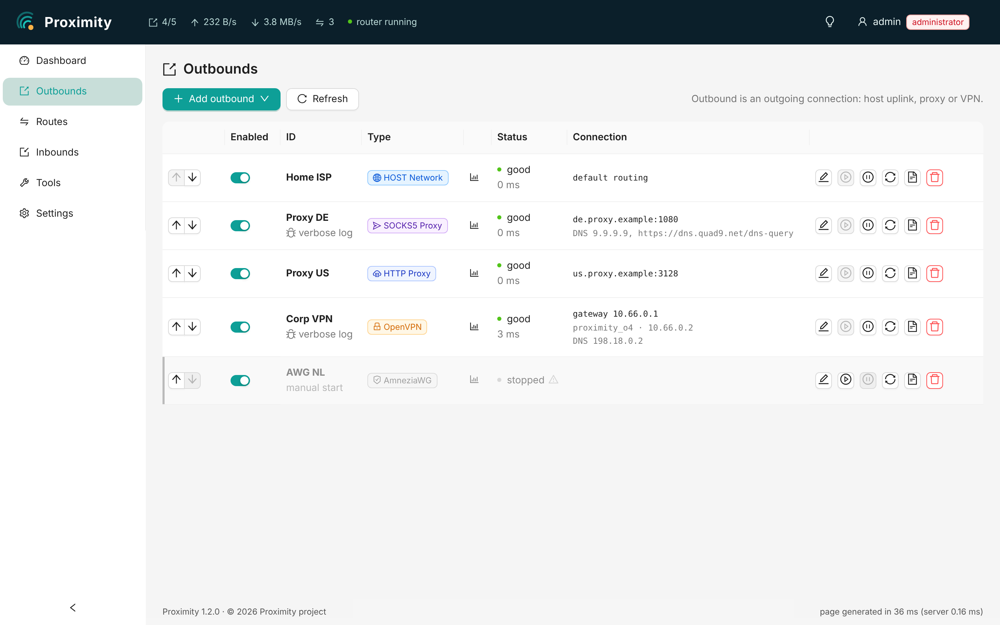
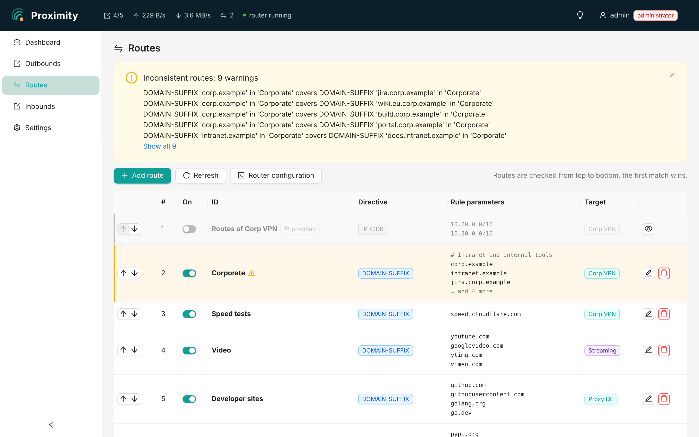
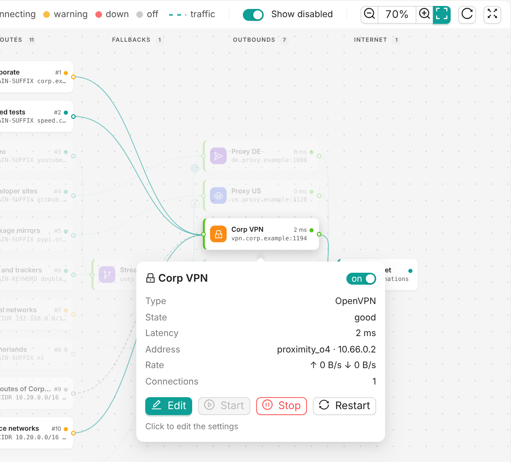
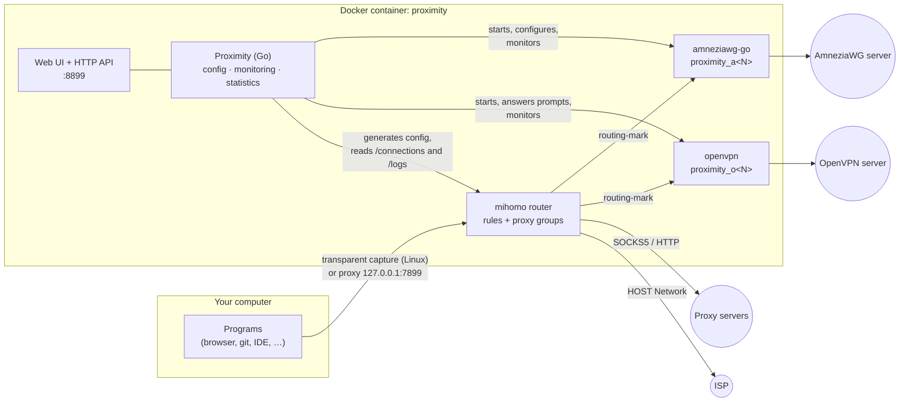

<p align="center">
  
</p>

<h1 align="center">Proximity</h1>

<p align="center">
  <b>Policy-based outbound router for your computer, in a single Docker container.</b><br>
  Send every outgoing connection through the right exit (home ISP, SOCKS5/HTTP proxy,
  OpenVPN or AmneziaWG) by domain, IP, port, country and more. Managed from a clean web UI.
</p>

<p align="center">
  
  
  
  
  
  <a href="LICENSE.md"></a>
</p>

<p align="center">
  
  <br>
  <sub><b>167</b> Go tests, <b>94.2%</b> statement coverage, 190 end-to-end checks on
  <a href="docs/development.md#test-stands">ready stands</a></sub>
</p>

<p align="center">
  
</p>

---

## Contents

- [Why Proximity](#why-proximity)
- [Features](#features)
- [Screenshots](#screenshots)
- [Quick start](#quick-start)
- [Network modes](#network-modes)
- [How it works](#how-it-works)
- [Concepts: outbounds, fallbacks, routes](#concepts-outbounds-fallbacks-routes)
- [Routes at a glance](#routes-at-a-glance)
- [Users and roles](#users-and-roles)
- [Backup and restore](#backup-and-restore)
- [Configuration folder](#configuration-folder)
- [Building and testing](#building-and-testing)
- [Project status](#project-status)
- [Documentation](#documentation)
- [License](#license)

## Why Proximity

You work through a corporate VPN, watch video through another tunnel, keep a couple of
SOCKS5 proxies for specific sites, and want everything else to go straight to your ISP.
Usually that means juggling VPN clients, browser extensions and proxy settings in every
program.

Proximity puts all of that into one container:

- **One place for all exits.** Your host uplink, proxies and VPN tunnels become
  *outbounds* that Proximity starts, monitors and reconnects.
- **One set of rules.** *Routes* decide which outbound handles a connection: by domain,
  domain suffix or keyword, IP network, `IP:port`, country (GeoIP/GeoSite), process name
  and more. The first match wins, the rest goes to a default target.
- **Nothing to configure in programs (Linux).** In the default Linux mode Proximity
  transparently captures *all* new outgoing connections of the host. On macOS and Windows
  programs use one proxy port (HTTP and SOCKS5 on `127.0.0.1:7899`).
- **No leaks.** Every tunnel has its own routing table with a `blackhole` fallback: if a
  VPN drops, its traffic stops instead of silently going through your ISP.

Under the hood the routing engine is [mihomo](https://github.com/MetaCubeX/mihomo).
Proximity generates its configuration, manages the tunnels and gives you a web UI on
port **8899**.

## Features

| Area | What you get |
|---|---|
| 🌐 **Outbounds** | HOST Network (default route or a specific interface/gateway), SOCKS5 (auth, TLS, UDP relay), HTTP proxy (separate HTTPS/FTP servers, TLS), OpenVPN (login, password, TOTP one-time codes, private key password), AmneziaWG (`.conf` upload, `vpn://` key import, QR code from an image) |
| 🔀 **Fallbacks** | Proxy groups of outbounds in priority order (bottom of the Routes page): either "first outbound that Proximity sees as good" or a mihomo health check by URL |
| 🧭 **Routes** | 15 mihomo directives, editor with syntax highlighting (domains, subdomains, IPs, masks, ports, comments), load/save/sort of the lists, automatic normalization (URLs → domains, IDN → punycode, `IP:port` → `AND` rule, masks), `#` comments, overlap and duplicate warnings, up/down ordering |
| 📥 **Inbounds** | SOCKS5 proxy servers and OpenVPN servers on ports 7800–7898 with their own users, optional anonymous access, TLS / TOTP, generated keys and certificates, one-click client configuration export; traffic goes to the host connection, to the routes or to a chosen outbound |
| 🧩 **DNS per outbound** | Every outbound has its own DNS servers (plain, TCP, DoT, DoH, DoQ) and a DNS exit: the domains of a route are asked where the traffic leaves, so the provider does not see them and the answer fits the exit; a proxy without UDP is asked over TCP; default servers and their exit in Settings; names in the settings (proxy server, VPN `remote`, `Endpoint`, time server) follow the same rules and are never asked through their own outbound |
| 📡 **VPN routes** | With *Receive routes* the networks announced by a VPN become a *provided* route that is on only while the connection is up |
| 🩺 **Monitoring** | Link state, latency, configurable checks, retries and reconnects; states `good` / `connecting` / `reconnecting` / `failed` / `stopped`; start, stop and restart of outbounds and inbounds with state and logs kept across restarts; per-outbound connection log with auto-scroll and hit counters of the routes; a *Verbose* switch per connection for debug logs (settings, checks, traced connections, OpenVPN `--verb 6`, AmneziaWG `LOG_LEVEL=verbose`); log sizes for both modes are set in Settings |
| 🕒 **Time** | OpenVPN clients and servers start only with synchronized time: the host clock is checked against NTP servers and never changed; when it is wrong, Proximity keeps its own time for OpenVPN certificates and one-time codes |
| 🗺️ **Connection map** | Live diagram of sources, router, routes, fallbacks and outbounds with state colors and animated traffic; hover to trace a path, click to edit settings; zoom, fit to screen and full screen |
| 🧪 **Tools** | Address check: a real connection through the router shows the route, the matched rule and the outbound, plus the answer of every outbound's DNS servers and a TCP connection through every outbound; Ping: ICMP through the host and the tunnels, timed TCP through the proxies, drawn as a map of the ways out with loss and times |
| 📈 **Statistics** | Upload/download totals and rates per outbound, interactive throughput chart (5 min / 15 min / 1 h) with an active connections chart beside it, list of unreachable destinations with reason and matched rule |
| 🛡️ **Transparent mode** | Linux: captures all new outgoing host connections through a TUN device, hijacks DNS (fake-IP), sniffs TLS SNI / HTTP Host / QUIC, leaves LAN, Docker and inbound traffic alone |
| 👥 **Access control** | Administrator, Operator, User and optional anonymous dashboard; secrets are hidden from read-only users |
| 💾 **Backup** | One-click export/import of the whole configuration as a single JSON file |
| 🎨 **UI** | Vue 3 + Ant Design Vue, light and dark themes, embedded into a single Go binary |

## Screenshots

| | |
|---|---|
|  **Dashboard** — summary cards, live throughput, connections and route hits charts |  **Dark theme** |
|  **Outbounds** — every exit with its state, latency and connection details |  **Routes** — ordered rules with comments, overlap warnings and VPN-provided routes |
|  **Connection map** — details, on/off and start/stop of any item; click to edit |  **Connection log** — live, auto-scrolling log of a tunnel; copy, download or clear it |
|  **OpenVPN outbound** — upload or edit `.ovpn`, credentials, TOTP |  **Client configuration** — preview, copy or download per user |
|  **Inbounds** — SOCKS5 and OpenVPN servers with users, state and traffic |  **Fallbacks** — proxy groups in priority order, at the bottom of the Routes page |
|  **Route editor** — syntax highlighting, load / save / sort, normalized preview |  **Settings** — router service, router, users, backup and restore |
|  **Address check** — route, outbound, DNS and connection through every outbound |  **Ping** — every way out with loss and times |

More screenshots with explanations are in the [User guide](docs/user-guide.md).

## Quick start

Requirements: Docker with Compose v2. On Linux the container needs `NET_ADMIN` and
`/dev/net/tun` (already set in the compose files).

```bash
git clone https://github.com/rogreedin/proximity.git && cd proximity
scripts/proximity.sh up -d --build      # Linux and macOS
```

```powershell
.\scripts\proximity.ps1 up -d --build   # Windows (PowerShell)
```

The script picks the right compose file and configuration folder for your OS, remembers the
start settings in `proximity.env`, and the container starts again after a reboot
(`restart: unless-stopped`) when Docker starts at boot — see
[Start after a reboot](docs/getting-started.md#start-after-a-reboot).

| What | Where |
|---|---|
| Web UI | <http://localhost:8899> |
| Proxy (HTTP and SOCKS5 on one port) | `127.0.0.1:7899` |
| Inbounds (SOCKS5 and OpenVPN servers you create) | ports `7800`–`7898`, TCP and UDP |
| Settings folder, Linux | `~/.config/proximity` |
| Settings folder, macOS | `~/Library/Application Support/Proximity` |
| Settings folder, Windows | `%APPDATA%\Proximity` |

### First sign-in

On the first visit the UI asks you to create the administrator account (user name,
password and password confirmation; the role is fixed to Administrator). No password is
generated or printed to the log.

<p align="center"></p>

For unattended installs set `PROXIMITY_ADMIN_USER` and `PROXIMITY_ADMIN_PASSWORD`
before the first start; the dialog is then skipped.

Then: add outbounds → (optionally) group them into fallbacks → write routes → pick the
default target for everything else. A step-by-step walkthrough is in
[Getting started](docs/getting-started.md).

## Network modes

| Mode | Compose file | Behaviour |
|---|---|---|
| **Linux, transparent** (default) | `docker-compose.yml` | Container shares the host network. **All new outgoing connections of the host** go through Proximity; programs need no proxy settings |
| **macOS, Windows, or Linux without capture** | `docker-compose.bridge.yml` | Container gets its own network `proximity_lan`; programs use the proxy `127.0.0.1:7899` |

`scripts/proximity.sh` chooses the file automatically. To run Linux without capture:

```bash
PROXIMITY_NETWORK=bridge scripts/proximity.sh up -d --build
```

### Transparent capture on Linux

- mihomo creates the `proximity_tun` interface. Proximity adds `ip rule` entries with
  priorities 5150–5170 and routing table 51000 that points into this interface.
- Only **new outgoing** connections are captured. Local networks, Docker networks and
  inbound connections (SSH, the Proximity UI itself) keep working as before.
- The domain used by DOMAIN routes comes from DNS (fake-IP) and from the connection
  itself (TLS SNI, HTTP `Host` header, QUIC).
- Host DNS queries are intercepted, and the name is resolved by the rule's target:
  remotely for SOCKS5/HTTP proxies, through the tunnel's DNS for VPNs (when enabled),
  through the DNS servers written on the **DNS** tab of the outbound, through the default
  DNS servers for DIRECT. Names that exist only inside a VPN or behind a proxy
  therefore work without any proxy settings in programs.
- Traffic of mihomo itself and of tunnel transports is marked with `fwmark 51000` and is
  never captured (no loops).
- When the container stops, the rules are removed. If the process is killed, the TUN
  interface disappears together with its route, and traffic returns to the normal path.
- Turn it off in **Settings → [Router] → Route all outgoing connections of the host
  through Proximity**.
- IPv6 is captured only when **IPv6** is enabled in Settings.
- Ping cannot pass a proxy. **Settings → Keep ping of the host on its routes** (on by
  default) lets it out directly only where the route is DIRECT or HOST, sends it through
  the tunnel for OpenVPN and AmneziaWG routes; other addresses do not answer, so a ping
  never leaves past the routes.

Details: [Architecture](docs/architecture.md#transparent-capture).

## How it works



How each outbound type is connected to mihomo:

| Outbound | mihomo side |
|---|---|
| HOST Network | proxy `direct`; for a specific interface — `interface-name`, with a gateway — `routing-mark` |
| SOCKS5 Proxy | proxy `socks5` |
| HTTP Proxy | proxy `http` (CONNECT tunnel); separate HTTPS/FTP servers become extra proxies selected by port 443/21 |
| OpenVPN | `openvpn` process on interface `proximity_o<N>` + `direct` with `routing-mark` |
| AmneziaWG | `amneziawg-go` on interface `proximity_a<N>` + `direct` with `routing-mark` |

- Each tunnel has its own routing table (`51000 + N`), a rule by mark and a rule by the
  tunnel address. The main routing table is never changed.
- If a tunnel goes down, a `blackhole` route stays in its table: traffic does not leak
  around the VPN.
- OpenVPN runs in a pseudo-terminal; Proximity answers the user name, password and
  one-time code prompts itself (TOTP, same as `oathtool --totp -b`).
- Every outbound and inbound: after *Connection attempts* failures in a row (pause —
  *Reconnection timeout*) the connection is restored: Proximity waits *Restore after*
  (1 minute) and starts a new series of attempts, without a limit by default
  (**Monitoring** tab). With recovery off, or after an error that needs your action, it
  goes to `failed` and waits for **Start** / **Restart**.

## Concepts: outbounds, fallbacks, routes

| Concept | Meaning | Example |
|---|---|---|
| **Outbound** | One outgoing connection | `OpenVPN 1` — corporate VPN |
| **Fallback** | A group of outbounds used in priority order | `Proxies` = `SOCKS5 1`, then `SOCKS5 2` |
| **Route** | A list of conditions with one directive and one target | `DOMAIN-SUFFIX corp.example → OpenVPN 1` |
| **Default target** | Where everything that matched no route goes | `HOST 1` or `DIRECT` |

Identifiers:

- IDs of outbounds, fallbacks and routes can be changed at any time. On rename all
  references (fallback members, route targets, default target) are updated, and a running
  tunnel is not interrupted.
- An ID is unique within its section. An outbound and a fallback can't share a name either,
  because both can be route targets.
- Empty IDs are generated: `<Type> <N>` for outbounds, `Fallback <N>`, `Route <N>`.
- `proximity.json`, backups and the [HTTP API](docs/api.md) use the same names
  (`outbounds`, `routes`). Files written by older versions with `endpoints` and `filters`
  are read and converted automatically.
- **Inbounds** are incoming connection points: SOCKS5 and OpenVPN servers with their own
  users on ports 7800–7898. Their IDs (`SOCKS5 <N>`, `OpenVPN <N>`) are unique among
  inbounds only, because an inbound is never a route target. See the
  [User guide](docs/user-guide.md#inbounds).

## Routes at a glance

Each line of a route's parameters becomes one mihomo rule `<Directive>,<parameter>,<Target>`.
A line whose first non-blank character is `#` is a comment: it is kept in place but is not
sent to mihomo. A route that has only comments is rejected.

| Input | Result |
|---|---|
| `https://Example.com/path` (DOMAIN) | `example.com` |
| `*.example.com` (DOMAIN-SUFFIX) | `example.com` |
| `пример.рф` | `xn--e1afmkfd.xn--p1ai` |
| `192.168.1.7` (IP-CIDR) | `192.168.1.7/32` |
| `10.1.2.3/8` | `10.0.0.0/8` |
| `1.2.3.4:443` | `AND,((IP-CIDR,1.2.3.4/32),(DST-PORT,443)),Target` |
| `5.5.5.5,no-resolve` | `IP-CIDR,5.5.5.5/32,Target,no-resolve` |
| `  # office` | `# office` (comment, no rule) |

A warning is shown only when an upper rule fully covers a lower one (the lower rule can
never match) or when rules are identical. "Specific above general" is normal and produces
no warning, for example `www.corp.example → DIRECT` above `corp.example → OpenVPN 1`.

Full reference: [Routes](docs/routes.md).

## Users and roles

| Role | Rights |
|---|---|
| Administrator | everything, including users and settings |
| Operator | edit outbounds, inbounds, fallbacks and routes, start and stop them and the router; export and import the configuration |
| User | view only (passwords and keys are hidden) |
| Anonymous | Dashboard only (can be disabled in Settings) |

## Backup and restore

**Settings → [Backup and Restore]**: *Export configuration* saves one JSON file (outbounds
and inbounds with passwords, VPN keys and certificates, fallbacks, routes, settings);
*Import configuration* replaces the current ones. User accounts are not included. When an Operator imports a file,
Settings stay unchanged.

## Configuration folder

| File | Contents |
|---|---|
| `proximity.json` | users, outbounds, inbounds, fallbacks, routes, settings |
| `state.json` | traffic counters and the list of unreachable destinations |
| `router.json` | router state (running or stopped) for *Start the router when the container starts* |
| `services.json` | state of tunnels and inbounds (running, stopped, failed) kept across restarts |
| `logs/` | logs of outbounds and inbounds, kept across restarts |
| `proximity.env` | variables of the first `scripts/proximity.sh up` (network mode, bind addresses, iptables tool, time zone), reused by later runs |
| `mihomo/config.yaml` | generated mihomo configuration (JSON, which is valid YAML) |

> [!WARNING]
> Outbound and inbound passwords, VPN configurations and private keys are stored in
> `proximity.json` as plain text.
> Protect the settings folder (and exported backup files) accordingly.

## Building and testing

```bash
make web      # build the UI (Node.js 22)
make build    # build ../proximity-build/bin/proximity
make cover    # run tests with coverage
make coverage-docs   # the same, and write the numbers into README.md and the docs
make up       # build the image and start the container
```

All build output and caches go to `../proximity-build` next to the repository; the
repository itself is not changed. Component versions are Docker build arguments in `Dockerfile`: `MIHOMO_IMAGE`,
`AWG_GO_VERSION`, `AWG_TOOLS_VERSION`. More in [Development](docs/development.md).

## Project status

Version **1.2.0**. 167 Go tests pass, total statement coverage 94.2% (81.4–99.1% per
package). Transparent capture has been verified in isolated network namespaces and in a
real Docker image: DIRECT, REJECT, domain → OpenVPN / AmneziaWG, LAN and inbound
connections untouched, `rp_filter=1`, container stop and kill. Inbounds have been verified
with real mihomo 1.19.34 and OpenVPN 2.6 in network namespaces: SOCKS5 authentication and
TLS, an OpenVPN client with password + TOTP (appended and `static-challenge`), anonymous
clients, token renegotiation, session kill on user change, traffic through the router,
DNS hijack, traffic counters. Nine ready stands run 190 end-to-end checks with the real
image (`make stand-security`, `stand-tunnel`, `stand-reload`, `stand-config`,
`stand-capture`, `stand-dns`, `stand-logs`): one-time codes, certificates, tokens, received routes, a damaged
configuration, the reload of an open page, TCP and ping of a host with transparent capture,
an AmneziaWG tunnel with obfuscation and received routes, the DNS servers and DNS exits of
outbounds (which server gets the query and from which address) and the names of the settings,
clearing the logs by the button and on Start / Restart. The web UI, including the connection map, has been checked in
Chrome in the light and dark themes with a live OpenVPN tunnel, SOCKS5 and HTTP proxies and
both inbound types.

Not verified yet:

- Inbounds inside a real Docker container (published port range, host mode with Docker's
  `FORWARD` policy, firewalld / ufw hosts), OpenVPN clients on Windows, macOS and phones.
- `docker-compose.yml` with a real `network_mode: host` on a physical machine; `PROCESS-NAME` routes.
- Interaction of capture with systemd-resolved, NetworkManager, firewalld and other VPN clients on the host.
- macOS and Windows (Docker Desktop), the `proximity.ps1` script.
- IPv6 capture, dynamic OTP challenge (CRV1), `tap` devices.
- Importing a real Amnezia `vpn://` key and QR code.

Bug reports and test results from these environments are very welcome.

## Documentation

| Document | What's inside |
|---|---|
| [Getting started](docs/getting-started.md) | Installation, first configuration, environment variables, upgrade and removal |
| [User guide](docs/user-guide.md) | Every page of the web UI with screenshots |
| [Routes](docs/routes.md) | Directives, normalization, comments, warnings, provided routes, recipes |
| [Architecture](docs/architecture.md) | Components, routing tables, transparent capture, DNS, monitoring, statistics |
| [HTTP API](docs/api.md) | REST endpoints used by the UI, roles, examples with `curl` |
| [Troubleshooting](docs/troubleshooting.md) | Common problems and how to diagnose them |
| [Development](docs/development.md) | Project layout, build, tests, release checklist |

## License

Proximity is free software distributed under the [MIT License](LICENSE.md), one of the most
permissive open source licenses. In short:

- You may use, copy, modify, merge, publish, distribute, sublicense and sell the software,
  in open source and in closed-source commercial products alike.
- You must keep the copyright notice and the license text in all copies or substantial
  portions of the software.
- No warranty: the software is provided "as is", and the authors are not liable for any
  claim or damages arising from its use.

This summary is for convenience only; the full text in [LICENSE.md](LICENSE.md) is what
applies. SPDX identifier: `MIT`.

Bundled third-party components (mihomo, OpenVPN, amneziawg-go, amneziawg-tools, GeoIP/GeoSite
data) keep their own licenses.
