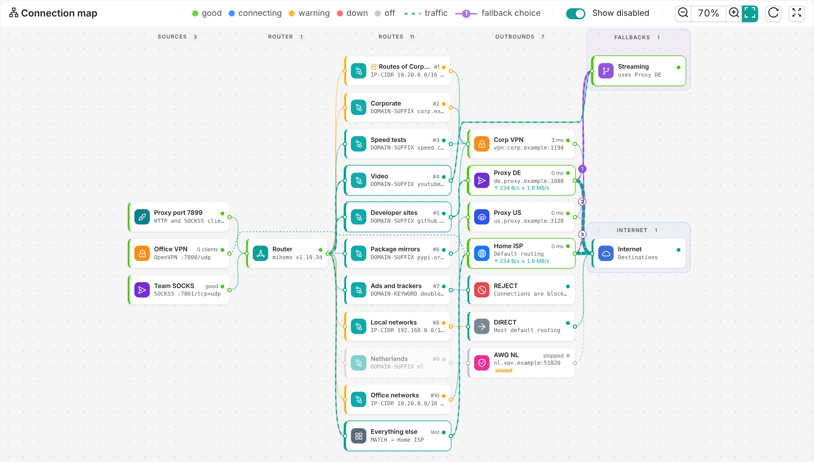
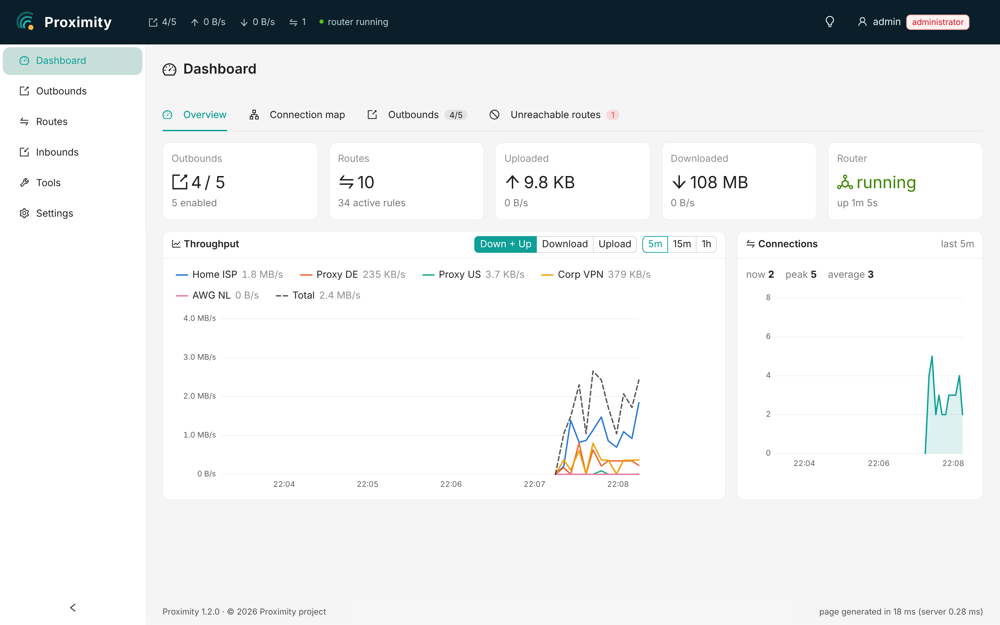
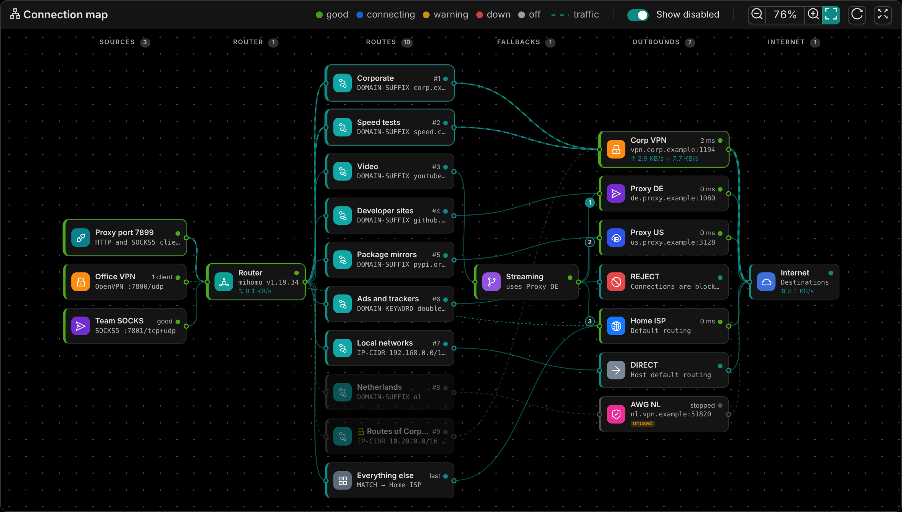
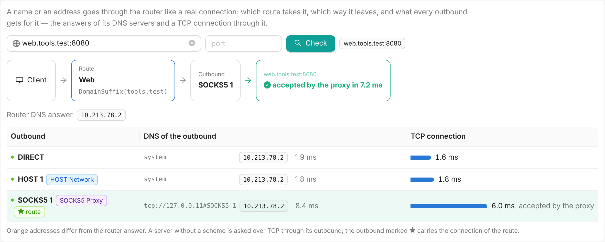
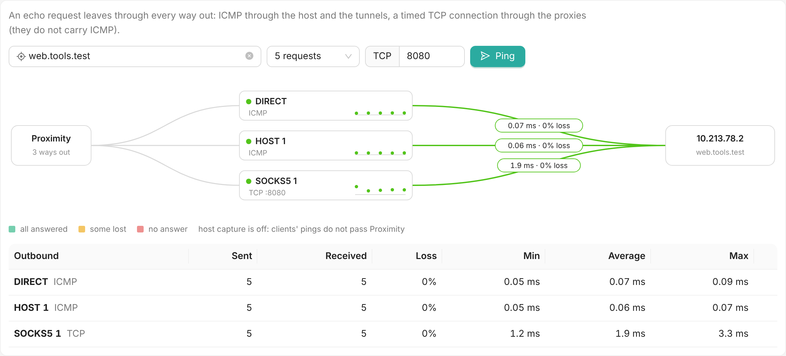

<p align="center">
  
</p>

<h1 align="center">Proximity</h1>

<p align="center">
  <b>Policy-based outbound router for your computer, in a single Docker container.</b><br>
  Send every outgoing connection through the right exit (home ISP, SOCKS5/HTTP proxy,
  OpenVPN or AmneziaWG) by domain, IP, port, country and more. Managed from a clean web UI.
</p>

<p align="center">
  
  
  
  
  
  <a href="LICENSE.md"></a>
</p>

<p align="center">
  
  <br>
  <sub><b>167</b> Go tests, <b>94.2%</b> statement coverage, 190 end-to-end checks on
  <a href="docs/development.md#test-stands">ready stands</a></sub>
</p>

<p align="center">
  
</p>

---

## Contents

- [Why Proximity](#why-proximity)
- [Features](#features)
- [Screenshots](#screenshots)
- [Quick start](#quick-start)
- [Documentation](#documentation)
- [Project status](#project-status)
- [License](#license)

## Why Proximity

You work through a corporate VPN, watch video through another tunnel, keep a couple of
SOCKS5 proxies for specific sites, and want everything else to go straight to your ISP.
Usually that means juggling VPN clients, browser extensions and proxy settings in every
program. Proximity puts all of that into one container:

- **One place for all exits.** Your host uplink, proxies and VPN tunnels become
  *outbounds* that Proximity starts, monitors and reconnects.
- **One set of rules.** *Routes* decide which outbound handles a connection: by domain,
  IP network, `IP:port`, country (GeoIP/GeoSite), process name and more. The first match
  wins, the rest goes to a default target.
- **Nothing to configure in programs (Linux).** Proximity transparently captures *all* new
  outgoing connections of the host. On macOS and Windows programs use one proxy port
  ([Network modes](docs/network-modes.md)).
- **No leaks.** Every tunnel has its own routing table with a `blackhole` fallback, and
  every name is resolved where its traffic leaves ([DNS](docs/dns.md)).

Under the hood the routing engine is [mihomo](https://github.com/MetaCubeX/mihomo);
Proximity generates its configuration, manages the tunnels and gives you a web UI on port
**8899**. How the parts fit together: [Concepts](docs/concepts.md).

## Features

| Area | What you get |
|---|---|
| 🌐 **Outbounds** | HOST Network (default route or a specific interface/gateway), SOCKS5 (auth, TLS, UDP relay), HTTP proxy (separate HTTPS/FTP servers, TLS), OpenVPN (login, password, TOTP one-time codes, private key password), AmneziaWG (`.conf` upload, `vpn://` key import, QR code from an image) |
| 🔀 **Fallbacks** | Proxy groups of outbounds in priority order (bottom of the Routes page): either "first outbound that Proximity sees as good" or a mihomo health check by URL |
| 🧭 **Routes** | 15 mihomo directives, editor with syntax highlighting (domains, subdomains, IPs, masks, ports, comments), load/save/sort of the lists, automatic normalization (URLs → domains, IDN → punycode, `IP:port` → `AND` rule, masks), `#` comments, overlap and duplicate warnings, up/down ordering |
| 📥 **Inbounds** | SOCKS5 proxy servers and OpenVPN servers on ports 7800–7898 with their own users, optional anonymous access, TLS / TOTP, generated keys and certificates, one-click client configuration export; traffic goes to the host connection, to the routes or to a chosen outbound |
| 🧩 **DNS per outbound** | Every outbound has its own DNS servers (plain, TCP, DoT, DoH, DoQ) and a DNS exit: the names of every domain route are asked where the traffic leaves, so the provider does not see them and the answer fits the exit; servers given by name are resolved through the same outbound; names in the settings follow the same rules and are never asked through their own outbound ([DNS](docs/dns.md)) |
| 📡 **VPN routes** | With *Receive routes* the networks announced by a VPN become a *provided* route that is on only while the connection is up |
| 🩺 **Monitoring** | Link state, latency, configurable checks, retries and reconnects; states `good` / `connecting` / `reconnecting` / `failed` / `stopped`; start, stop and restart of outbounds and inbounds with state and logs kept across restarts; per-outbound connection log with auto-scroll, copy, download and **Clear**; a *Verbose* switch per connection for debug logs (settings, checks, traced connections, OpenVPN `--verb 6`, AmneziaWG `LOG_LEVEL=verbose`); log sizes for both modes are set in Settings |
| 🕒 **Time** | OpenVPN clients and servers start only with synchronized time: the host clock is checked against NTP servers and never changed; when it is wrong, Proximity keeps its own time for OpenVPN certificates and one-time codes |
| 🗺️ **Connection map** | Live diagram of sources, router, routes, fallbacks and outbounds with state colors and animated traffic; hover to trace a path, click to edit settings; zoom, fit to screen and full screen |
| 🧪 **Tools** | Address check: a real connection through the router shows the route, the matched rule and the outbound, plus the answer of every outbound's DNS servers and a TCP connection through every outbound; Ping: ICMP through the host and the tunnels, timed TCP through the proxies, drawn as a map of the ways out with loss and times |
| 📈 **Statistics** | Upload/download totals and rates per outbound, interactive throughput chart (5 min / 15 min / 1 h) with an active connections chart beside it, route hit counters with a chart (how often each route matched, read from mihomo), list of unreachable destinations with reason and matched rule |
| 🛡️ **Transparent mode** | Linux: captures all new outgoing host connections through a TUN device, hijacks DNS (fake-IP), sniffs TLS SNI / HTTP Host / QUIC, leaves LAN, Docker and inbound traffic alone |
| 👥 **Access control** | Administrator, Operator, User and optional anonymous dashboard; secrets are hidden from read-only users |
| 💾 **Backup** | One-click export/import of the whole configuration as a single JSON file |
| 🎨 **UI** | Vue 3 + Ant Design Vue, light and dark themes, embedded into a single Go binary |

## Screenshots

| | |
|---|---|
|  **Dashboard** — summary cards, live throughput, connections and route hits charts |  **Connection map** in the dark theme |
|  **Routes** — ordered rules, hit counters, overlap warnings, VPN-provided routes |  **Outbounds** — every exit with its state, latency and DNS |
|  **Tools: address check** — route, outbound, DNS and connection through every outbound |  **Tools: ping** — every way out with loss and times |

Every page with explanations: [User guide](docs/user-guide.md).

## Quick start

Requirements: Docker with Compose v2. On Linux the container needs `NET_ADMIN` and
`/dev/net/tun` (already set in the compose files).

```bash
git clone https://github.com/rogreedin/proximity.git && cd proximity
scripts/proximity.sh up -d --build      # Linux and macOS
```

```powershell
.\scripts\proximity.ps1 up -d --build   # Windows (PowerShell)
```

The script picks the right compose file and configuration folder for your OS, remembers the
start settings in `proximity.env`, and the container starts again after a reboot
(`restart: unless-stopped`) when Docker starts at boot — see
[Start after a reboot](docs/getting-started.md#start-after-a-reboot).

| What | Where |
|---|---|
| Web UI | <http://localhost:8899> |
| Proxy (HTTP and SOCKS5 on one port) | `127.0.0.1:7899` |
| Inbounds (SOCKS5 and OpenVPN servers you create) | ports `7800`–`7898`, TCP and UDP |
| Settings folder, Linux | `~/.config/proximity` |
| Settings folder, macOS | `~/Library/Application Support/Proximity` |
| Settings folder, Windows | `%APPDATA%\Proximity` |

Then create the administrator on the first visit, add outbounds, write routes and pick
the default target — step by step in [Getting started](docs/getting-started.md).

## Documentation

| Document | What's inside |
|---|---|
| [Getting started](docs/getting-started.md) | Installation, first configuration, environment variables, upgrade and removal |
| [Concepts](docs/concepts.md) | How it works, outbounds / fallbacks / routes, identifiers, roles, backup, configuration folder |
| [Network modes](docs/network-modes.md) | Transparent capture on Linux, proxy mode on macOS and Windows |
| [User guide](docs/user-guide.md) | Every page of the web UI with screenshots: Dashboard, Outbounds, Routes, Inbounds, Tools, Settings |
| [Routes](docs/routes.md) | Directives, normalization, comments, warnings, provided routes, hit counters, recipes |
| [DNS](docs/dns.md) | Which server resolves a name, DNS of outbounds, DoT / DoH, fake-IP, OpenVPN inbounds |
| [Architecture](docs/architecture.md) | Components, routing tables, capture, DNS internals, monitoring, statistics, tools, storage |
| [HTTP API](docs/api.md) | REST endpoints used by the UI, roles, examples with `curl` |
| [Troubleshooting](docs/troubleshooting.md) | Common problems and how to diagnose them |
| [Development](docs/development.md) | Project layout, build, tests, test stands, release checklist |
| [Project status](docs/status.md) | What is verified and what is not yet |

## Project status

Version **1.2.0**. Test numbers are in the badges above; verified environments and open
questions are in [Project status](docs/status.md), build and tests in
[Development](docs/development.md).

## License

[MIT](LICENSE.md): use, modify and distribute freely, also in commercial products; keep
the copyright notice; no warranty. Bundled third-party components (mihomo, OpenVPN,
amneziawg-go, amneziawg-tools, GeoIP/GeoSite data) keep their own licenses.
