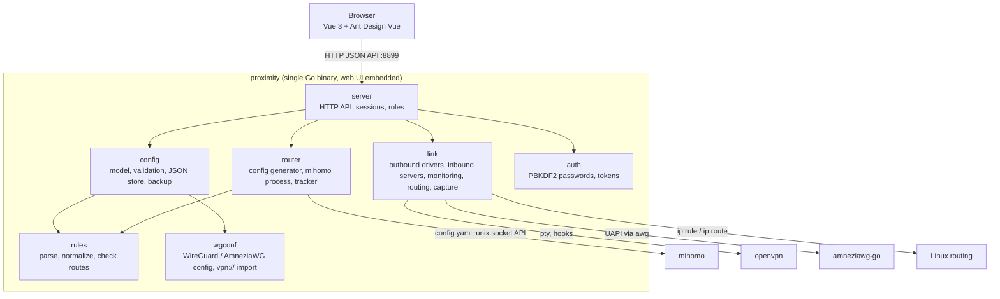

# Architecture

This document describes how Proximity is built and how traffic flows through it. It is
meant for people who want to understand, debug or extend the project.

- [Components](#components)
- [Container image](#container-image)
- [Control loop](#control-loop)
- [Outbounds and mihomo](#outbounds-and-mihomo)
- [Routing tables and marks](#routing-tables-and-marks)
- [Transparent capture](#transparent-capture)
- [DNS](#dns)
- [Monitoring and states](#monitoring-and-states)
- [OpenVPN driver](#openvpn-driver)
- [AmneziaWG driver](#amneziawg-driver)
- [Time synchronization](#time-synchronization)
- [Inbounds](#inbounds)
- [Statistics and unreachable routes](#statistics-and-unreachable-routes)
- [Storage](#storage)
- [Security model](#security-model)
- [Naming](#naming)

## Components



| Package | Responsibility |
|---|---|
| `cmd/proximity` | Entry point: flags and environment, `health` and `hook` subcommands |
| `internal/server` | HTTP API, cookie sessions, role checks, control loop that ties everything together |
| `internal/config` | Data model, validation, cascading renames, JSON store with atomic writes, backup export/import |
| `internal/rules` | Route parsing, normalization, comments, overlap and duplicate checks |
| `internal/router` | Generation of mihomo configuration, mihomo process and API client, traffic tracker and history |
| `internal/link` | Outbound drivers (HOST, proxy, OpenVPN, AmneziaWG), monitoring, routing tables, transparent capture |
| `internal/auth` | Password hashing (PBKDF2-SHA256, 600 000 iterations), signed session tokens, bootstrap admin |
| `internal/wgconf` | Parsing WireGuard/AmneziaWG configuration, Amnezia `vpn://` import |
| `internal/clock` | SNTP client, host clock check, Proximity's own time (offset) |
| `web` | Vue 3 single-page app, built by Vite and embedded with `go:embed` |

The only third-party Go dependency is `testify`, used in tests. The binary is built with
`CGO_ENABLED=0`.

## Container image

The `Dockerfile` is a multi-stage build:

| Stage | Base | Produces |
|---|---|---|
| `mihomo` | `metacubex/mihomo:v1.19.34` | `mihomo` binary, `geoip.metadb`, `geosite.dat` |
| `web` | `node:22-bookworm-slim` | `web/dist` |
| `amnezia` | `golang:1.25-bookworm` | `amneziawg-go` (`v3.1.20260828`), `awg` (`v3.1.20260812`) |
| `build` | `golang:1.25-bookworm` | `proximity` with the UI embedded |
| final | `debian:bookworm-slim` | + `iproute2`, `iptables`, `iputils-ping`, `openvpn`, `oathtool`, `libfaketime`, `ca-certificates`, `tzdata` |

Exposed ports: `8899` (UI/API), `7899` (mixed HTTP/SOCKS5 proxy) and `7800-7898` TCP + UDP
(inbounds). Volume: `/config`.
`HEALTHCHECK` runs `proximity health`, which requests `/api/session`.

## Control loop

Proximity keeps a desired state (the configuration) and continuously brings the system to
it:

1. Any change through the API is validated and saved to `proximity.json`.
2. The store notifies the server, which **synchronizes**:
   - outbound drivers are started, restarted (only when their settings changed) or stopped;
   - for a VPN outbound with *Receive routes* (`use_routes`) the *provided* route is kept:
     created at the top and switched on when the tunnel is up and has reported its routes,
     switched off while it is down, removed when the option is off;
   - a new mihomo configuration is generated from outbounds, fallbacks, routes and the
     current outbound states;
   - the configuration is checked with `mihomo -t` and applied through mihomo's unix
     socket API without restarting the process.
3. Every 500 ms the server polls mihomo `/connections` to update traffic counters and
   re-checks transparent capture. Every 30 s the counters are saved to `state.json`.
4. Outbound state changes (e.g. a tunnel goes up or down) trigger step 2 again, so
   fallbacks always contain the outbounds that currently work.
5. When the router is stopped (Settings → Router service), synchronization stops mihomo
   (no automatic restart), all outbounds and inbounds and host traffic capture. At startup the router runs only when
   `autostart` is on and `router.json` says it was running.
6. Services keep a journal (`services.json`): `running`, `stopped` or `failed` with the
   message. When the router starts, a service starts only if its `autostart` is on and the
   journal says `running` (or has no entry); otherwise it is recorded as `stopped`. A
   failed service is retried only when its settings change (the journal stores a hash of
   them) or on **Start** / **Restart**. A stopped SOCKS5 inbound is left out of the mihomo
   listeners.

## Outbounds and mihomo

| Outbound | mihomo proxy | Notes |
|---|---|---|
| HOST, default routing | `direct` | |
| HOST, interface | `direct` + `interface-name` | |
| HOST, interface + gateway | `direct` + `routing-mark` | own table with `default via <gateway> dev <interface>` |
| SOCKS5 | `socks5` | user/password, TLS, `skip-cert-verify`, UDP |
| HTTP | `http` | one server for all protocols, or extra proxies `<ID>~https` / `<ID>~ftp` selected by destination port 443 / 21 |
| OpenVPN | `direct` + `routing-mark` | traffic is routed by mark into the tunnel's table |
| AmneziaWG | `direct` + `routing-mark` | same as OpenVPN |

Fallbacks become `proxy-groups`:

| Fallback | Group |
|---|---|
| *Enable health check* off | `select` with the members that Proximity currently sees as `up`, in order |
| *Enable health check* on | `fallback` with all members; mihomo requests the URL through each of them every *interval* seconds |

A fallback with no enabled members is skipped with a warning; routes that target it are
skipped too.

The generated configuration can be viewed in **Routes → Router configuration** (highlighted,
with **Copy** and **Save**). It is JSON, which mihomo reads as YAML; the dialog can also show
it as YAML, converted in the browser with js-yaml.


## Routing tables and marks

Proximity never touches the main routing table. Each tunnel (and HOST with a gateway) gets
its own table, numbered `51000 + slot`, where *slot* is a stable number assigned when the
outbound is created (renaming does not change it):

```text
$ ip rule show
5100:  from all fwmark 0xc73d lookup 51005      # OpenVPN 1 (slot 5): mihomo marks its connections
5100:  from all fwmark 0xc73e lookup 51006      # AmneziaWG 1 (slot 6)
5100:  from 10.66.0.2 lookup 51006              # replies from the tunnel address (works with rp_filter=1)
5100:  from 10.8.0.2 lookup 51005

$ ip route show table 51005
default dev proximity_o5 scope link
blackhole default metric 4294967295             # stays when the tunnel is down → no leak
10.20.0.0/16 via 10.8.0.1 dev proximity_o5
172.16.40.0/24 via 10.8.0.1 dev proximity_o5
```

mihomo sets `routing-mark = 51000 + slot` on connections that go to a tunnel outbound, so
the kernel looks them up in the tunnel's table. If the tunnel is down, only the
`blackhole` route is left and the connection fails instead of escaping through the ISP.

## Transparent capture

Only in host network mode (`docker-compose.yml`, `PROXIMITY_NETWORK=host`) and only when
**Settings → Route all outgoing connections…** is on.

mihomo runs a TUN device `proximity_tun` (gVisor stack, `auto-route` off). Proximity adds
the routing itself:

| Priority | Rule | Purpose |
|---|---|---|
| 5150 | `fwmark 51000 lookup main` | Bypass: mihomo's own connections and tunnel transports are never captured |
| 5155 | `iif lo ipproto udp/tcp dport 53 lookup 51000` | Host DNS queries go to the TUN (DNS hijack) |
| 5160 | `lookup main suppress_prefixlength 0` | Anything with a specific route (LAN, Docker networks, VPN clients' own routes) uses the main table |
| 5170 | `from 0.0.0.0/32 iif lo lookup 51000` (and the TUN source range) | New locally originated connections without a specific route go to the TUN |

Table 51000 contains `default dev proximity_tun`.

Consequences:

- inbound connections and their replies are not affected (they have a known source address);
- LAN and Docker traffic is not affected (rule 5160);
- when the container stops, the rules are deleted; if the process is killed, the TUN
  device disappears with its route and rule 5170 has nothing to send traffic to, so the
  host falls back to normal routing;
- IPv6 rules are installed only when **IPv6** is on in Settings.

mihomo's sniffer recovers domain names from TLS SNI (ports 443, 8443), HTTP `Host`
(80, 8080–8880) and QUIC (443, 8443), so DOMAIN rules work even for connections made to IP
addresses.

## DNS

| Situation | mihomo DNS configuration |
|---|---|
| Transparent capture | `enhanced-mode: fake-ip`, range `198.18.0.1/16`, `dns-hijack: any:53`, nameserver `system` |
| VPN with *Use DNS servers…* enabled | `nameserver-policy` sends the route's domains (and domains pushed by the VPN) to the tunnel's DNS servers, through the tunnel |
| Otherwise | mihomo resolves through the system resolver of the container |

With fake-IP the application receives a placeholder address immediately; the real name is
resolved later by the target: remotely by a proxy, through the tunnel's DNS for a VPN, or
by the system resolver for DIRECT/HOST.

## Monitoring and states

| State | Meaning |
|---|---|
| `disabled` | Outbound is switched off |
| `connecting` | Starting (tunnel process launched, waiting for it) |
| `up` (*good* in the UI) | Working; checks pass |
| `reconnecting` | Checks failed; restarting after the configured delay. Also a tunnel or inbound that used all *Connection attempts* and waits for the next series (`recovery attempt N: …`) |
| `failed` | *Connection attempts* exhausted and recovery is off, used up or not possible; see the message and the connection log. Tunnels and inbounds wait for **Start** / **Restart**; HOST and proxies keep being checked and return to `up` |
| `stopped` | Stopped by a user, by the router stop, or not started because *Start automatically* is off |

| Outbound | How it is checked |
|---|---|
| HOST | TCP connection to *Probe target* (Settings, default `1.1.1.1:443`) through the same path mihomo uses; after *Connection attempts* failures → `failed`, but checks continue every *Restore after* seconds and it returns to `up` |
| SOCKS5 / HTTP | TCP connection to the proxy server; same *Connection attempts* rule as HOST |
| OpenVPN | `ping` of the VPN gateway through the tunnel interface |
| AmneziaWG | TCP connection to the monitoring *Check target* through the tunnel |

Proxy and HOST checks run every *Check interval* when **Enable connectivity checks** is on.
Tunnel monitoring (interval, timeout, retries) is set per outbound on its **Monitoring**
tab; *Connection attempts* and *Reconnection timeout* of every outbound and inbound are on
its **General** tab.

Recovery (`link.policy`, settings `recovery` of an outbound or inbound) decides what
happens when the attempts are exhausted. Enabled (default): wait *Restore after* (60 s),
reset the attempt counter and start again, at most *Recovery attempts* series in a row
(0 — unlimited); the series counter is reset by a working connection. A tunnel or inbound
is `reconnecting` meanwhile, so the service journal keeps `running` and the service
starts again after a container restart. A fatal error (credentials, certificate,
configuration) and `authentication failed` (`link.deniedError`, also with an OTP key) are
not restored; a time synchronization error (`link.clockError`) is. A
failed monitoring check ends the link in the same way as an exited process, so it is one
of the signals that start reconnection.

## OpenVPN driver

- The configuration is sanitized: directives that would conflict with Proximity
  (`dev`, `up`, `route-up`, `script-security`, `auth-user-pass` file, `management`,
  `daemon`, `log`, `user`/`group`, `chroot`, plugins …) are removed; `dev-type tun|tap` is
  kept.
- `openvpn` is started inside a pseudo-terminal with `--dev proximity_o<slot>`, `--verb 3`
  (`--verb 6` for a verbose outbound), `--route-noexec` and `proximity hook` as the `up` / `route-up` script.
- Prompts are answered from the outbound settings: user name, password, private key
  password and the one-time code. The code is generated with `oathtool --totp -b` from the
  base32 *OTP key*, and either typed into the `CHALLENGE` prompt or appended to the
  password (*OTP code usage*).
- The hook reports the interface address, gateway, pushed DNS servers, domains and routes.
  Routes are not installed into the main table; they are stored in the tunnel's table and
  fill the *provided* route when *Receive routes* is on.
- `AUTH_FAILED` without an OTP key stops the outbound as `failed` at once, without
  retrying, to avoid locking the account. With an OTP key the next attempt uses a fresh
  code.
- A prompt that cannot be answered, `bad decrypt` of the private key and `VERIFY ERROR`
  of the server certificate also stop the outbound as `failed` at once. `openvpn` ignores
  `SIGTERM` while it waits at a prompt, so it is killed after 1 s.
- A configuration with `proto tcp…` (or `remote … tcp…`) gets `--socket-flags
  TCP_NODELAY`: without it every small packet waits for the delayed ACK of the peer
  (about 40 ms per direction).
- After the tunnel is up its address and gateway are compared with the networks of the
  `proximity_i<slot>` devices; an overlap stops the outbound as `failed` (the kernel drops
  packets whose source address is local).

## AmneziaWG driver

- The configuration is parsed (`Interface`/`Peer`, Amnezia parameters `Jc`, `Jmin`, `Jmax`,
  `S1`, `S2`, `H1`–`H4`); `vpn://` keys exported by the Amnezia app are converted to a
  normal `.conf`; the UI can also decode a QR code from an image (in the browser, with jsQR).
- `amneziawg-go proximity_a<slot>` is started (`LOG_LEVEL=error`, `verbose` for a verbose
  outbound; its output goes to the connection log). Proximity waits until the interface exists and the control socket
  `/var/run/amneziawg/proximity_a<slot>.sock` accepts connections (otherwise `awg`
  would remove the socket, try the kernel module and fail), then applies the configuration with `awg setconf`, addresses and MTU
  (default 1280) are set, and the default route goes into the tunnel's table.
- The connection log ends with the output of `awg show` for the device.

## Time synchronization

A container shares the kernel clock with the host (Linux time namespaces cover only the
monotonic clocks), so setting the clock from the container would change the host clock.
Proximity never does it and keeps its own time instead: the host clock plus an offset.

- `internal/clock` sends SNTP requests (UDP 123, NTP version 4, client mode) to all servers
  at once, 3 s timeout each, rejects answers in a wrong mode, from unsynchronized servers
  (leap indicator 3, stratum 0) and with a foreign originate timestamp, and takes the
  median offset. With transparent capture the requests carry the capture mark and bypass
  the TUN device.
- The kernel synchronization flag is read with `adjtimex` (read-only, no privileges).
- States: `host` — the median offset is within the tolerance, or no server answers but the
  kernel reports a synchronized clock; `corrected` — the offset is larger, Proximity uses
  it (when servers stop answering later, the last offset is kept); `unsynchronized` — no
  answer and no kernel synchronization; the check is repeated every 10 s instead of the
  normal interval.
- The applied offset is written to `/run/proximity/clock.json`.
- Every OpenVPN client and server waits in `start` until the state is `host` or
  `corrected`, at most *Wait for synchronization*; otherwise the start fails without
  further attempts of this series and the service waits for recovery (`failed` when
  recovery is off).
- With an offset OpenVPN runs with `LD_PRELOAD=libfaketime.so.1`,
  `FAKETIME=±seconds` and `FAKETIME_DONT_FAKE_MONOTONIC=1`: certificate validity is
  checked with the corrected time, timers keep the real monotonic clock. Without
  `libfaketime` (`PROXIMITY_FAKETIME` or `/usr/lib/*/faketime/libfaketime.so.1`) the start
  fails.
- One-time codes of OpenVPN outbounds are generated with the corrected time
  (`oathtool --now`); `proximity verify` of OpenVPN inbounds reads `clock.json` (its path is
  in `auth.json`). Certificates and keys generated in the UI use the corrected time too.

## Inbounds

An inbound is stored in `proximity.json` (`inbounds`) and applied by the same control loop
on every change. Its port (7800…7898) is also its key: slot = port − 7799.

**SOCKS5** is a mihomo listener (`listeners: [{type: socks, name: <ID>, port, users}]`).

- Anonymous access → `users: []` (mihomo skips authentication); otherwise only enabled
  users are written. An inbound without enabled users and without anonymous access is
  never written, because an empty list would open the proxy.
- TLS → inline `certificate` / `private-key`.
- The state is read from the kernel socket table (`/proc/net/tcp`), not by a probe
  connection, so health checks are not counted as traffic.

**OpenVPN** is an `openvpn` server process per inbound (`link.openvpnAcceptor`).

- The configuration is rendered to `/run/proximity/inbound-<slot>/server.conf`: device
  `proximity_i<slot>`, `topology subnet`, `dh none` (ECDH), `tls-crypt`, `duplicate-cn`,
  `username-as-common-name`, `auth-user-pass-optional`; a TCP server gets `tcp-nodelay`
  (sets `TCP_NODELAY` and pushes it to clients).
- Credentials are checked by `proximity verify <auth.json> <file>`
  (`auth-user-pass-verify … via-file`). `auth.json` holds enabled users, the anonymous
  flag and the TOTP key; it is replaced atomically when users change, so the server keeps
  running. The code is accepted appended to the password or as a `static-challenge`
  response (`SCRV1:…`), for the current and the neighbouring 30-second windows. With TOTP
  the server issues `auth-gen-token 0 external-auth`, so renegotiation and a reconnect do
  not ask for a new code. The key of the tokens (`auth-gen-token-secret`, file `token.key`)
  is derived from the server key and the TOTP key, so a token outlives a restart of the
  inbound and of the container. A login with a token still calls `proximity verify`
  (`session_state` is `Authenticated`): the password is not checked again, but the user
  must still be enabled.
- A code is used once: `codes.json` beside `auth.json` remembers who used the code of
  which 30-second window (user and client address, taken from `untrusted_ip`). The same
  user at the same address may repeat it, anybody else is refused. An outbound whose code
  was refused waits for the next window before the next attempt.
- `peer-fingerprint` holds the SHA-256 of the current client certificate: a regenerated
  certificate replaces the old one, other certificates of the CA are rejected.
- The clients' traffic goes to the router device, which carries TCP and UDP only. ICMP of
  clients to other hosts is rejected in `FORWARD` (`-i proximity_i<N> -p icmp -j REJECT
  --reject-with icmp-admin-prohibited`, above the accepting rules) unless the inbound
  goes straight to the host.
- Sessions of changed, disabled or deleted users are closed through the management unix
  socket with `client-kill <CID> HALT` (the client is told to stop and notices it at once;
  `kill <name>` when the session is not in the list); the same socket gives the list of
  connected clients (`status 2`,
  entries without a virtual address are unfinished handshakes and are skipped).
- Client traffic is forwarded by the kernel into the mihomo TUN device and terminated
  there, so no NAT is needed: table `61000 + slot` holds `<network> dev proximity_i<slot>`,
  `default dev proximity_tun` and a `blackhole` fallback; rule `5140: from <network>`.
  The TUN device is enabled in the mihomo configuration whenever an OpenVPN inbound is
  active, even without transparent capture. DNS requests of clients are hijacked
  (`198.18.0.2` is pushed), so fake-IP and domain routes work for them.
- Forwarding needs `net.ipv4.ip_forward=1` (set by the bridge compose file; in host mode
  Proximity checks it and tries to enable it) and `iptables -I FORWARD -i/-o
  proximity_i<slot> -j ACCEPT`, because Docker sets the `FORWARD` policy to `DROP`.
- In host mode with capture the server socket carries mark 51000, like tunnel transports.

**Where the traffic goes** is decided by rules placed before the routes:

| Outbound | SOCKS5 | OpenVPN |
|---|---|---|
| Router | no rule — the routes decide | no rule |
| Host | `IN-NAME,<ID>,DIRECT` | `SRC-IP-CIDR,<network>,DIRECT` |
| an outbound | `IN-NAME,<ID>,<outbound>` | `SRC-IP-CIDR,<network>,<outbound>` |

HTTP outbounds with per-protocol servers get `AND,((…),(DST-PORT,443)),<ID>~https` lines
first. An inbound whose outbound is disabled or deleted is not started (fail closed).

**Key material** (`config.GenerateMaterial`): ECDSA P-256 CA, server certificate
(`serverAuth`) and one client certificate (`clientAuth`) shared by the users of the
inbound, valid for 10 years; a 2048-bit OpenVPN static key for `tls-crypt`; a 160-bit
base32 TOTP key.

## Statistics and unreachable routes

- `router.Tracker` reads mihomo `/connections` every 500 ms and attributes bytes to the
  outbound at the end of each connection's chain (fallback members included).
- Every 5 s a sample (`total` + per outbound upload/download rates + number of active
  connections) is added to an in-memory history of 720 samples (1 hour). The Dashboard
  throughput and connections charts request only new
  samples (`/api/history?since=…`). History is not persisted; totals are.
- The Dashboard **connection map** has no API of its own: every 3 s the browser reads
  `/api/outbounds`, `/api/inbounds`, `/api/routes`, `/api/fallbacks` and `/api/targets`,
  builds the graph (sources → router → routes → fallbacks → outbounds → Internet) and lays
  it out in columns. An edge carries traffic when the outbound (or inbound) at its end has
  a non-zero rate; a fallback uses its first member in good state.
- mihomo's log stream (`/logs?level=info`) is parsed for dial errors. Each error is
  classified (`refused`, `timeout`, `no route`, `unreachable`, `dns`, …) and stored with the
  destination, outbound, matched rule, count and first/last time. The list is bounded by
  *Settings → Unreachable routes*: entries older than the maximum lifetime (by the last
  occurrence) are removed, then the oldest ones above the maximum count.
- Inbound traffic is read every 2 s. OpenVPN: `rx_bytes` / `tx_bytes` of the server device.
  SOCKS5: byte counters of two `iptables` chains (`PROXIMITY-STAT-IN` from `INPUT` by
  destination port, `PROXIMITY-STAT-OUT` from `OUTPUT` by source port), because short
  connections are invisible in mihomo's `/connections` snapshots. Without `iptables` the
  counters fall back to those snapshots and miss short connections.

## Storage

All persistent data lives in the settings folder mounted as `/config`:

| File | Written | Contents |
|---|---|---|
| `proximity.json` | on every change (atomic replace) | users, outbounds, inbounds, fallbacks, routes, settings, token secret |
| `proximity.invalid-<time>.json` | at a start with a damaged `proximity.json` | the file as it was; the valid part is written back to `proximity.json` |
| `proximity.problems.json` | with the copy above; removed by `DELETE /api/problems` | what was dropped and why (`GET /api/problems`) |
| `state.json` | every 30 s and on shutdown | traffic totals of outbounds and inbounds, unreachable routes |
| `router.json` | on start, stop and restart of the router, and at startup | requested router state (`running`) |
| `services.json` | on every service state change | state of tunnels and inbounds: `running`, `stopped`, `failed` with message |
| `logs/<outbound\|inbound>-<N>.log` | on every log line (trimmed to *Lines to keep*: 300 by default, 3000 for a verbose service) | logs of outbounds (by slot) and inbounds (by port) |
| `mihomo/config.yaml` | on every synchronization | generated mihomo configuration |
| `mihomo/geoip.metadb`, `geosite.dat` | first start | GeoIP / GeoSite databases |

Runtime files (unix socket, generated tunnel and server configs, hook output, `auth.json`
of OpenVPN inbounds) are in `/run/proximity`.

## Security model

- Passwords: PBKDF2-SHA256, 600 000 iterations, minimum length 6.
- Sessions: signed token in an HTTP-only, `SameSite=Strict` cookie, lifetime 7 days.
  Changing a user's password invalidates all existing sessions of that user.
- Every non-GET request must carry the `X-Requested-With` header (CSRF protection).
- Failed sign-ins are delayed by 0.7 s.
- Users with the *User* role receive outbounds and inbounds with passwords and private keys
  removed.
- Inbound users are separate from Proximity accounts. Their passwords are compared in
  constant time; they are stored in plain text because mihomo and exported client
  configurations need them.
- Secrets in `proximity.json` and in backups are stored in plain text — protect the folder
  and backup files.

## Naming

| Object | Name |
|---|---|
| Project / image / container | `proximity` |
| Bridge network and its Linux bridge | `proximity_lan` |
| Capture TUN device | `proximity_tun` |
| OpenVPN device | `proximity_o<slot>` |
| AmneziaWG device | `proximity_a<slot>` |
| Routing tables | `51000` (capture), `51000 + slot` (outbounds) |
| `ip rule` priorities | `5100` (outbounds), `5150`–`5170` (capture) |
