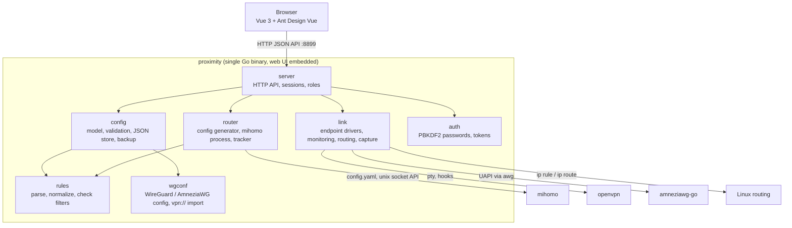
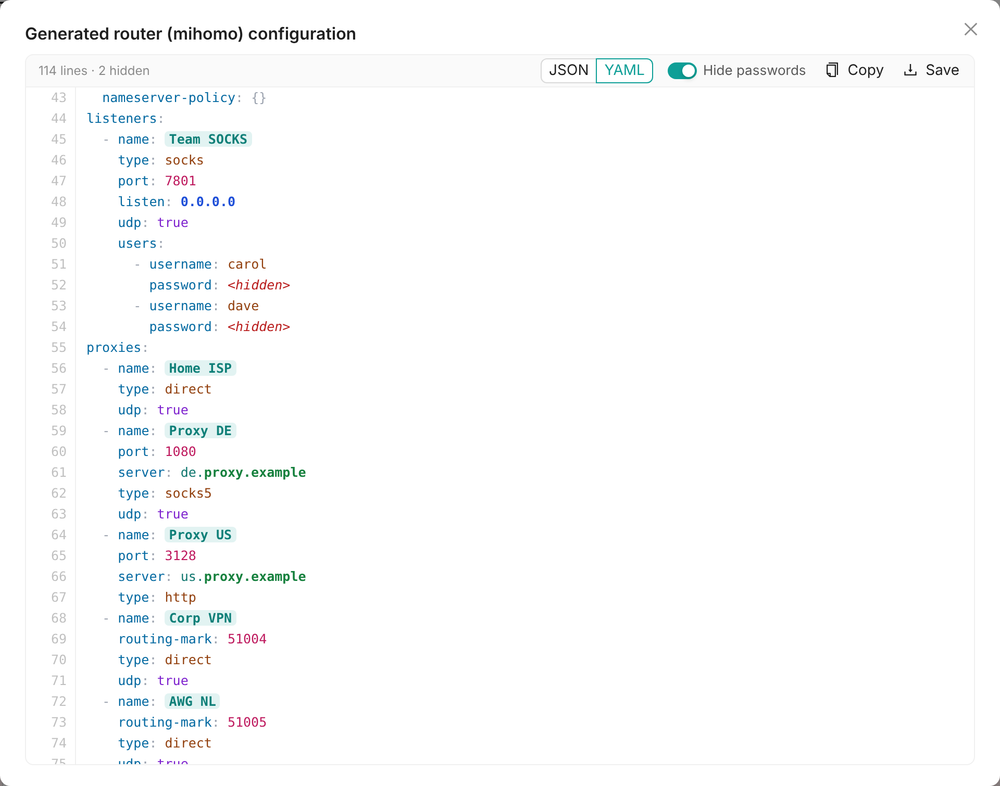

# Architecture

This document describes how Proximity is built and how traffic flows through it. It is
meant for people who want to understand, debug or extend the project.

- [Components](#components)
- [Container image](#container-image)
- [Control loop](#control-loop)
- [Endpoints and mihomo](#endpoints-and-mihomo)
- [Routing tables and marks](#routing-tables-and-marks)
- [Transparent capture](#transparent-capture)
- [DNS](#dns)
- [Monitoring and states](#monitoring-and-states)
- [OpenVPN driver](#openvpn-driver)
- [AmneziaWG driver](#amneziawg-driver)
- [Statistics and unreachable routes](#statistics-and-unreachable-routes)
- [Storage](#storage)
- [Security model](#security-model)
- [Naming](#naming)

## Components



| Package | Responsibility |
|---|---|
| `cmd/proximity` | Entry point: flags and environment, `health` and `hook` subcommands |
| `internal/server` | HTTP API, cookie sessions, role checks, control loop that ties everything together |
| `internal/config` | Data model, validation, cascading renames, JSON store with atomic writes, backup export/import |
| `internal/rules` | Filter parsing, normalization, comments, overlap and duplicate checks |
| `internal/router` | Generation of mihomo configuration, mihomo process and API client, traffic tracker and history |
| `internal/link` | Endpoint drivers (HOST, proxy, OpenVPN, AmneziaWG), monitoring, routing tables, transparent capture |
| `internal/auth` | Password hashing (PBKDF2-SHA256, 600 000 iterations), signed session tokens, bootstrap admin |
| `internal/wgconf` | Parsing WireGuard/AmneziaWG configuration, Amnezia `vpn://` import |
| `web` | Vue 3 single-page app, built by Vite and embedded with `go:embed` |

The only third-party Go dependency is `testify`, used in tests. The binary is built with
`CGO_ENABLED=0`.

## Container image

The `Dockerfile` is a multi-stage build:

| Stage | Base | Produces |
|---|---|---|
| `mihomo` | `metacubex/mihomo:v1.19.34` | `mihomo` binary, `geoip.metadb`, `geosite.dat` |
| `web` | `node:22-bookworm-slim` | `web/dist` |
| `amnezia` | `golang:1.25-bookworm` | `amneziawg-go` (`v3.1.20260828`), `awg` (`v3.1.20260812`) |
| `build` | `golang:1.25-bookworm` | `proximity` with the UI embedded |
| final | `debian:bookworm-slim` | + `iproute2`, `iputils-ping`, `openvpn`, `oathtool`, `ca-certificates`, `tzdata` |

Exposed ports: `8899` (UI/API) and `7899` (mixed HTTP/SOCKS5 proxy). Volume: `/config`.
`HEALTHCHECK` runs `proximity health`, which requests `/api/session`.

## Control loop

Proximity keeps a desired state (the configuration) and continuously brings the system to
it:

1. Any change through the API is validated and saved to `proximity.json`.
2. The store notifies the server, which **synchronizes**:
   - endpoint drivers are started, restarted (only when their settings changed) or stopped;
   - routes reported by VPNs are saved as *provided* filters;
   - a new mihomo configuration is generated from endpoints, fallbacks, filters and the
     current endpoint states;
   - the configuration is checked with `mihomo -t` and applied through mihomo's unix
     socket API without restarting the process.
3. Every 500 ms the server polls mihomo `/connections` to update traffic counters and
   re-checks transparent capture. Every 30 s the counters are saved to `state.json`.
4. Endpoint state changes (e.g. a tunnel goes up or down) trigger step 2 again, so
   fallbacks always contain the endpoints that currently work.

## Endpoints and mihomo

| Endpoint | mihomo proxy | Notes |
|---|---|---|
| HOST, default routing | `direct` | |
| HOST, interface | `direct` + `interface-name` | |
| HOST, interface + gateway | `direct` + `routing-mark` | own table with `default via <gateway> dev <interface>` |
| SOCKS5 | `socks5` | user/password, TLS, `skip-cert-verify`, UDP |
| HTTP | `http` | one server for all protocols, or extra proxies `<ID>~https` / `<ID>~ftp` selected by destination port 443 / 21 |
| OpenVPN | `direct` + `routing-mark` | traffic is routed by mark into the tunnel's table |
| AmneziaWG | `direct` + `routing-mark` | same as OpenVPN |

Fallbacks become `proxy-groups`:

| Fallback | Group |
|---|---|
| *Enable health check* off | `select` with the members that Proximity currently sees as `up`, in order |
| *Enable health check* on | `fallback` with all members; mihomo requests the URL through each of them every *interval* seconds |

A fallback with no enabled members is skipped with a warning; filters that target it are
skipped too.

The generated configuration can be viewed in **Filters → Router configuration**.



## Routing tables and marks

Proximity never touches the main routing table. Each tunnel (and HOST with a gateway) gets
its own table, numbered `51000 + slot`, where *slot* is a stable number assigned when the
endpoint is created (renaming does not change it):

```text
$ ip rule show
5100:  from all fwmark 0xc73d lookup 51005      # OpenVPN 1 (slot 5): mihomo marks its connections
5100:  from all fwmark 0xc73e lookup 51006      # AmneziaWG 1 (slot 6)
5100:  from 10.66.0.2 lookup 51006              # replies from the tunnel address (works with rp_filter=1)
5100:  from 10.8.0.2 lookup 51005

$ ip route show table 51005
default dev proximity_o5 scope link
blackhole default metric 4294967295             # stays when the tunnel is down → no leak
10.20.0.0/16 via 10.8.0.1 dev proximity_o5
172.16.40.0/24 via 10.8.0.1 dev proximity_o5
```

mihomo sets `routing-mark = 51000 + slot` on connections that go to a tunnel endpoint, so
the kernel looks them up in the tunnel's table. If the tunnel is down, only the
`blackhole` route is left and the connection fails instead of escaping through the ISP.

## Transparent capture

Only in host network mode (`docker-compose.yml`, `PROXIMITY_NETWORK=host`) and only when
**Settings → Route all outgoing connections…** is on.

mihomo runs a TUN device `proximity_tun` (gVisor stack, `auto-route` off). Proximity adds
the routing itself:

| Priority | Rule | Purpose |
|---|---|---|
| 5150 | `fwmark 51000 lookup main` | Bypass: mihomo's own connections and tunnel transports are never captured |
| 5155 | `iif lo ipproto udp/tcp dport 53 lookup 51000` | Host DNS queries go to the TUN (DNS hijack) |
| 5160 | `lookup main suppress_prefixlength 0` | Anything with a specific route (LAN, Docker networks, VPN clients' own routes) uses the main table |
| 5170 | `from 0.0.0.0/32 iif lo lookup 51000` (and the TUN source range) | New locally originated connections without a specific route go to the TUN |

Table 51000 contains `default dev proximity_tun`.

Consequences:

- inbound connections and their replies are not affected (they have a known source address);
- LAN and Docker traffic is not affected (rule 5160);
- when the container stops, the rules are deleted; if the process is killed, the TUN
  device disappears with its route and rule 5170 has nothing to send traffic to, so the
  host falls back to normal routing;
- IPv6 rules are installed only when **IPv6** is on in Settings.

mihomo's sniffer recovers domain names from TLS SNI (ports 443, 8443), HTTP `Host`
(80, 8080–8880) and QUIC (443, 8443), so DOMAIN rules work even for connections made to IP
addresses.

## DNS

| Situation | mihomo DNS configuration |
|---|---|
| Transparent capture | `enhanced-mode: fake-ip`, range `198.18.0.1/16`, `dns-hijack: any:53`, nameserver `system` |
| VPN with *Use DNS servers…* enabled | `nameserver-policy` sends the filter's domains (and domains pushed by the VPN) to the tunnel's DNS servers, through the tunnel |
| Otherwise | mihomo resolves through the system resolver of the container |

With fake-IP the application receives a placeholder address immediately; the real name is
resolved later by the target: remotely by a proxy, through the tunnel's DNS for a VPN, or
by the system resolver for DIRECT/HOST.

## Monitoring and states

| State | Meaning |
|---|---|
| `disabled` | Endpoint is switched off |
| `connecting` | Starting (tunnel process launched, waiting for it) |
| `up` (*good* in the UI) | Working; checks pass |
| `reconnecting` | Checks failed; restarting after the configured delay |
| `down` | Proxy server is not reachable; checks continue and it comes back to `up` by itself |
| `failed` | All attempts exhausted; see the message and the connection log |

| Endpoint | How it is checked |
|---|---|
| HOST | TCP connection to *Probe target* (Settings, default `1.1.1.1:443`) through the same path mihomo uses; after *Connection attempts* failures → `failed`, but checks continue and it returns to `up` |
| SOCKS5 / HTTP | TCP connection to the proxy server |
| OpenVPN | `ping` of the VPN gateway through the tunnel interface |
| AmneziaWG | TCP connection to the monitoring *Check target* through the tunnel |

Proxy and HOST checks run every *Check interval* when **Enable connectivity checks** is on.
Tunnel monitoring (interval, timeout, retries, reconnect delay and attempts) is set per
endpoint on its **Monitoring** tab.

## OpenVPN driver

- The configuration is sanitized: directives that would conflict with Proximity
  (`dev`, `up`, `route-up`, `script-security`, `auth-user-pass` file, `management`,
  `daemon`, `log`, `user`/`group`, `chroot`, plugins …) are removed; `dev-type tun|tap` is
  kept.
- `openvpn` is started inside a pseudo-terminal with `--dev proximity_o<slot>`,
  `--route-noexec` and `proximity hook` as the `up` / `route-up` script.
- Prompts are answered from the endpoint settings: user name, password, private key
  password and the one-time code. The code is generated with `oathtool --totp -b` from the
  base32 *OTP key*, and either typed into the `CHALLENGE` prompt or appended to the
  password (*OTP code usage*).
- The hook reports the interface address, gateway, pushed DNS servers, domains and routes.
  Routes are not installed into the main table; they are stored in the tunnel's table and
  shown as the *provided* filter.
- `AUTH_FAILED` without an OTP key stops the endpoint as `failed` at once, without
  retrying, to avoid locking the account. With an OTP key the next attempt uses a fresh
  code.

## AmneziaWG driver

- The configuration is parsed (`Interface`/`Peer`, Amnezia parameters `Jc`, `Jmin`, `Jmax`,
  `S1`, `S2`, `H1`–`H4`); `vpn://` keys exported by the Amnezia app are converted to a
  normal `.conf`; the UI can also decode a QR code from an image (in the browser, with jsQR).
- `amneziawg-go proximity_a<slot>` is started (log level verbose, its output goes to the
  connection log). Proximity waits until the interface exists and the control socket
  `/var/run/amneziawg/proximity_a<slot>.sock` accepts connections (otherwise `awg`
  would remove the socket, try the kernel module and fail), then applies the configuration with `awg setconf`, addresses and MTU
  (default 1280) are set, and the default route goes into the tunnel's table.
- The connection log ends with the output of `awg show` for the device.

## Statistics and unreachable routes

- `router.Tracker` reads mihomo `/connections` every 500 ms and attributes bytes to the
  endpoint at the end of each connection's chain (fallback members included).
- Every 5 s a sample (`total` + per endpoint upload/download rates) is added to an
  in-memory history of 720 samples (1 hour). The Dashboard chart requests only new
  samples (`/api/history?since=…`). History is not persisted; totals are.
- mihomo's log stream (`/logs?level=info`) is parsed for dial errors. Each error is
  classified (`refused`, `timeout`, `no route`, `unreachable`, `dns`, …) and stored with the
  destination, endpoint, matched rule, count and first/last time.

## Storage

All persistent data lives in the settings folder mounted as `/config`:

| File | Written | Contents |
|---|---|---|
| `proximity.json` | on every change (atomic replace) | users, endpoints, fallbacks, filters, settings, token secret |
| `state.json` | every 30 s and on shutdown | traffic totals, unreachable routes |
| `mihomo/config.yaml` | on every synchronization | generated mihomo configuration |
| `mihomo/geoip.metadb`, `geosite.dat` | first start | GeoIP / GeoSite databases |

Runtime files (unix socket, generated tunnel configs, hook output) are in `/run/proximity`.

## Security model

- Passwords: PBKDF2-SHA256, 600 000 iterations, minimum length 6.
- Sessions: signed token in an HTTP-only, `SameSite=Strict` cookie, lifetime 7 days.
  Changing a user's password invalidates all existing sessions of that user.
- Every non-GET request must carry the `X-Requested-With` header (CSRF protection).
- Failed sign-ins are delayed by 0.7 s.
- Users with the *User* role receive endpoints with passwords and keys removed.
- Secrets in `proximity.json` and in backups are stored in plain text — protect the folder
  and backup files.

## Naming

| Object | Name |
|---|---|
| Project / image / container | `proximity` |
| Bridge network and its Linux bridge | `proximity_lan` |
| Capture TUN device | `proximity_tun` |
| OpenVPN device | `proximity_o<slot>` |
| AmneziaWG device | `proximity_a<slot>` |
| Routing tables | `51000` (capture), `51000 + slot` (endpoints) |
| `ip rule` priorities | `5100` (endpoints), `5150`–`5170` (capture) |
