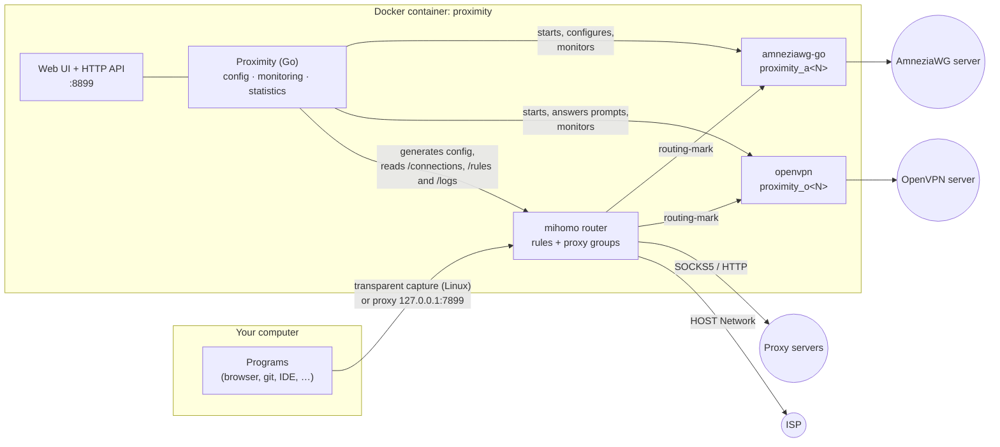

# Concepts

What Proximity is made of, the words used in the UI and the documentation, who may do
what, and where the data lives.

- [How it works](#how-it-works)
- [Outbounds, fallbacks, routes](#outbounds-fallbacks-routes)
- [Identifiers](#identifiers)
- [Users and roles](#users-and-roles)
- [Backup and restore](#backup-and-restore)
- [Configuration folder](#configuration-folder)

## How it works

The routing engine is [mihomo](https://github.com/MetaCubeX/mihomo). Proximity generates
its configuration from your outbounds, fallbacks and routes, starts and watches the
tunnels, counts traffic and route hits, and serves the web UI on port **8899**.

How each outbound type is connected to mihomo:

| Outbound | mihomo side |
|---|---|
| HOST Network | proxy `direct`; for a specific interface — `interface-name`, with a gateway — `routing-mark` |
| SOCKS5 Proxy | proxy `socks5` |
| HTTP Proxy | proxy `http` (CONNECT tunnel); separate HTTPS/FTP servers become extra proxies selected by port 443/21 |
| OpenVPN | `openvpn` process on interface `proximity_o<N>` + `direct` with `routing-mark` |
| AmneziaWG | `amneziawg-go` on interface `proximity_a<N>` + `direct` with `routing-mark` |

- Each tunnel has its own routing table (`51000 + N`), a rule by mark and a rule by the
  tunnel address. The main routing table is never changed.
- If a tunnel goes down, a `blackhole` route stays in its table: traffic does not leak
  around the VPN.
- OpenVPN runs in a pseudo-terminal; Proximity answers the user name, password and
  one-time code prompts itself (TOTP, same as `oathtool --totp -b`).
- Every outbound and inbound: after *Connection attempts* failures in a row (pause —
  *Reconnection timeout*) the connection is restored: Proximity waits *Restore after*
  (1 minute) and starts a new series of attempts, without a limit by default
  (**Monitoring** tab). With recovery off, or after an error that needs your action, it
  goes to `failed` and waits for **Start** / **Restart**.

The full picture — control loop, routing tables, capture, DNS, monitoring, statistics,
the tools of the UI — is in [Architecture](architecture.md).

## Outbounds, fallbacks, routes

| Concept | Meaning | Example |
|---|---|---|
| **Outbound** | One outgoing connection | `OpenVPN 1` — corporate VPN |
| **Fallback** | A group of outbounds used in priority order | `Proxies` = `SOCKS5 1`, then `SOCKS5 2` |
| **Route** | A list of conditions with one directive and one target | `DOMAIN-SUFFIX corp.example → OpenVPN 1` |
| **Default target** | Where everything that matched no route goes | `HOST 1` or `DIRECT` |
| **Inbound** | An incoming connection point: a SOCKS5 or OpenVPN server with its own users on ports 7800–7898 | `SOCKS5 1` for a phone |

Routes are checked from top to bottom, the first match wins. The [Routes](routes.md)
reference has every directive, the normalization of the input, warnings and recipes; the
[DNS](dns.md) guide explains which server resolves the names of a route.

## Identifiers

- IDs of outbounds, fallbacks and routes can be changed at any time. On rename all
  references (fallback members, route targets, default target) are updated, and a running
  tunnel is not interrupted.
- An ID is unique within its section. An outbound and a fallback can't share a name either,
  because both can be route targets.
- Empty IDs are generated: `<Type> <N>` for outbounds, `Fallback <N>`, `Route <N>`.
- `proximity.json`, backups and the [HTTP API](api.md) use the same names
  (`outbounds`, `routes`). Files written by older versions with `endpoints` and `filters`
  are read and converted automatically.
- Inbound IDs (`SOCKS5 <N>`, `OpenVPN <N>`) are unique among inbounds only, because an
  inbound is never a route target. See the [User guide](user-guide.md#inbounds).

## Users and roles

| Role | Rights |
|---|---|
| Administrator | everything, including users and settings |
| Operator | edit outbounds, inbounds, fallbacks and routes, start and stop them and the router; clear logs and hit counters; the page **Tools**; export and import the configuration |
| User | view only (passwords and keys are hidden) |
| Anonymous | Dashboard only (can be disabled in Settings) |

## Backup and restore

**Settings → [Backup and Restore]**: *Export configuration* saves one JSON file (outbounds
and inbounds with passwords, VPN keys and certificates, fallbacks, routes, settings);
*Import configuration* replaces the current ones. User accounts are not included. When an
Operator imports a file, Settings stay unchanged.

## Configuration folder

| File | Contents |
|---|---|
| `proximity.json` | users, outbounds, inbounds, fallbacks, routes, settings |
| `state.json` | traffic counters, route hit counters and the list of unreachable destinations |
| `router.json` | router state (running or stopped) for *Start the router when the container starts* |
| `services.json` | state of tunnels and inbounds (running, stopped, failed) kept across restarts |
| `logs/` | logs of outbounds and inbounds, kept across restarts (written once a second) |
| `proximity.env` | variables of the first `scripts/proximity.sh up` (network mode, bind addresses, iptables tool, time zone), reused by later runs |
| `mihomo/config.yaml` | generated mihomo configuration (JSON, which is valid YAML) |

When each file is written: [Architecture → Storage](architecture.md#storage).

> [!WARNING]
> Outbound and inbound passwords, VPN configurations and private keys are stored in
> `proximity.json` as plain text.
> Protect the settings folder (and exported backup files) accordingly.
