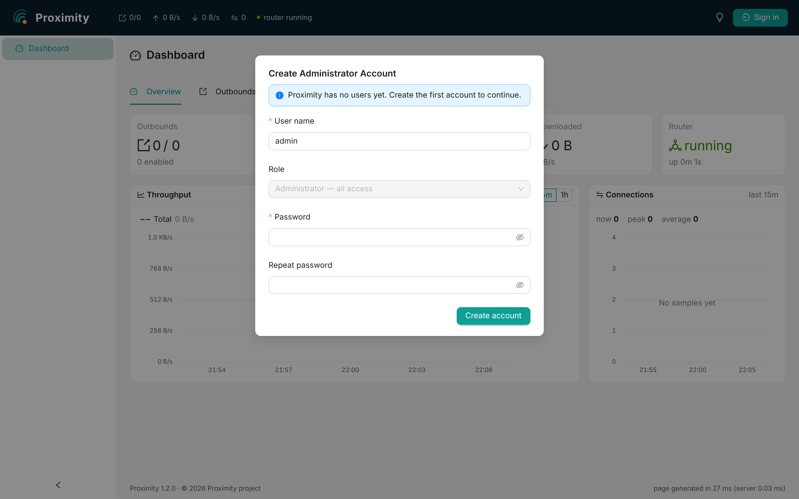
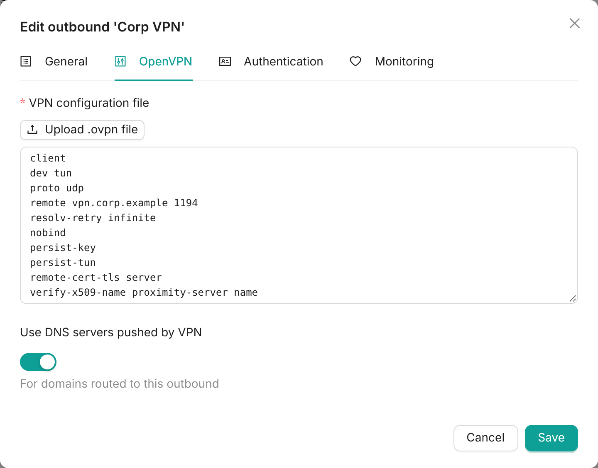

# Getting started

This guide takes you from an empty machine to a working setup: one VPN for corporate
sites, a proxy for a couple of services, everything else straight to your ISP.

- [1. Requirements](#1-requirements)
- [2. Install and start](#2-install-and-start)
- [3. Create the administrator](#3-create-the-administrator)
- [4. Add outbounds](#4-add-outbounds)
- [5. Optional: group outbounds into a fallback](#5-optional-group-outbounds-into-a-fallback)
- [6. Write routes](#6-write-routes)
- [7. Point your programs at Proximity](#7-point-your-programs-at-proximity)
- [8. Check that it works](#8-check-that-it-works)
- [Environment variables](#environment-variables)
- [Upgrade, stop, remove](#upgrade-stop-remove)

## 1. Requirements

| | Linux | macOS / Windows |
|---|---|---|
| Docker | Docker Engine with Compose v2 | Docker Desktop |
| Kernel features | `/dev/net/tun`, policy routing (`ip rule`) | provided by Docker Desktop |
| Container privileges | `NET_ADMIN`, `SYS_PTRACE` (host mode) | `NET_ADMIN` |
| Free ports | 8899 (UI), 7899 (proxy), 7800–7898 (inbounds you create) | 8899, 7899, 7800–7898 |

The image is built locally from the `Dockerfile`; it bundles mihomo, OpenVPN,
`amneziawg-go`, `awg`, `oathtool` and the GeoIP/GeoSite databases.

## 2. Install and start

```bash
git clone https://github.com/rogreedin/proximity.git
cd proximity
scripts/proximity.sh up -d --build
```

On Windows use PowerShell:

```powershell
.\scripts\proximity.ps1 up -d --build
```

The script prints which settings folder and compose file it uses:

```text
proximity: config folder is '/home/me/.config/proximity', compose file is 'docker-compose.yml'
```

Any arguments are passed to `docker compose`, so the same script manages the container:

```bash
scripts/proximity.sh ps          # status
scripts/proximity.sh logs -f     # logs
scripts/proximity.sh down        # stop and remove the container
```

Open <http://localhost:8899>.

## 3. Create the administrator

On the first visit you see the **Create Administrator Account** dialog. Enter a user name
(lower-case letters, digits, `_ . -`, up to 32 characters) and a password (at least
6 characters) twice.



> [!TIP]
> For scripted installs set `PROXIMITY_ADMIN_USER` and `PROXIMITY_ADMIN_PASSWORD` before
> the first start. The account is created automatically and the dialog never appears.
> The variables are ignored once any user exists.

## 4. Add outbounds

Go to **Outbounds → Add outbound** and choose a type.

| You have… | Add outbound | Key fields |
|---|---|---|
| A normal internet connection | **HOST Internet** | *Outgoing connection*: default host routing, or a specific interface (+ gateway) |
| A SOCKS5 server | **SOCKS5 Proxy** | server, port (1080), optional user/password, TLS, UDP relay |
| An HTTP proxy (Squid etc.) | **HTTP Proxy** | server, port (3128); optionally separate HTTPS and FTP servers |
| An `.ovpn` file | **OpenVPN** | upload/paste the file, user, password, optional TOTP key |
| An AmneziaWG `.conf`, `vpn://` key or QR code | **AmneziaWG** | upload/paste config, convert `vpn://`, or *Scan QR code from image* |

Every outbound also has a **General** tab (ID, name, group, enabled, collect statistics),
and tunnels have a **Monitoring** tab. Changes are applied immediately: there is no
separate "apply" step.



When a tunnel comes up its state turns **good**, and the interface and address appear in
the *Connection* column.

## 5. Optional: group outbounds into a fallback

A fallback is a list of outbounds used in priority order. Use it when several exits can
serve the same traffic.

**Routes → [Fallbacks] → Add fallback** (the section at the bottom of the Routes page), choose the outbounds and order them. Leave *Enable health
check* off to use the first outbound that Proximity sees as good; turn it on to let mihomo
probe a URL through every member.

## 6. Write routes

**Routes → Add route**. Pick a directive, a target and type the parameters, one per line.
The preview shows exactly what will be sent to the router.

Example set:

| # | ID | Directive | Parameters | Target |
|---|---|---|---|---|
| 1 | Ads | DOMAIN-KEYWORD | `adservice`, `doubleclick` | REJECT |
| 2 | Public corp sites | DOMAIN-SUFFIX | `www.corp.example` | DIRECT |
| 3 | Corporate | DOMAIN-SUFFIX | `corp.example`, `corp.internal` | OpenVPN 1 |
| 4 | Media | DOMAIN | `media.example.net` | Proxies (fallback) |
| — | Everything else | MATCH | — | HOST 1 |

Routes are checked from top to bottom; the first match wins. Set the target for
everything else in the **Everything else (MATCH)** selector under the table.

See [Routes](routes.md) for all directives and recipes.

## 7. Point your programs at Proximity

- **Linux, default mode:** nothing to do. All new outgoing connections of the host are
  captured. The header shows **transparent**.
- **macOS, Windows, Linux bridge mode:** set the proxy to `127.0.0.1:7899` in programs or
  in the system settings. The same port speaks HTTP and SOCKS5.

```bash
# quick test from a terminal (bridge mode)
curl -x http://127.0.0.1:7899 https://ifconfig.me
curl -x socks5h://127.0.0.1:7899 https://ifconfig.me
```

## 8. Check that it works

1. **Dashboard** → the outbound you expect shows growing *Traffic* and a line on the
   **Throughput** chart.
2. **Routes → Router configuration** shows the rules exactly as mihomo received them.
3. Connections that failed (refused, timeout, DNS) are listed under **Unreachable
   routes** on the Dashboard with the outbound and the rule that matched.

## Environment variables

Variables read by `scripts/proximity.sh` and the compose files (set them in the shell or in
a `.env` file next to the compose file):

| Variable | Default | Meaning |
|---|---|---|
| `PROXIMITY_NETWORK` | `host` on Linux | `bridge` disables transparent capture and uses `docker-compose.bridge.yml` |
| `PROXIMITY_CONFIG_DIR` | per-OS folder | Settings folder on the host |
| `PROXIMITY_ADMIN_USER` | `admin` | Name of the administrator created on the first start (only when the password below is set) |
| `PROXIMITY_ADMIN_PASSWORD` | — | Password for `PROXIMITY_ADMIN_USER` |
| `PROXIMITY_UI_BIND` | `0.0.0.0` | Address the web UI listens on (host side) |
| `PROXIMITY_PROXY_BIND` | `127.0.0.1` | Address of the proxy port. In host mode it overrides *Bind address* from Settings |
| `PROXIMITY_INBOUND_BIND` | `0.0.0.0` | Bridge mode: host address the inbound ports 7800–7898 (TCP and UDP) are published on |
| `PROXIMITY_IPTABLES` | `iptables` | Host mode: tool used for forwarding rules and traffic counters of inbounds. Set `iptables-legacy` when the host firewall uses the legacy backend |
| `PROXIMITY_VERSION` | `1.2.0` | Version string compiled into the image |
| `TZ` | `UTC` | Time zone for logs |

> [!CAUTION]
> `PROXIMITY_UI_BIND=0.0.0.0` makes the UI reachable from your network. Use a strong
> administrator password, disable the anonymous dashboard, or bind to `127.0.0.1` if you
> don't need remote access.

Variables inside the container (already set by the `Dockerfile`; change only for custom
builds):

| Variable | Default | Meaning |
|---|---|---|
| `PROXIMITY_LISTEN` | `:8899` | UI/API listen address |
| `PROXIMITY_CONFIG` | `/config` | Settings folder |
| `PROXIMITY_RUN` | `/run/proximity` | Runtime files (sockets, generated tunnel configs) |
| `PROXIMITY_GEODATA` | `/usr/share/proximity/geodata` | Bundled GeoIP/GeoSite databases, copied to `mihomo/` on first start |
| `PROXIMITY_MIHOMO` | `mihomo` | mihomo binary |
| `PROXIMITY_OPENVPN`, `PROXIMITY_AWG_GO`, `PROXIMITY_AWG`, `PROXIMITY_IP`, `PROXIMITY_PING`, `PROXIMITY_OATHTOOL` | tool names | Paths to helper tools |

The binary also accepts flags with the same meaning: `--listen`, `--config`, `--run`,
`--geodata`, `--mihomo`. `proximity health` is used by the Docker `HEALTHCHECK`.

## Upgrade, stop, remove

```bash
git pull
scripts/proximity.sh up -d --build   # rebuild and restart; settings are kept
scripts/proximity.sh down            # stop; host routing rules are removed
```

To remove Proximity completely, stop it and delete the settings folder
(`~/.config/proximity` on Linux). Export a backup first if you may need it again.
