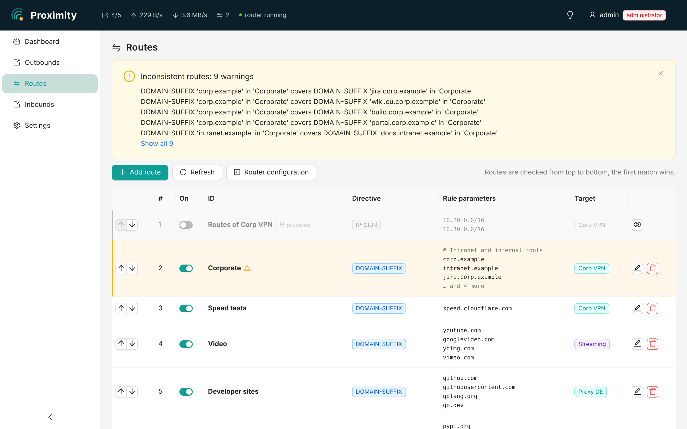
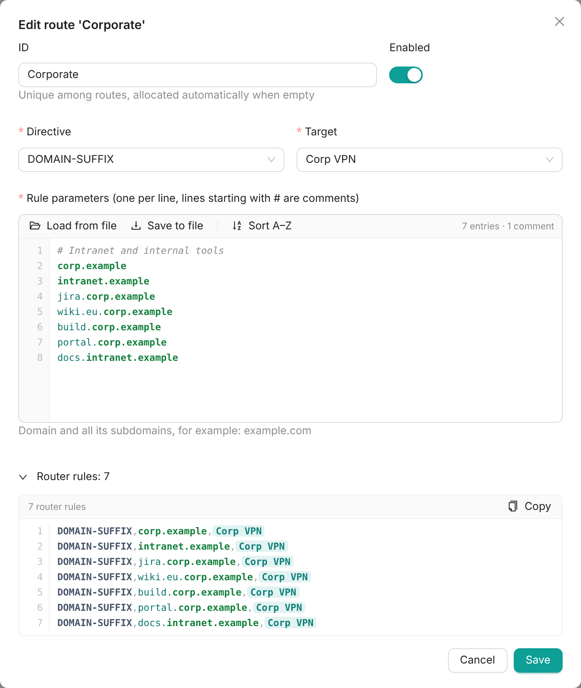
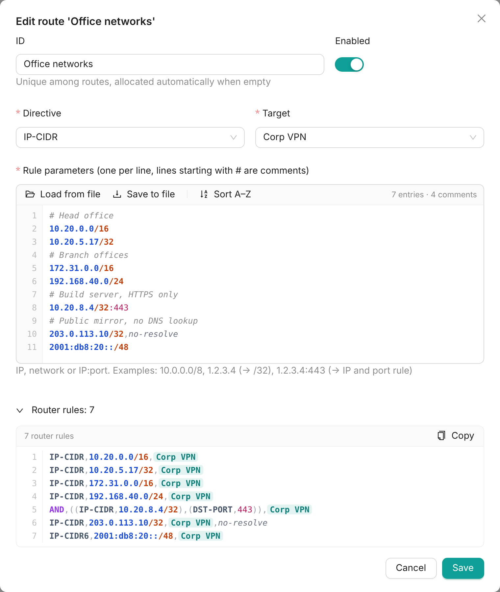

# Routes

Routes decide which outbound or fallback handles each outgoing connection. Proximity
turns them into [mihomo rules](https://wiki.metacubex.one/en/config/rules/), checks them
for mistakes and applies them immediately.



- [How matching works](#how-matching-works)
- [Fields of a route](#fields-of-a-route)
- [Directives](#directives)
- [Normalization](#normalization)
- [Comments](#comments)
- [Consistency warnings](#consistency-warnings)
- [Routes provided by a VPN](#routes-provided-by-a-vpn)
- [Targets](#targets)
- [DNS: which server resolves the name](#dns-which-server-resolves-the-name)
- [Hits and checks](#hits-and-checks)
- [Recipes](#recipes)

## How matching works

1. Routes are checked **from top to bottom**. Inside a route, its lines are checked in
   order too.
2. The **first match wins**; nothing below it is checked for that connection.
3. A connection that matches nothing goes to the **Everything else (MATCH)** target
   shown under the table.
4. Disabled routes (switch **On** is off) and routes whose target is disabled or missing
   are skipped. The Routes page and the Dashboard show a warning for skipped routes.

Order is changed with the ↑ ↓ buttons. The new order is saved and applied at once.

## Fields of a route

| Field | Meaning |
|---|---|
| **ID** | Optional name, unique among routes. Empty → `Route <N>` |
| **Directive** | The kind of condition: `DOMAIN-SUFFIX`, `IP-CIDR`, `GEOIP`, … |
| **Target** | An outbound, a fallback, `DIRECT` or `REJECT` |
| **Rule parameters** | One condition per line; `#` lines are comments |
| **Enabled** | Switch the route on or off without deleting it |



The parameters editor highlights every line as you type:

| Color | Meaning |
|---|---|
| gray, italic | `# comment` |
| green, bold | the domain itself (`corp.example`) |
| teal | subdomains in front of it (`jira.`, `wiki.eu.`) |
| amber | wildcards: `*.`, `+.`, `*`, `?` |
| blue, bold | IP addresses, IPv4 and IPv6 |
| orange | network masks (`/16`, `/48`) |
| pink | ports and port ranges (`:443`, `8000-8100`) |
| violet | keywords, GeoIP and GeoSite codes, process names |
| gray | options after a comma (`,no-resolve`) and the scheme and path of a pasted URL |
| red, wavy underline | an impossible value: an octet above 255, a mask above 32/128, a port above 65535, a domain in an `IP-CIDR` route |

The toolbar above the lines:

- **Load from file** — replace the parameters with the lines of a text file (`.txt`,
  `.list`, `.conf`, up to 4 MB; Windows line endings are converted);
- **Save to file** — download the parameters as `<route ID>.txt`;
- **Sort A–Z** — sort the lines alphabetically (numbers in IP addresses are compared as
  numbers); comments at the top stay there, and every other comment moves together with
  the line below it;
- the counter on the right shows the number of entries and comments.

Line numbers on the left match the line numbers in error messages. **Tab** inserts two
spaces.



The editor shows a live **preview**: the normalized parameters and the exact rule lines
that will be sent to mihomo. Invalid lines are reported with their line number before you
can save. Expand **Router rules** to see them numbered and highlighted the same way:
directives in bold, logical operators (`AND`) in violet, the target as a colored label,
values with the colors above. **Copy** puts all rules on the clipboard (it also works when
the UI is opened over plain HTTP by IP address).

## Directives

| Directive | Parameter | Example |
|---|---|---|
| `DOMAIN` | Exact host name | `www.example.com` |
| `DOMAIN-SUFFIX` | Domain and all its subdomains | `example.com` |
| `DOMAIN-KEYWORD` | Part of the host name | `google` |
| `DOMAIN-WILDCARD` | Host name with `*` and `?` | `*.cdn.example.com` |
| `DOMAIN-REGEX` | Regular expression for the host name | `^ads\d+\.example\.com$` |
| `GEOSITE` | Category of the GeoSite database | `youtube` |
| `GEOIP` | Country code of the destination IP | `NL` |
| `IP-CIDR` | IP, network or `IP:port` (IPv6 → `IP-CIDR6`) | `10.0.0.0/8`, `1.2.3.4:443` |
| `IP-ASN` | Autonomous system number | `13335` or `AS13335` |
| `SRC-IP-CIDR` | Source address of the client | `192.168.1.0/24` |
| `DST-PORT` | Destination port or range | `443`, `8000-8100` |
| `SRC-PORT` | Source port or range | `50000-50100` |
| `NETWORK` | Transport | `tcp` or `udp` |
| `PROCESS-NAME` | Process name (host network mode only) | `curl` |
| `PROCESS-PATH` | Full path of the process (host network mode only) | `/usr/bin/git` |

`IP-CIDR`, `SRC-IP-CIDR`, `GEOIP` and `IP-ASN` accept the `,no-resolve` suffix: the rule
is then checked only when the destination is already an IP address, without a DNS lookup.

> [!NOTE]
> GeoIP and GeoSite databases are bundled into the image and copied to the `mihomo`
> settings subfolder on the first start. Automatic updates are off; replace the files to
> update them.

## Normalization

You can paste parameters "as they are": Proximity cleans them up and shows the result in
the preview and in the table.

| Input | Directive | Result |
|---|---|---|
| `https://Example.com/path` | DOMAIN | `example.com` |
| `*.example.com` | DOMAIN-SUFFIX | `example.com` |
| `пример.рф` | DOMAIN / DOMAIN-SUFFIX | `xn--e1afmkfd.xn--p1ai` (punycode) |
| `192.168.1.7` | IP-CIDR | `192.168.1.7/32` |
| `10.1.2.3/8` | IP-CIDR | `10.0.0.0/8` |
| `1.2.3.4:443` | IP-CIDR | `AND,((IP-CIDR,1.2.3.4/32),(DST-PORT,443)),Target` |
| `5.5.5.5,no-resolve` | IP-CIDR | `IP-CIDR,5.5.5.5/32,Target,no-resolve` |
| `2001:db8::1` | IP-CIDR | `IP-CIDR6,2001:db8::1/128,Target` |
| `ru` | GEOIP | `RU` |
| `AS13335` | IP-ASN | `13335` |
| `Tcp` | NETWORK | `TCP` |

Rejected input (error with the line number):

- characters not allowed in a domain (spaces, `,`, a trailing `# comment` …) or a domain longer than 253 characters;
- ports outside `1–65535`, reversed ranges like `9000-8000`;
- a port on `SRC-IP-CIDR`;
- `NETWORK` other than `tcp` / `udp`;
- a route that contains only comments (`rule parameters do not exist`).

## Comments

A line whose first non-blank character is `#` is a comment.

```text
# internal services
corp.example
corp.internal
  # VPN-only wiki (leading spaces are trimmed)
wiki.corp.example
```

- Comments are kept in their places when you save, and shown dimmed in the table.
- Comments are never sent to mihomo and are ignored by the consistency check.
- A comment at the end of a rule line (`corp.example # note`) is **not** supported: that
  line is rejected as an invalid domain.

## Consistency warnings

Proximity lets you save any valid route, but warns at the top of the page when a rule can
never take effect:

| Situation | Example | Warning |
|---|---|---|
| Duplicate | `example.com` twice | `duplicate DOMAIN-SUFFIX 'example.com' in …` |
| Upper suffix covers a lower domain | `corp.example` above `git.corp.example` | `DOMAIN-SUFFIX 'corp.example' in 'Corporate' covers DOMAIN-SUFFIX 'git.corp.example' in 'Legacy git'` |
| Upper keyword covers a lower domain | keyword `ads` above `downloads.example.org` | `DOMAIN-KEYWORD 'ads' … covers DOMAIN-SUFFIX 'downloads.example.org' …` |
| Upper network covers a lower one | `10.0.0.0/8` above `10.20.0.0/16` | `network '10.0.0.0/8' in … covers '10.20.0.0/16' in …` |

When the targets differ, the warning adds `(different targets: 'A' and 'B')`. Affected
rows get a ⚠ mark and an orange bar.

"Specific above general" is the normal pattern and gives **no** warning:

```text
1. Public corp sites   DOMAIN-SUFFIX  www.corp.example   → DIRECT
2. Corporate           DOMAIN-SUFFIX  corp.example       → OpenVPN 1
```

> [!TIP]
> `DOMAIN-KEYWORD` matches any substring of the host name. A keyword like `ads` also
> catches `downloads.example.org` and `roads.example.com`. Prefer longer keywords
> (`adservice`, `doubleclick`) or `DOMAIN-SUFFIX`.

## Routes provided by a VPN

Turn on **Receive routes** in a VPN outbound (tab *OpenVPN* or *AmneziaWG*, below the DNS
switch; off by default) and Proximity keeps a route **Routes of &lt;outbound&gt;** marked `provided`. It
holds what the VPN announces: the routes pushed by an OpenVPN server and the `route` lines
of its configuration, or the `AllowedIPs` of AmneziaWG (without `0.0.0.0/0`).

- Directive `IP-CIDR`, target — the VPN outbound itself.
- The route **follows the connection**: it appears and is switched on when the connection
  is up and has given its routes, it is switched off (and keeps its networks) while the
  connection is down or stopped, and it is updated when the VPN reconnects with other
  routes.
- It can't be edited, switched by hand or deleted (👁 opens a read-only view).
- A new route of this kind is put **at the top** of the list. Move it up and down like any
  other route: the place is saved and survives restarts.
- Turn **Receive routes** off and the route is removed.

Use it when "everything the VPN would normally route" must go through this outbound,
without copying networks by hand.

> Upgrading from an earlier version: a provided route that was switched on keeps working
> (*Receive routes* is turned on for its outbound); one that was switched off is removed.

## Targets

| Target | Meaning |
|---|---|
| Outbound, e.g. `OpenVPN 1` | Use this outbound |
| Fallback, e.g. `Proxies` | Use the group: first good outbound, or mihomo health check |
| `DIRECT` | Connect directly from the container, bypassing outbounds |
| `REJECT` | Refuse the connection |

The default target (**Everything else**) can be any of these as well. If it points to a
disabled outbound, Proximity falls back to `DIRECT` and shows a warning.

On rename of an outbound or fallback, all route targets and the default target are
updated automatically.

## DNS: which server resolves the name

For domain rules the name is resolved by the side that owns the target:

| Target | Who resolves the domain |
|---|---|
| An outbound with its own servers (tab **DNS**) | those servers, through the outbound or through the exit chosen there |
| SOCKS5 / HTTP proxy | the proxy server (the domain is sent as is) |
| OpenVPN / AmneziaWG with *Use DNS servers…* enabled | DNS servers of the tunnel, through the tunnel |
| OpenVPN / AmneziaWG without it, HOST, `DIRECT` | system DNS of the container |

In transparent mode (Linux) host DNS queries are intercepted and answered with fake IPs,
so the real resolution happens only when the connection is made — by the target above.
This is why intranet names that exist only behind the VPN work without changing
`/etc/resolv.conf`.

The binding follows the routes: every domain rule (`DOMAIN`, `DOMAIN-SUFFIX`,
`DOMAIN-KEYWORD`, `DOMAIN-WILDCARD`, `DOMAIN-REGEX`, `GEOSITE`), the first route that
matches a name decides, the same as for the traffic. A route to `DIRECT` above
a wider route to a VPN keeps its domains on the default servers:

```text
Public corp sites  DOMAIN-SUFFIX  www.corp.example   → DIRECT       default DNS servers
Corporate          DOMAIN-SUFFIX  corp.example       → OpenVPN 1    DNS of the VPN, through the tunnel
Everything else                                      → SOCKS5 1     DNS servers of SOCKS5 1, through the proxy
```

The default servers and their exit are set in **Settings → Router → DNS**; when the
default target (**Everything else**) has its own servers, names without a route are asked
there. A proxy still resolves the names it is given by itself; the servers of a proxy
outbound answer what the router has to resolve: records other than addresses (browsers ask
for `HTTPS` records), and names checked against an `IP-CIDR` / `GEOIP` route that stands
above without `,no-resolve`. The whole picture — servers given by name, fake-IP, OpenVPN
inbounds — is in [DNS](dns.md).

## Hits and checks

- **Hits** (a column of the Routes page and the **Route hits** chart, also on the
  dashboard): how many connections each route matched and when the last one came. The
  counts come from mihomo itself (every rule counts its matches), are summed per route,
  survive reloads and restarts and are reset by **Reset**. A route that stays at 0 is
  covered by a route above or never sees its traffic.
- **Tools → Address check**: type a name or an address and see which route and rule take
  it, through which outbound it leaves and whether it connects — before you change the
  routes, or to check them after ([user guide](user-guide.md#address-check)).

## Recipes

**Corporate VPN for company domains, with exceptions**

```text
Public corp sites  DOMAIN-SUFFIX  www.corp.example, status.corp.example  → DIRECT
Corporate          DOMAIN-SUFFIX  corp.example, corp.internal           → OpenVPN 1
Routes of OpenVPN 1 (provided, "Receive routes" is on)                   → OpenVPN 1
```

**One service through a specific port only**

```text
Dev servers  IP-CIDR  203.0.113.10:8443  → SOCKS5 2
```

**Country-based routing**

```text
Europe direct  GEOIP  NL, DE  → DIRECT
Everything else                → Proxies
```

**Block trackers**

```text
Ads  DOMAIN-KEYWORD  adservice, doubleclick  → REJECT
```

**Only one program through a proxy (Linux host mode)**

```text
Git over proxy  PROCESS-NAME  git  → SOCKS5 1
```
