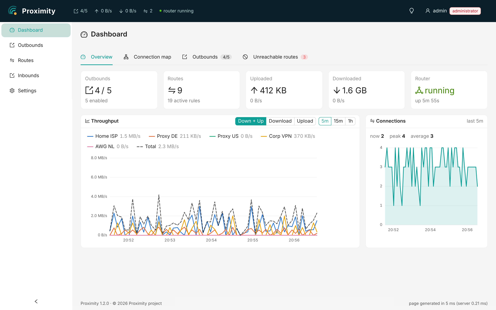
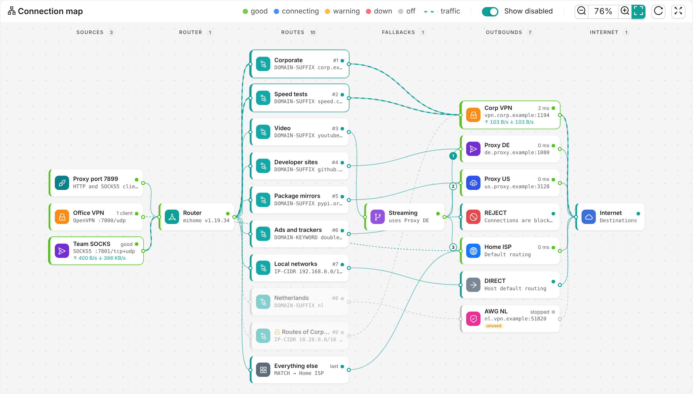
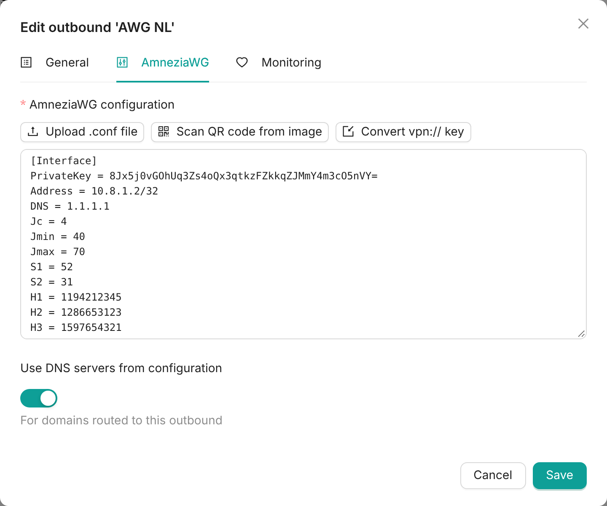
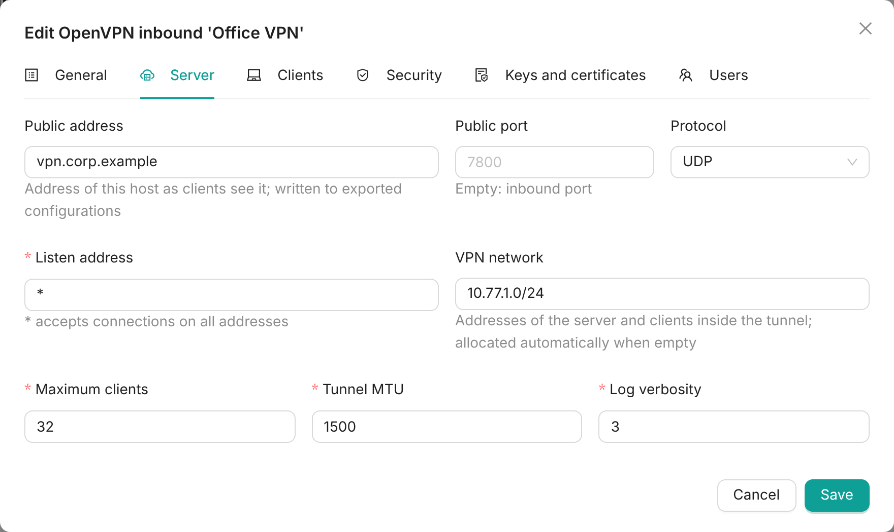
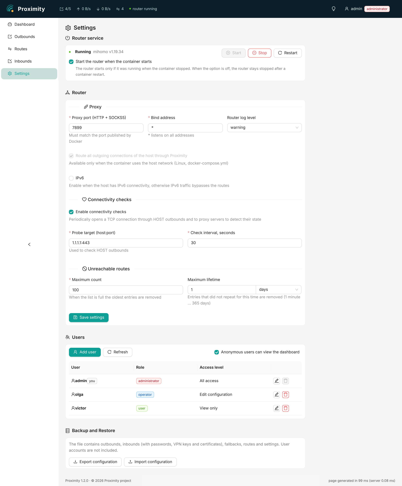
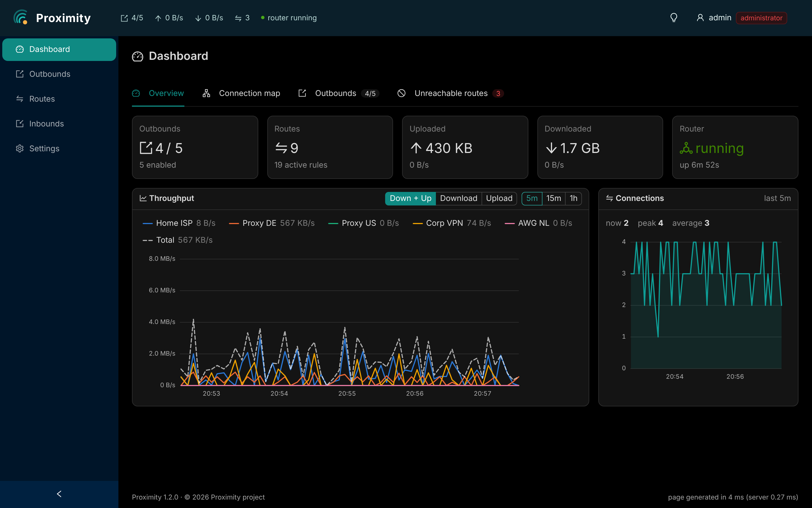
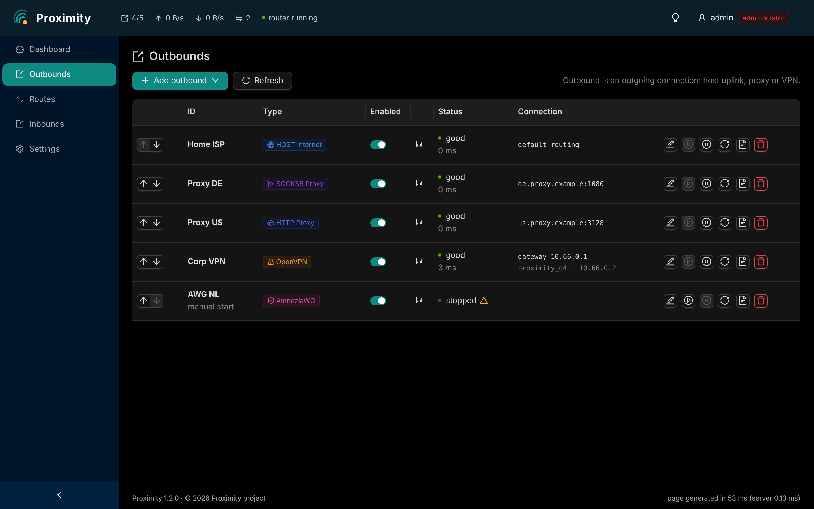

# User guide

A tour of every page of the Proximity web UI (<http://localhost:8899>).

> Screenshots were taken from a running Proximity 1.2.0 instance with a live OpenVPN
> tunnel, SOCKS5 and HTTP proxies, an OpenVPN and a SOCKS5 inbound and generated traffic.
> Host names such as `corp.example` and `proxy.example` are placeholders.

- [Layout](#layout)
- [Dashboard](#dashboard)
  - [Connection map](#connection-map)
- [Outbounds](#outbounds)
  - [HOST Internet](#host-internet)
  - [SOCKS5 Proxy](#socks5-proxy)
  - [HTTP Proxy](#http-proxy)
  - [OpenVPN](#openvpn)
  - [AmneziaWG](#amneziawg)
  - [Monitoring](#monitoring)
  - [Connection log](#connection-log)
- [Routes](#routes)
  - [Fallbacks](#fallbacks)
- [Inbounds](#inbounds)
- [Settings](#settings)
- [Themes](#themes)

## Layout

| Area | Contents |
|---|---|
| **Header** | Logo; outbounds in good state / enabled; current upload and download rate; active connections; `transparent` when the host's traffic is captured; router state; theme switch; current user and role (menu: *Change password*, *Sign out*) |
| **Left column** | Dashboard, Outbounds, Routes, Inbounds, Settings — only the sections your role may open. The column can be collapsed |
| **Center** | The selected section. The URL keeps the section (`#/routes`), so you can bookmark it |
| **Footer** | Version, copyright, page generation time (total and server) |

All lists refresh themselves; the **Refresh** buttons force an immediate reload.

## Dashboard

The dashboard has four tabs; the selected one is remembered in the browser:

| Tab | Contents |
|---|---|
| **Overview** | Summary cards, the throughput and connections charts |
| **Connection map** | A live diagram of sources, routes, fallbacks and outbounds, see [Connection map](#connection-map) (signed-in users) |
| **Outbounds** | State, latency and traffic of every outbound; the tab shows *good / total* |
| **Unreachable routes** | Connections that failed, with the reason and the matched rule (signed-in users); the tab shows their number |

**Overview** — **cards** at the top: outbounds (good / total, enabled), routes (and the number
of active router rules), total uploaded and downloaded bytes with the current rate, and
the router state with its uptime. The capture mode is shown in the header
(`transparent`).

**Throughput** — an interactive chart of the upload and download rate of every outbound
that collects statistics, plus a dashed **Total** line.

- *Down + Up* / *Download* / *Upload* — what to plot;
- *5m* / *15m* / *1h* — time window (samples every 5 seconds);
- click a legend item to hide or show a series;
- hover to see exact values at a moment in time;
- gaps in a line mean the outbound had no samples (for example, it was disabled).

**Connections** — to the right of the throughput chart (30% of the width): the number of
active connections over the same time window, with the current, peak and average values.
Hover to see the exact count at a moment in time. On narrow screens it moves below the
throughput chart.

**Outbounds** tab — a table: status (enabled / disabled / unused — not referenced by any route or
fallback), operation state (`good`, `connecting`, `reconnecting`, `failed`), tunnel link
state and interface, latency, total traffic, current rates with the number of
connections, time since the last state change.

**Unreachable routes** tab (signed-in users) — connections that failed, grouped by destination:

| Column | Meaning |
|---|---|
| Destination | host and port |
| Reason | `refused`, `timeout`, `no route`, `unreachable`, `dns`, … |
| Via | the outbound or fallback that was used |
| Matched rule | the mihomo rule that sent the connection there (`Match/` = default target) |
| Count, Last seen | how often and how recently |

Operators can **Clear** the list.

When *Anonymous users can view the dashboard* is on, the Dashboard is visible without
signing in: only the **Overview** and **Outbounds** tabs, with secrets hidden.

### Connection map

A live picture of what is connected to what, from left to right:

| Column | Items |
|---|---|
| Sources | *Host applications* (transparent capture), the *Proxy port* and every inbound |
| Router | mihomo, which checks the routes |
| Routes | routes in priority order (`#1`, `#2` …) and *Everything else* (`MATCH`) |
| Fallbacks | fallbacks; numbered edges show the priority of their outbounds, the filled number is the outbound in use |
| Outbounds | outbounds with the remote server, latency and rate, plus `DIRECT` and `REJECT` when used |
| Internet | destination servers |

An inbound whose outbound is not *Router* is connected straight to its outbound (dotted
edge). The color of an item and of the edges that lead to it shows the state: green —
good, blue — connecting, amber — warning, red — down or failed, gray — disabled or
stopped. Moving dashes show the edges that carry traffic now; the edge from an outbound to
the Internet gets thicker with the rate.

- Hover over an item to highlight everything that leads to it and everything it leads to,
  and to see its details. The popup also has an **on/off** switch and, for outbounds,
  inbounds and the router, **Start**, **Stop** and **Restart**:

  

- Click an outbound, inbound, route, fallback or *Everything else* to open its settings
  dialog (operators and administrators). Changes are applied at once and the map is
  redrawn. Click the router or a source to open Settings.
- **Show disabled** hides or shows disabled items.
- **Zoom**: turn the mouse wheel over the map (the point under the cursor stays in place),
  or use **−** / **+**; the percentage button returns to 100%. **Fit to screen** (on by
  default) scales the map so that it fits the window and keeps it fitted when the window
  is resized. A map larger than the window gets scroll bars; drag an empty place to move
  it, or hold **Shift** and turn the wheel to scroll sideways. The zoom is remembered in
  the browser.
- **Full screen** (the last button) spreads the map over the whole screen; dialogs and
  popups work there too. **Esc** or the same button returns to the dashboard.

Each item shows a colored icon of its type, the ID, a short description (remote server,
directive and first parameter, port) and a metric on the right: latency for outbounds,
`#N` for routes, the number of connected clients for OpenVPN inbounds. The map is redrawn
every 3 seconds.

## Outbounds

An outbound is one outgoing connection. The table shows the order (↑ ↓), ID (*manual
start* when autostart is off), type, the *Enabled* switch, whether statistics
are collected, state with latency, and connection details (server, interface and tunnel
address).

Row actions: ✏️ **Edit**, ▶ **Start**, ⏸ **Stop** (with confirmation), 🔄 **Restart**,
📄 **Connection log**, 🗑️ **Delete**. A stopped HOST or proxy outbound is no longer checked
and is skipped by fallbacks; routes that name it directly still use it.

A stopped or failed outbound keeps its state after a container restart: it is not started
again until **Start** or **Restart** is pressed (or its settings change, for a failed one).
The log is kept too, so the reason of the last failure stays visible.

**Add outbound** opens a menu with the five types:

Every outbound dialog has a **General** tab:

| Field | Meaning |
|---|---|
| ID | Unique among outbounds *and* fallbacks; empty → `<Type> <N>`. Renaming updates all references and does not interrupt a tunnel |
| Enabled | Off: the outbound is stopped and its routes are skipped |
| Start automatically when the router starts | On by default. Off: after the router starts, the outbound stays stopped until **Start** |
| Connection attempts | Default 3. Failed attempts in a row before the outbound is `failed`: a tunnel then stays down until **Start** / **Restart**; HOST and proxies keep being checked and recover by themselves |
| Reconnection timeout, seconds | Default 10. Pause between attempts |
| Collect statistics | Count traffic and draw it on the chart |

All fields are validated before saving. Changes are applied immediately.

### HOST Internet

Your own uplink. *Outgoing connection*:

- **Default host routing** — whatever route the host uses;
- **Specific network interface** — pick an interface (`eth0`, `wlan0`, …); add a
  *Gateway* when that interface has no default route of its own.

### SOCKS5 Proxy

Server (IP or host name), port (1080), optional user name and password, *TLS to server*
with *Skip certificate check*, and *UDP relay* for UDP traffic through the proxy.

### HTTP Proxy

Server and port (3128). *Use this proxy server for all protocols* is on by default; turn it
off to set separate **HTTPS** and **FTP** proxy servers (empty → the HTTP proxy is used).
Proxy credentials and *TLS to proxy (HTTPS proxy)* are optional.

### OpenVPN

Tabs: **General**, **OpenVPN**, **Authentication**, **Monitoring**.

**OpenVPN** tab (above):

- **VPN configuration file** — *Upload .ovpn file* or paste/edit the text; inline
  `<ca>`, `<cert>`, `<key>`, `<tls-auth>` blocks are supported.
- **Use DNS servers pushed by VPN** — resolve the domains of routes that target this
  outbound through the VPN's DNS.

**Authentication** tab:

- **User name / User password** — answered automatically when the server asks.
- **OTP key** — base32 TOTP secret; *OTP code usage* is either *Answer the CHALLENGE
  prompt* or *Append code to the password*.
- **Private key password** — if the client key is encrypted.

Directives that would break Proximity's control (`dev`, `up`, `script-security`, `daemon`,
`management` …) are removed automatically. Routes pushed by the server appear in Routes
as **Routes of OpenVPN N**.

### AmneziaWG

- **Upload .conf file** or paste the configuration.
- **Scan QR code from image** — choose a screenshot/photo of the QR code from the Amnezia
  app; it is decoded in the browser.
- **Convert vpn:// key** — paste the `vpn://…` key exported by the Amnezia app and press
  the button: it is replaced with a normal configuration.
- **Use DNS servers from configuration** — use the `DNS =` servers for the domains routed
  to this outbound.

### Monitoring

Tunnels (OpenVPN, AmneziaWG) have a **Monitoring** tab:

| Field | Meaning |
|---|---|
| Enable monitoring | Turn the checks on |
| Check every, seconds | Interval between checks |
| Wait for response, seconds | Timeout of one check |
| If check fails, repeat it, times | Retries before the tunnel is reconnected (attempts and pause — on the **General** tab) |
| Check target (host:port) | AmneziaWG: TCP target reached through the tunnel |

OpenVPN is checked by pinging the VPN gateway through the tunnel.

### Connection log

The live log of an outbound (last 300 lines): process output, answered prompts, applied
routes, check results, starts and stops. It is saved in `logs/` of the settings folder and
survives container restarts. It refreshes every 1.5 s; **Follow new lines** keeps it scrolled to
the bottom, **Copy** copies the whole log.

## Routes

Routes are checked from top to bottom; the first match wins. The table shows the order,
the *On* switch, ID, directive, parameters (comments dimmed), and the target. Rows with a
⚠ are involved in a warning listed at the top. **Everything else (MATCH)** at the bottom
sets the default target.

- **Add route** / ✏️ — the editor with a live preview of the generated router rules:

  

- 🔒 **provided** routes come from a VPN; they are read-only (👁 to view) but can be
  enabled and moved.
- **Router configuration** — the complete generated mihomo configuration, read-only:

  

Routes, fallbacks and the default target can also be edited from the
[Connection map](#connection-map): click a route, a fallback or *Everything else*.

The full reference, with all directives, normalization rules and recipes, is in
[Routes](routes.md).

### Fallbacks

The **Fallbacks** section at the bottom of the Routes page lists proxy groups. A fallback
is a group of outbounds that routes can target as one. Order matters: the
first usable member is used.

| Field | Meaning |
|---|---|
| ID | Unique among outbounds and fallbacks; empty → `Fallback <N>` |
| Enabled | Off: the fallback and its routes are skipped |
| Outbounds (in priority order) | Add with *Add outbound…*, reorder with ↑ ↓, remove with ✕ |
| Enable health check | **Off** (default): the first member that Proximity sees as good. **On**: mihomo requests *Health check URL* through every member each *Interval* seconds and uses the first that answers |

## Inbounds

An inbound is an incoming connection point: clients connect to a port of Proximity and
their traffic leaves through the selected outbound. **Add inbound** offers two types:
**SOCKS5 Inbound** (a SOCKS5 proxy server) and **OpenVPN Inbound** (an OpenVPN server).
Changes are applied immediately: saving restarts only the affected inbound, and a change
of users does not interrupt other clients.

The table shows the port, the outbound, the state, connected OpenVPN clients (hover the
counter for names and addresses), users and traffic. Actions: ▶ **Start**, ⏸ **Stop** (with
confirmation), 🔄 **Restart**, 📄 log (kept across restarts). A stopped or failed inbound
keeps its state after a container restart.

### General

| Field | Meaning |
|---|---|
| ID | Unique among inbounds; empty → `SOCKS5 <N>` / `OpenVPN <N>` |
| Enabled | Off: the port is closed |
| Start automatically when the router starts | On by default: the inbound starts with the router (unless it was stopped or failed) |
| Connection attempts | Default 3. Failed starts in a row before the inbound is `failed`; it then stays stopped until **Start** / **Restart** |
| Reconnection timeout, seconds | Default 10. Pause between attempts |
| Collect statistics | Count upload and download traffic of the inbound |
| Port number | Unique, `7800…7898` (the range published by the Docker files); empty → the first free port |
| Outbound | **Router** — the routes decide, like for the proxy port; **Host** — the host Internet connection, routes are skipped; or one of the outbounds — everything goes there |

An inbound does not start (state *failed* with the reason) when its outbound is disabled
or deleted, or when anonymous connections are off and there is no enabled user.

### SOCKS5

| Field | Meaning |
|---|---|
| Listen address | `*` or an IPv4 address of the host |
| UDP relay | SOCKS5 `UDP ASSOCIATE` |
| TLS | SOCKS5 over TLS. The certificate and the key are generated (self-signed) when TLS is switched on; replace them or press **Regenerate** |

### OpenVPN

The OpenVPN inbound dialog has the tabs **General**, **Server**, **Clients**, **Security**,
**Keys and certificates** and **Users**. When a field is invalid, saving opens its tab.

| Tab | Fields |
|---|---|
| Server | *Public address* and *Public port* (what clients connect to; written to exported configurations), *Protocol* UDP/TCP, *Listen address*, *VPN network* (`10.77.<N>.0/24` when empty), *Maximum clients*, *Tunnel MTU*, *Log verbosity* |
| Clients | *Route all client traffic through the VPN*, *Clients can reach each other*, *Additional routes*, *DNS servers* (empty: the Proximity resolver, so domain routes work for VPN clients) |
| Security | *Data ciphers*, *HMAC digest*, *Minimum TLS version*, *Renegotiation*, *Keepalive*, *Require one-time code (TOTP)* with the *TOTP key* |
| Keys and certificates | CA certificate and key, server certificate and key, client certificate and key, TLS-crypt key |

Keys, certificates, the TLS-crypt key and the TOTP key are generated automatically when
the dialog opens. Every field can be edited (paste your own PEM text) or regenerated with
its **Regenerate** button; *Regenerate CA and all certificates* replaces the whole chain.
After regeneration clients need new configuration files.

All users of an inbound share the client certificate and the TOTP key; they differ by user
name and password. With TOTP on, clients are asked for the code together with the password
(`static-challenge`); a client that cannot show a prompt may append the code to the
password.

### Users

| Element | Meaning |
|---|---|
| Allow anonymous connections | SOCKS5: no authentication at all, the list is not checked. OpenVPN: a client with the certificate connects without user name and password |
| User list | *Enabled*, *User name*, *Password* (⚡ generates a random one), delete |
| Export configuration (OpenVPN) | Saves the inbound and opens a read-only preview of the client configuration with **Copy to clipboard** and **Export**. The file is named `<ID>-<username>.conf`. *Embed user name and password* writes the credentials into the file (OpenVPN 2.6 or newer) |

Disabling or deleting an OpenVPN user, or changing the password, disconnects the sessions
of that user at once.

## Settings

The page has four sections.

### Router service

The state of the router (mihomo) and the **Start**, **Stop** and **Restart** buttons
(Operator and Administrator). **Stop** asks for confirmation: the proxy port, the
inbounds and the tunnels (OpenVPN, AmneziaWG outbounds) stop, host traffic is no longer
captured (it goes directly); all outbounds stop. **Start** starts the outbounds and
inbounds that have *Start automatically* on and were running before. **Restart** starts a new mihomo process; it also starts a stopped
router.

*Start the router when the container starts* (Administrator, applied at once):

| Option | Router state before the container restart | After the restart |
|---|---|---|
| on | running | running |
| on | stopped | stopped |
| off | any | stopped |

The router state is saved to `router.json` in the settings folder.

### Router

| Setting | Meaning |
|---|---|
| Proxy port (HTTP + SOCKS5) | mihomo mixed port, default 7899. In bridge mode it must match the port published by Docker |
| Bind address | `*` = all addresses. In host mode `PROXIMITY_PROXY_BIND` overrides it |
| Router log level | mihomo log level: `silent`, `error`, `warning`, `info`, `debug` |
| Route all outgoing connections of the host through Proximity | Transparent capture. Available only in host network mode (Linux, `docker-compose.yml`) |
| IPv6 | Enable when the host has IPv6; otherwise IPv6 traffic bypasses the routes |
| Enable connectivity checks | Periodically check HOST outbounds and proxy servers |
| Probe target (host:port) | Target for HOST checks, default `1.1.1.1:443` |
| Check interval, seconds | How often |
| Unreachable routes: Maximum count | Size of the *Unreachable routes* list on the Dashboard, default 100. The oldest entries are removed first |
| Unreachable routes: Maximum lifetime | Entries that did not repeat for this time are removed, default 1 day |

Only an administrator can change these settings; other roles see them read-only.

### Users

Administrators manage accounts here: **Add user**, change role or password (leave the
password empty to keep it), delete. *Anonymous users can view the dashboard* is applied at
once. Roles:

| Role | Can |
|---|---|
| Administrator | everything, including users and settings |
| Operator | edit outbounds, inbounds, fallbacks and routes; export and import the configuration |
| User | view everything except secrets |

Every user can change their own password from the user menu in the header. A password
change signs the user out of all other sessions.

### Backup and Restore

Administrator and Operator. *Export configuration* downloads one JSON file with outbounds
and inbounds (including passwords, VPN keys and certificates), fallbacks, routes and
settings; *Import configuration* replaces them after confirmation. A file written by a
version without inbounds keeps the current inbounds. User accounts are not included; an
Operator's import keeps the current settings.

## Themes

The 💡 button in the header switches between light and dark themes; the choice is stored
in the browser.

