# User guide

A tour of every page of the Proximity web UI (<http://localhost:8899>).

> Screenshots were taken from a real Proximity 1.1.0 instance with live OpenVPN and
> AmneziaWG tunnels, SOCKS5/HTTP proxies and generated traffic. Host names such as
> `corp.example` are placeholders.

- [Layout](#layout)
- [Dashboard](#dashboard)
- [Endpoints](#endpoints)
  - [HOST Internet](#host-internet)
  - [SOCKS5 Proxy](#socks5-proxy)
  - [HTTP Proxy](#http-proxy)
  - [OpenVPN](#openvpn)
  - [AmneziaWG](#amneziawg)
  - [Monitoring](#monitoring)
  - [Connection log](#connection-log)
- [Fallbacks](#fallbacks)
- [Filters](#filters)
- [Users](#users)
- [Settings](#settings)
- [Themes](#themes)

## Layout

| Area | Contents |
|---|---|
| **Header** | Logo; endpoints in good state / enabled; current upload and download rate; active connections; `transparent` when the host's traffic is captured; router state; theme switch; current user and role (menu: *Change password*, *Sign out*) |
| **Left column** | Dashboard, Endpoints, Fallbacks, Filters, Users, Settings — only the sections your role may open. The column can be collapsed |
| **Center** | The selected section. The URL keeps the section (`#/filters`), so you can bookmark it |
| **Footer** | Version, copyright, page generation time (total and server) |

All lists refresh themselves; the **Refresh** buttons force an immediate reload.

## Dashboard

**Cards** at the top: endpoints (good / total, enabled), fallbacks, filters (and the number
of active router rules), total uploaded and downloaded bytes with the current rate, and
the router: mihomo version, proxy port, uptime and mode (`transparent: all host traffic`
or `proxy port only`).

**Throughput** — an interactive chart of the upload and download rate of every endpoint
that collects statistics, plus a dashed **Total** line.

- *Down + Up* / *Download* / *Upload* — what to plot;
- *5m* / *15m* / *1h* — time window (samples every 5 seconds);
- click a legend item to hide or show a series;
- hover to see exact values at a moment in time;
- gaps in a line mean the endpoint had no samples (for example, it was disabled).

**Endpoints** table: status (enabled / disabled / unused — not referenced by any filter or
fallback), operation state (`good`, `connecting`, `reconnecting`, `failed`), tunnel link
state and interface, latency, total traffic, current rates with the number of
connections, time since the last state change.

**Fallbacks** — each group with its members in order; members are colored by their state.

**Unreachable routes** (signed-in users) — connections that failed, grouped by destination:

| Column | Meaning |
|---|---|
| Destination | host and port |
| Reason | `refused`, `timeout`, `no route`, `unreachable`, `dns`, … |
| Via | the endpoint or fallback that was used |
| Matched rule | the mihomo rule that sent the connection there (`Match/` = default target) |
| Count, Last seen | how often and how recently |

Operators can **Clear** the list.

When *Anonymous users can view the dashboard* is on, the Dashboard is visible without
signing in (secrets and the unreachable routes list are hidden).

## Endpoints

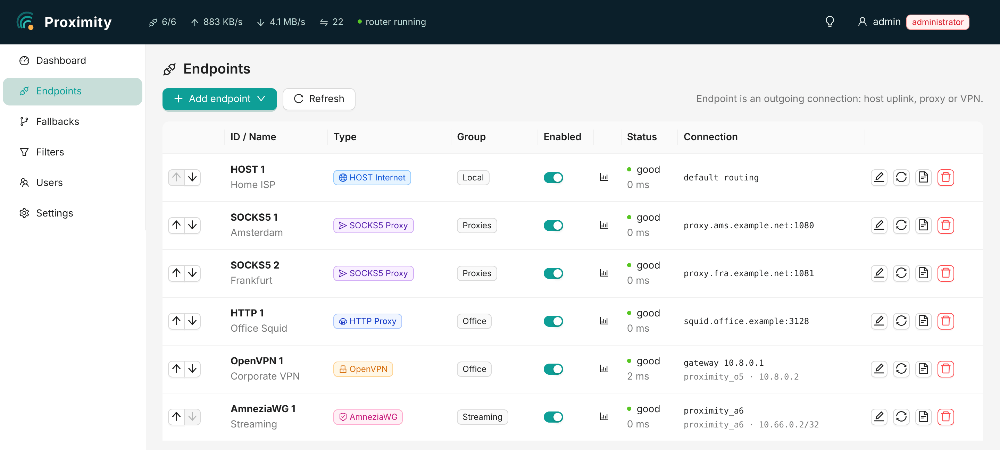

An endpoint is one outgoing connection. The table shows the order (↑ ↓), ID and name, type,
group, the *Enabled* switch, whether statistics are collected, state with latency, and
connection details (server, interface and tunnel address).

Row actions: ✏️ **Edit**, 🔄 **Reconnect**, 📄 **Connection log**, 🗑️ **Delete**.

**Add endpoint** opens a menu with the five types:

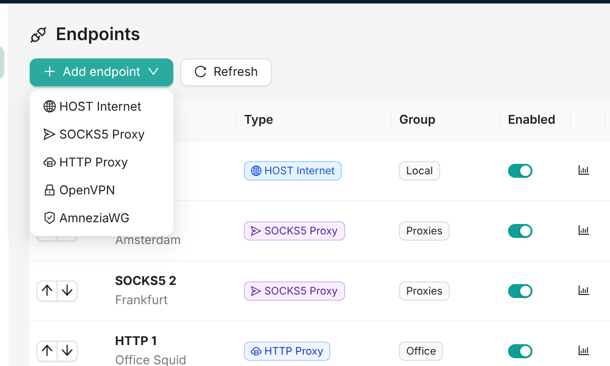

Every endpoint dialog has a **General** tab:

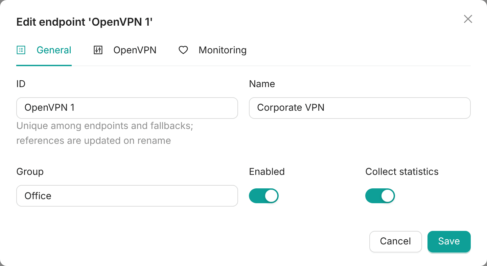

| Field | Meaning |
|---|---|
| ID | Unique among endpoints *and* fallbacks; empty → `<Type> <N>`. Renaming updates all references and does not interrupt a tunnel |
| Name | Free-text description |
| Group | New or existing group label, shown on the Dashboard |
| Enabled | Off: the endpoint is stopped and its filters are skipped |
| Collect statistics | Count traffic and draw it on the chart |

All fields are validated before saving. Changes are applied immediately.

### HOST Internet

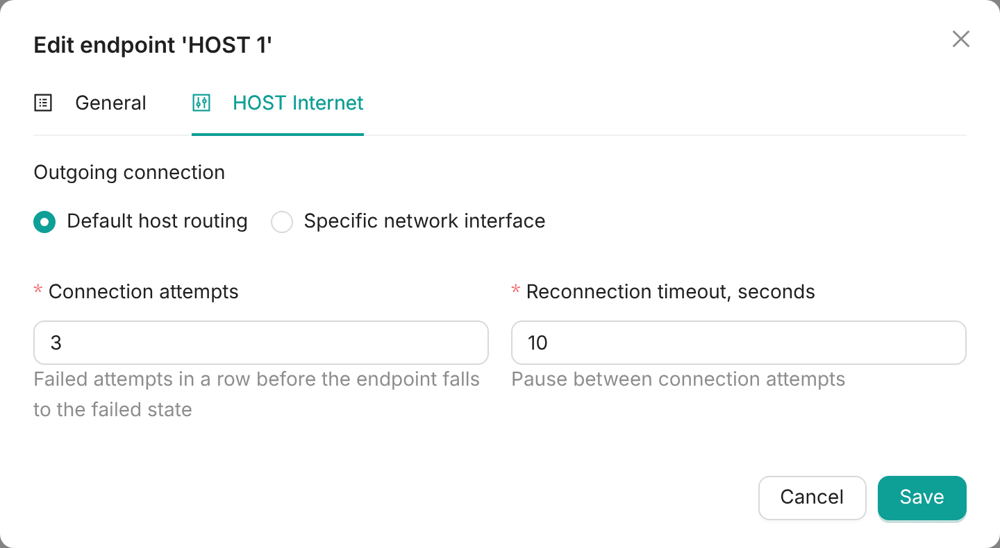

Your own uplink. *Outgoing connection*:

- **Default host routing** — whatever route the host uses;
- **Specific network interface** — pick an interface (`eth0`, `wlan0`, …); add a
  *Gateway* when that interface has no default route of its own.

*Connection attempts* (default 3) and *Reconnection timeout* (10 s) control when the
endpoint is declared `failed`. It keeps being checked and returns to `good` by itself.

### SOCKS5 Proxy

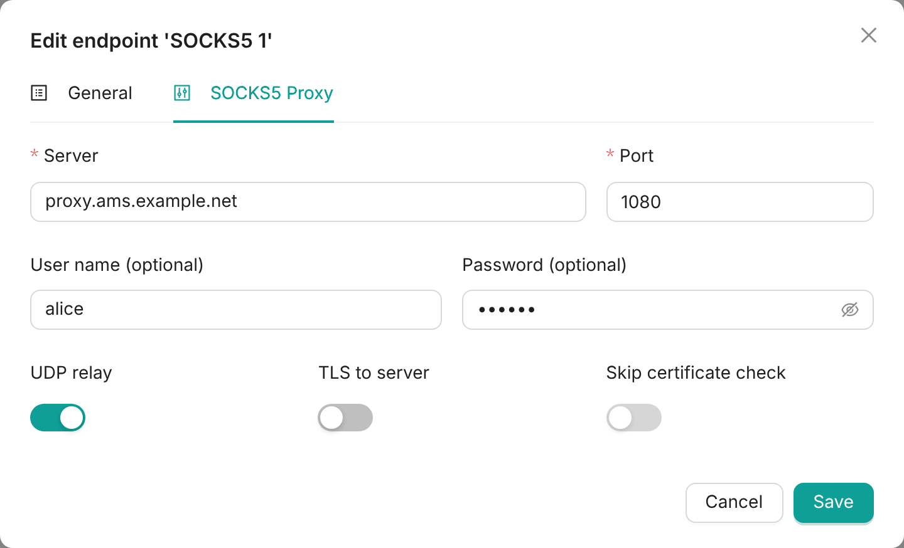

Server (IP or host name), port (1080), optional user name and password, *TLS to server*
with *Skip certificate check*, and *UDP relay* for UDP traffic through the proxy.

### HTTP Proxy

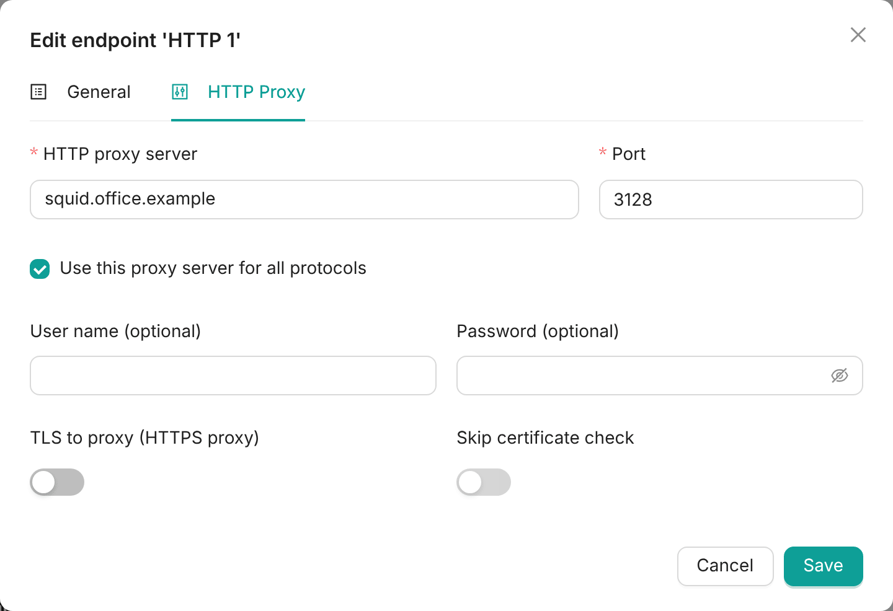

Server and port (3128). *Use this proxy server for all protocols* is on by default; turn it
off to set separate **HTTPS** and **FTP** proxy servers (empty → the HTTP proxy is used).
Proxy credentials and *TLS to proxy (HTTPS proxy)* are optional.

### OpenVPN

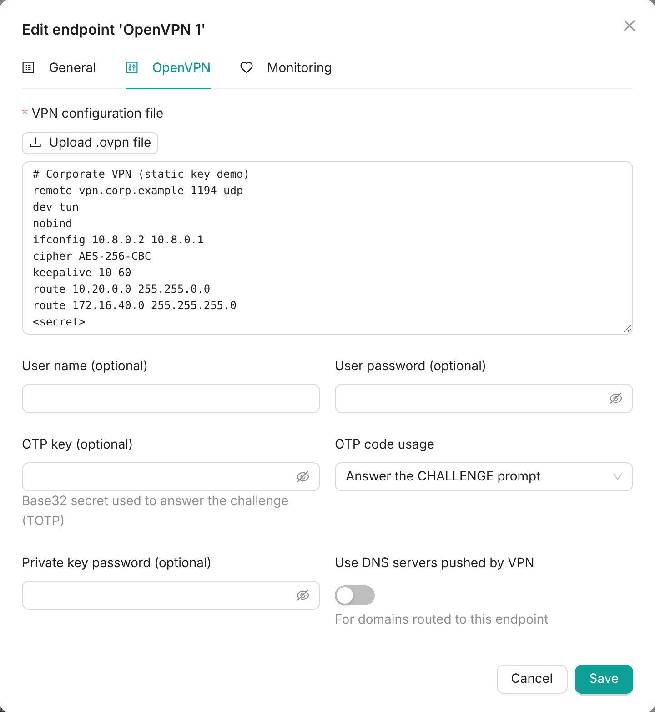

- **VPN configuration file** — *Upload .ovpn file* or paste/edit the text; inline
  `<ca>`, `<cert>`, `<key>`, `<tls-auth>` blocks are supported.
- **User name / User password** — answered automatically when the server asks.
- **OTP key** — base32 TOTP secret; *OTP code usage* is either *Answer the CHALLENGE
  prompt* or *Append code to the password*.
- **Private key password** — if the client key is encrypted.
- **Use DNS servers pushed by VPN** — resolve the domains of filters that target this
  endpoint through the VPN's DNS.

Directives that would break Proximity's control (`dev`, `up`, `script-security`, `daemon`,
`management` …) are removed automatically. Routes pushed by the server appear in Filters
as **Routes of OpenVPN N**.

### AmneziaWG

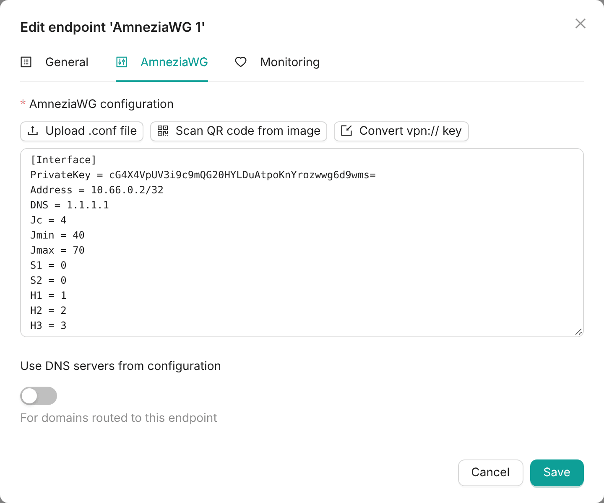

- **Upload .conf file** or paste the configuration.
- **Scan QR code from image** — choose a screenshot/photo of the QR code from the Amnezia
  app; it is decoded in the browser.
- **Convert vpn:// key** — paste the `vpn://…` key exported by the Amnezia app and press
  the button: it is replaced with a normal configuration.
- **Use DNS servers from configuration** — use the `DNS =` servers for the domains routed
  to this endpoint.

### Monitoring

Tunnels (OpenVPN, AmneziaWG) have a **Monitoring** tab:

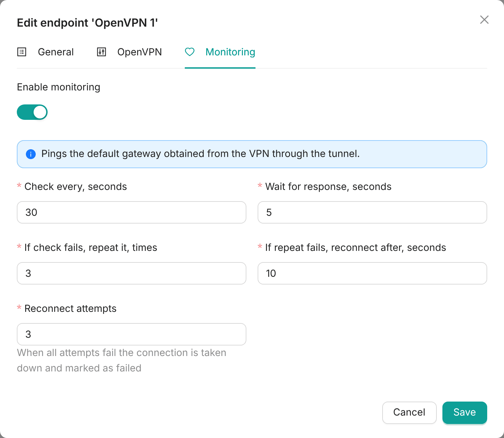

| Field | Meaning |
|---|---|
| Enable monitoring | Turn the checks on |
| Check every, seconds | Interval between checks |
| Wait for response, seconds | Timeout of one check |
| If check fails, repeat it, times | Retries before reconnecting |
| If repeat fails, reconnect after, seconds | Pause before a reconnect |
| Reconnect attempts | After this many failed reconnects the tunnel is taken down and marked `failed` |
| Check target (host:port) | AmneziaWG: TCP target reached through the tunnel |

OpenVPN is checked by pinging the VPN gateway through the tunnel.

### Connection log

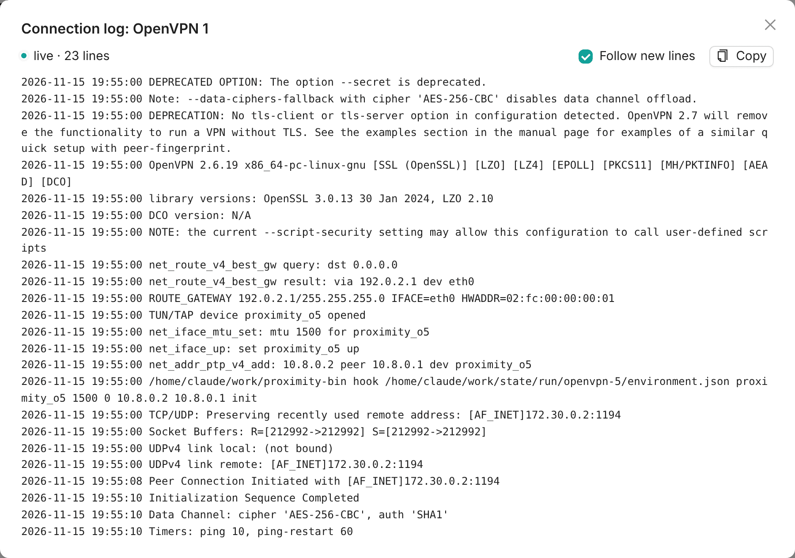

The live log of an endpoint (last 300 lines): process output, answered prompts, applied
routes, check results. It refreshes every 1.5 s; **Follow new lines** keeps it scrolled to
the bottom, **Copy** copies the whole log.

## Fallbacks

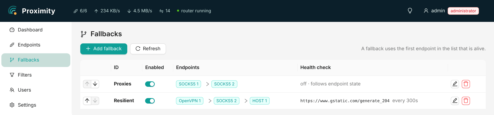

A fallback is a group of endpoints that filters can target as one. Order matters: the
first usable member is used.

| Field | Meaning |
|---|---|
| ID | Unique among endpoints and fallbacks; empty → `Fallback <N>` |
| Enabled | Off: the fallback and its filters are skipped |
| Endpoints (in priority order) | Add with *Add endpoint…*, reorder with ↑ ↓, remove with ✕ |
| Enable health check | **Off** (default): the first member that Proximity sees as good. **On**: mihomo requests *Health check URL* through every member each *Interval* seconds and uses the first that answers |

## Filters

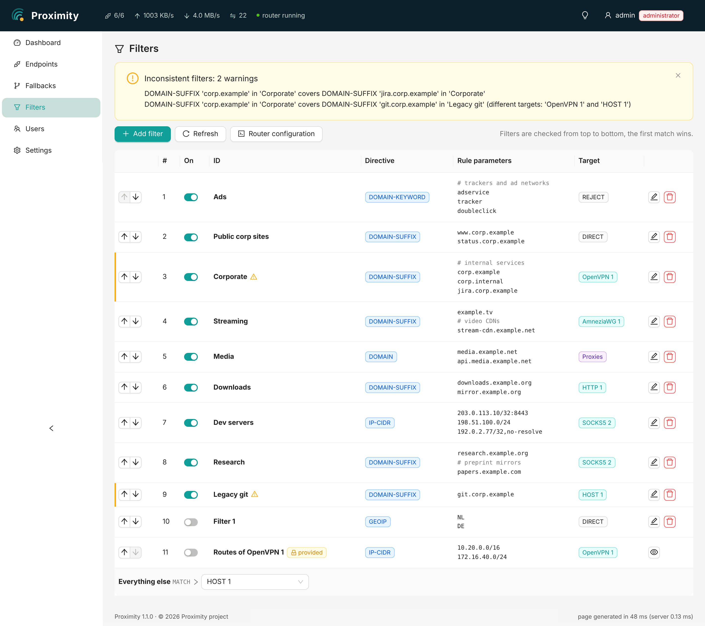

Filters are checked from top to bottom; the first match wins. The table shows the order,
the *On* switch, ID, directive, parameters (comments dimmed), and the target. Rows with a
⚠ are involved in a warning listed at the top. **Everything else (MATCH)** at the bottom
sets the default target.

- **Add filter** / ✏️ — the editor with a live preview of the generated router rules:

  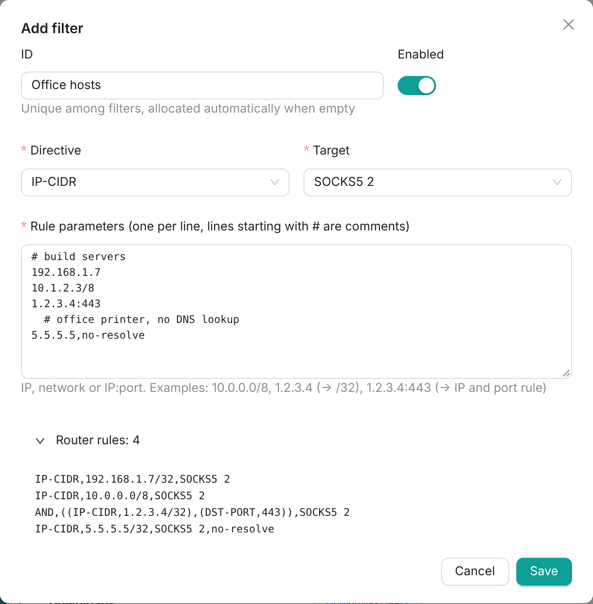

- 🔒 **provided** filters come from a VPN; they are read-only (👁 to view) but can be
  enabled and moved.
- **Router configuration** — the complete generated mihomo configuration, read-only:

  

The full reference, with all directives, normalization rules and recipes, is in
[Filters](filters.md).

## Users

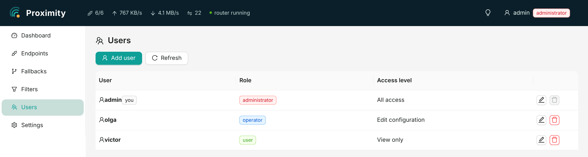

Administrators manage accounts here: **Add user**, change role or password (leave the
password empty to keep it), delete. Roles:

| Role | Can |
|---|---|
| Administrator | everything, including users and settings |
| Operator | edit endpoints, fallbacks and filters; export and import the configuration |
| User | view everything except secrets |

Every user can change their own password from the user menu in the header. A password
change signs the user out of all other sessions.

## Settings

**Router**

| Setting | Meaning |
|---|---|
| Proxy port (HTTP + SOCKS5) | mihomo mixed port, default 7899. In bridge mode it must match the port published by Docker |
| Bind address | `*` = all addresses. In host mode `PROXIMITY_PROXY_BIND` overrides it |
| Router log level | mihomo log level: `silent`, `error`, `warning`, `info`, `debug` |
| Route all outgoing connections of the host through Proximity | Transparent capture. Available only in host network mode (Linux, `docker-compose.yml`) |
| IPv6 | Enable when the host has IPv6; otherwise IPv6 traffic bypasses the filters |
| Enable connectivity checks | Periodically check HOST endpoints and proxy servers |
| Probe target (host:port) | Target for HOST checks, default `1.1.1.1:443` |
| Check interval, seconds | How often |

**Access** — *Anonymous users can view the dashboard*.

**Backup & Restore** (Administrator, Operator) — *Export configuration* downloads one
JSON file with endpoints (including passwords and VPN keys), fallbacks, filters and
settings; *Import configuration* replaces them after confirmation. User accounts are not
included; an Operator's import keeps the current settings.

Only an administrator can change settings; other roles see them read-only.

## Themes

The 💡 button in the header switches between light and dark themes; the choice is stored
in the browser.

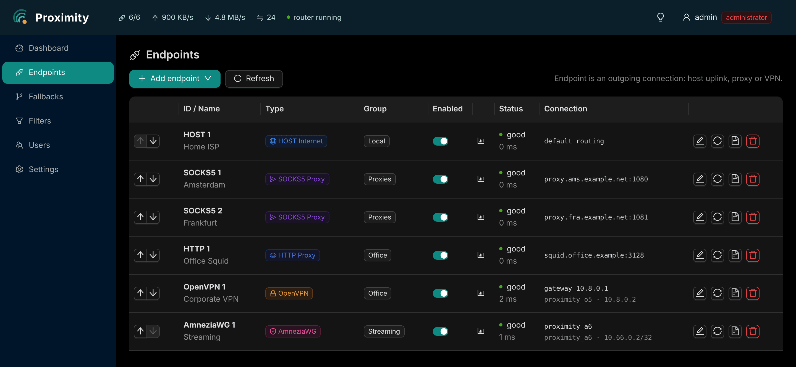
