# User guide

A tour of every page of the Proximity web UI (<http://localhost:8899>).

> Screenshots were taken from a running Proximity 1.2.0 instance with a live OpenVPN
> tunnel, SOCKS5 and HTTP proxies, an OpenVPN and a SOCKS5 inbound and generated traffic.
> Host names such as `corp.example` and `proxy.example` are placeholders.

- [Layout](#layout)
- [Dashboard](#dashboard)
  - [Connection map](#connection-map)
- [Outbounds](#outbounds)
  - [HOST Network](#host-network)
  - [SOCKS5 Proxy](#socks5-proxy)
  - [HTTP Proxy](#http-proxy)
  - [OpenVPN](#openvpn)
  - [AmneziaWG](#amneziawg)
  - [Monitoring](#monitoring)
  - [Connection log](#connection-log)
- [Routes](#routes)
  - [Fallbacks](#fallbacks)
- [Inbounds](#inbounds)
- [Settings](#settings)
- [Themes](#themes)

## Layout

| Area | Contents |
|---|---|
| **Header** | Logo; outbounds in good state / enabled; current upload and download rate; active connections; `transparent` when the host's traffic is captured; router state; theme switch; current user and role (menu: *Change password*, *Sign out*) |
| **Left column** | Dashboard, Outbounds, Routes, Inbounds, Settings — only the sections your role may open. The column can be collapsed |
| **Center** | The selected section. The URL keeps the section (`#/routes`), so you can bookmark it |
| **Footer** | Version, copyright, page generation time (total and server) |

All lists refresh themselves; the **Refresh** buttons force an immediate reload. When
Proximity itself was updated or restarted, the open page notices it within 3 seconds and
reloads itself; with an open dialog it shows a notice with **Reload now** instead and
reloads when the dialog is closed, so typed values are not lost.

When the settings file was damaged at start, a yellow message *Proximity started with a
damaged configuration* stands above every section for signed-in users. Proximity starts
anyway with everything that is valid: a block that cannot be read or checked (an outbound,
a fallback, a route, an inbound, a user, the settings) is dropped, the rest works. The
message lists every dropped element with the reason, and the routes and inbounds that
are kept but point to a dropped element. The file as it was before the start is kept in
the settings folder as `proximity.invalid-<time>.json`. An Administrator closes the
message; until then it also survives restarts.

## Dashboard

The dashboard has four tabs; the selected one is remembered in the browser:

| Tab | Contents |
|---|---|
| **Overview** | Summary cards, the throughput and connections charts |
| **Connection map** | A live diagram of sources, routes, fallbacks and outbounds, see [Connection map](#connection-map) (signed-in users) |
| **Outbounds** | State, latency and traffic of every outbound; the tab shows *good / total* |
| **Unreachable routes** | Connections that failed, with the reason and the matched rule (signed-in users); the tab shows their number |

**Overview** — **cards** at the top: outbounds (good / total, enabled), routes (and the number
of active router rules), total uploaded and downloaded bytes with the current rate, and
the router state with its uptime. The capture mode is shown in the header
(`transparent`).

**Throughput** — an interactive chart of the upload and download rate of every outbound
that collects statistics, plus a dashed **Total** line.

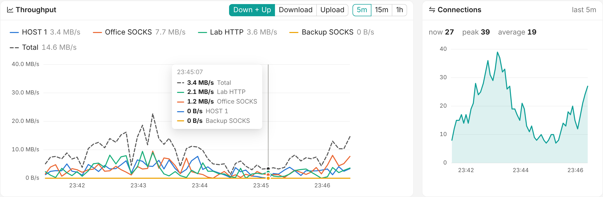

- *Down + Up* / *Download* / *Upload* — what to plot;
- *5m* / *15m* / *1h* — time window (samples every 5 seconds);
- click a legend item to hide or show a series;
- hover to see exact values at a moment in time;
- gaps in a line mean the outbound had no samples (for example, it was disabled).

**Connections** — to the right of the throughput chart (30% of the width): the number of
active connections over the same time window, with the current, peak and average values.
Hover to see the exact count at a moment in time. On narrow screens it moves below the
throughput chart.

**Outbounds** tab — a table: status (enabled / disabled / unused — not referenced by any route or
fallback), operation state (`good`, `connecting`, `reconnecting`, `failed`), tunnel link
state and interface, latency, total traffic, current rates with the number of
connections, time since the last state change.

**Unreachable routes** tab (signed-in users) — connections that failed, grouped by destination:

| Column | Meaning |
|---|---|
| Destination | host and port |
| Reason | `refused`, `timeout`, `no route`, `unreachable`, `dns`, … |
| Via | the outbound or fallback that was used |
| Matched rule | the mihomo rule that sent the connection there (`Match/` = default target) |
| Count, Last seen | how often and how recently |

Operators can **Clear** the list.

When *Anonymous users can view the dashboard* is on, the Dashboard is visible without
signing in: only the **Overview** and **Outbounds** tabs, with secrets hidden.

### Connection map

A live picture of what is connected to what, from left to right:

| Column | Items |
|---|---|
| Sources | *Host applications* (transparent capture), the *Proxy port* and every inbound |
| Router | mihomo, which checks the routes |
| Routes | routes in priority order (`#1`, `#2` …) and *Everything else* (`MATCH`) |
| Fallbacks | fallbacks; numbered edges show the priority of their outbounds, the filled number is the outbound in use |
| Outbounds | outbounds with the remote server, latency and rate, plus `DIRECT` and `REJECT` when used |
| Internet | destination servers |

An inbound whose outbound is not *Router* is connected straight to its outbound (dotted
edge). The color of an item and of the edges that lead to it shows the state: green —
good, blue — connecting, amber — warning, red — down or failed, gray — disabled or
stopped. Moving dashes show the edges that carry traffic now; the edge from an outbound to
the Internet gets thicker with the rate.

- Hover over an item to highlight everything that leads to it and everything it leads to,
  and to see its details. The popup also has an **on/off** switch and, for outbounds,
  inbounds and the router, **Start**, **Stop** and **Restart**:

  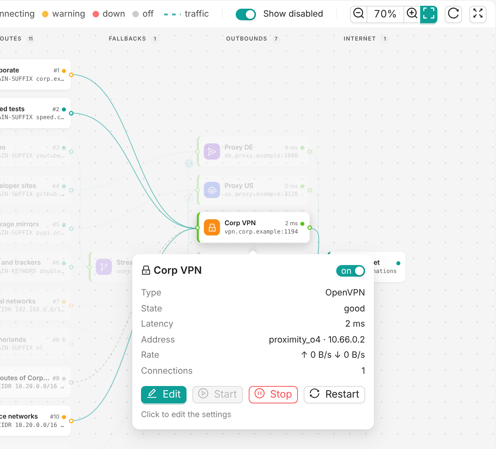

- Click an outbound, inbound, route, fallback or *Everything else* to open its settings
  dialog (operators and administrators). Changes are applied at once and the map is
  redrawn. Click the router or a source to open Settings.
- **Show disabled** hides or shows disabled items.
- **Zoom**: turn the mouse wheel over the map (the point under the cursor stays in place),
  or use **−** / **+**; the percentage button returns to 100%. **Fit to screen** (on by
  default) scales the map so that it fits the window and keeps it fitted when the window
  is resized. A map larger than the window gets scroll bars; drag an empty place to move
  it, or hold **Shift** and turn the wheel to scroll sideways. The zoom is remembered in
  the browser.
- **Full screen** (the last button) spreads the map over the whole screen; dialogs and
  popups work there too. **Esc** or the same button returns to the dashboard.

Each item shows a colored icon of its type, the ID, a short description (remote server,
directive and first parameter, port) and a metric on the right: latency for outbounds,
`#N` for routes, the number of connected clients for OpenVPN inbounds. The map is redrawn
every 3 seconds.

## Outbounds

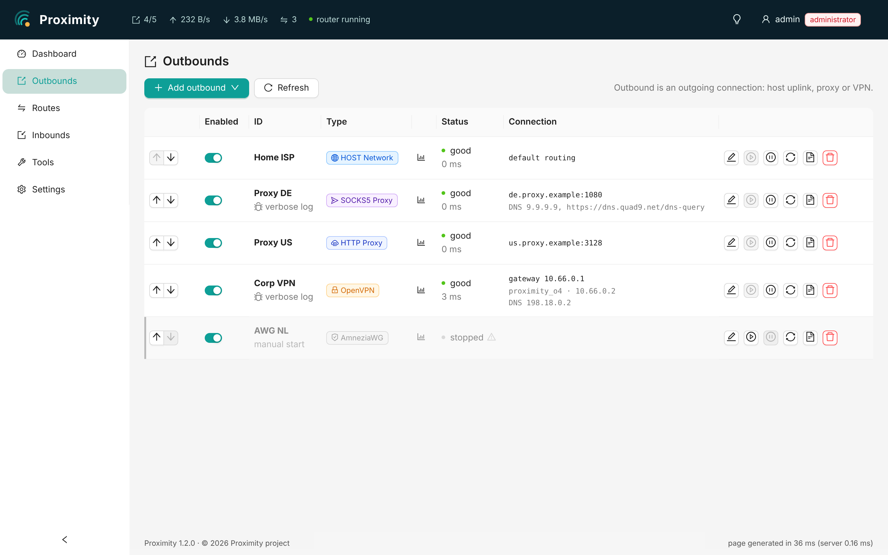

An outbound is one outgoing connection. The table shows the order (↑ ↓), the *Enabled* switch,
ID (*manual start* when autostart is off), type, whether statistics are collected, state with latency, and connection details (server, interface and tunnel
address).

Rows are tinted by state with the colors of the connection map: blue while the outbound is
connecting or reconnecting, red when it is down or failed. Disabled and stopped rows are gray
with dimmed text (the switches and buttons stay clear). Rows in good state are not tinted. The same applies to the inbounds table, to the *Outbounds* tab
of the Dashboard, to routes and to fallbacks (see below).

Row actions: ✏️ **Edit**, ▶ **Start**, ⏸ **Stop** (with confirmation), 🔄 **Restart**,
📄 **Connection log**, 🗑️ **Delete**. A stopped HOST or proxy outbound is no longer checked
and is skipped by fallbacks; routes that name it directly still use it.

A stopped or failed outbound keeps its state after a container restart: it is not started
again until **Start** or **Restart** is pressed (or its settings change, for a failed one).
The log is kept too, so the reason of the last failure stays visible.

**Add outbound** opens a menu with the five types:

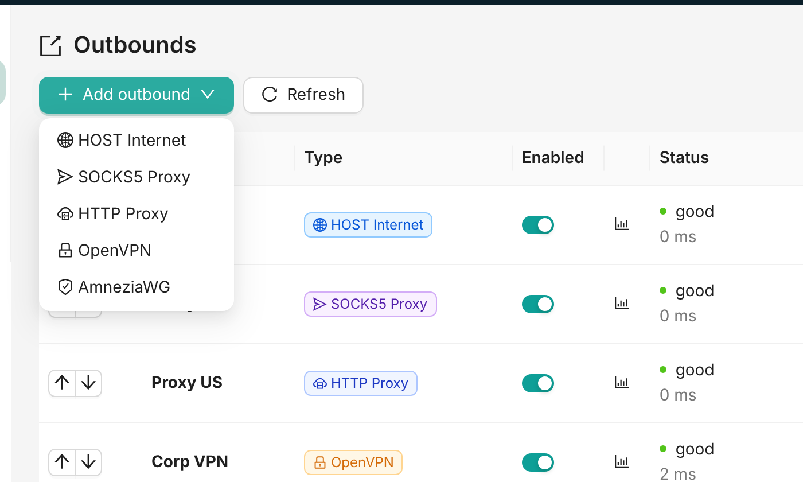

Every outbound dialog has a **General** tab:

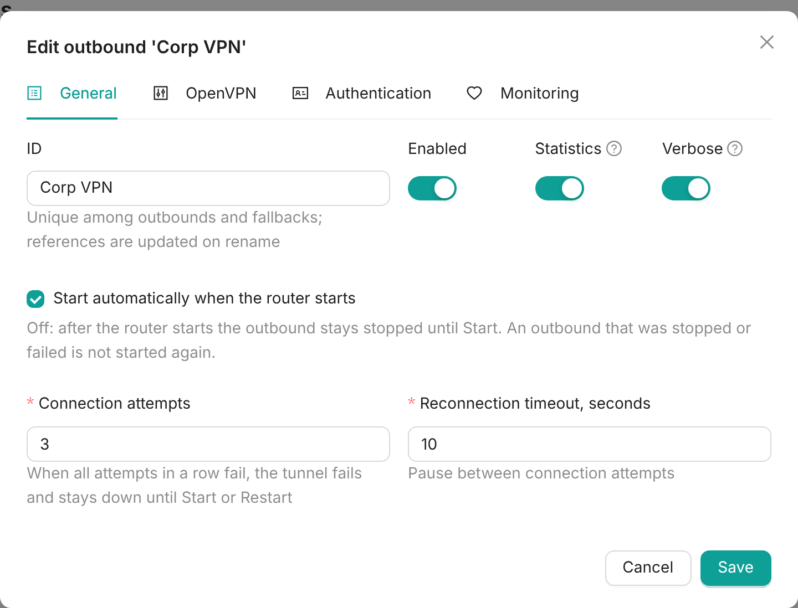

| Field | Meaning |
|---|---|
| ID | Unique among outbounds *and* fallbacks; empty → `<Type> <N>`. Renaming updates all references and does not interrupt a tunnel |
| Enabled | Off: the outbound is stopped and its routes are skipped |
| Start automatically when the router starts | On by default. Off: after the router starts, the outbound stays stopped until **Start** |
| Connection attempts | Default 3. Failed attempts in a row before the connection is considered lost; what happens next is set by *Restore lost connections* on the **Monitoring** tab |
| Reconnection timeout, seconds | Default 10. Pause between attempts |
| Statistics | Count traffic and draw it on the chart |
| Verbose | Off by default. Writes detailed debug information to the [connection log](#connection-log) (see below) |

All fields are validated before saving. Changes are applied immediately.

**Verbose** is meant for finding problems. A verbose outbound is marked *verbose log* in the
table, and its log keeps more lines: 3000 instead of 300 by default, both numbers are set in
[Settings → Miscellaneous](#miscellaneous). It adds:

- `debug:` lines from Proximity: the settings in effect, every attempt and state change,
  every connectivity check with its time, the routing table and the command line of the
  tunnel process;
- every connection that goes through the outbound: source, target, matched route, chain and
  process, and when it closes, its duration and traffic (connections shorter than 0.5 s may
  be missed; at most 20 new connections are listed per second);
- maximum verbosity of the external program: OpenVPN runs with `--verb 6` instead of
  `--verb 3` (every packet is logged), AmneziaWG with `LOG_LEVEL=verbose` instead of
  `error`.

Switch it off when the problem is found: OpenVPN at `--verb 6` writes thousands of lines.

### HOST Network

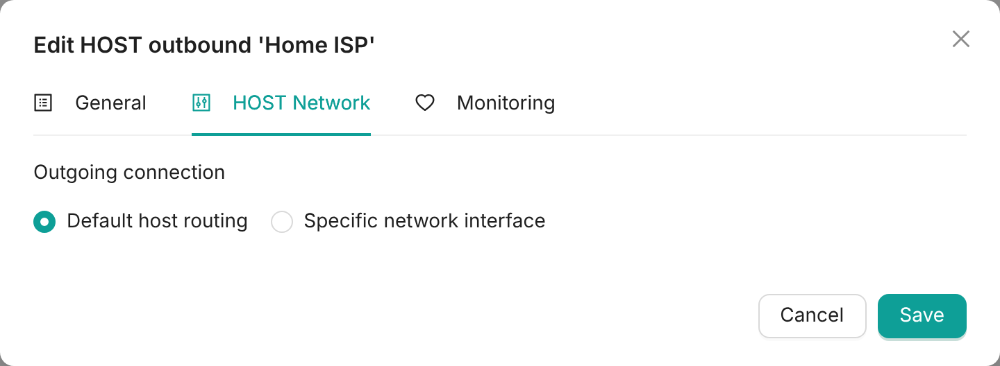

Your own uplink. *Outgoing connection*:

- **Default host routing** — whatever route the host uses;
- **Specific network interface** — pick an interface (`eth0`, `wlan0`, …); add a
  *Gateway* when that interface has no default route of its own.

### SOCKS5 Proxy

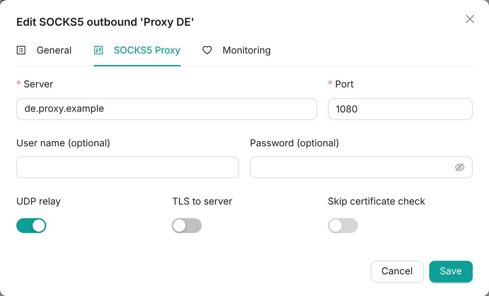

Server (IP or host name), port (1080), optional user name and password, *TLS to server*
with *Skip certificate check*, and *UDP relay* for UDP traffic through the proxy.

### HTTP Proxy

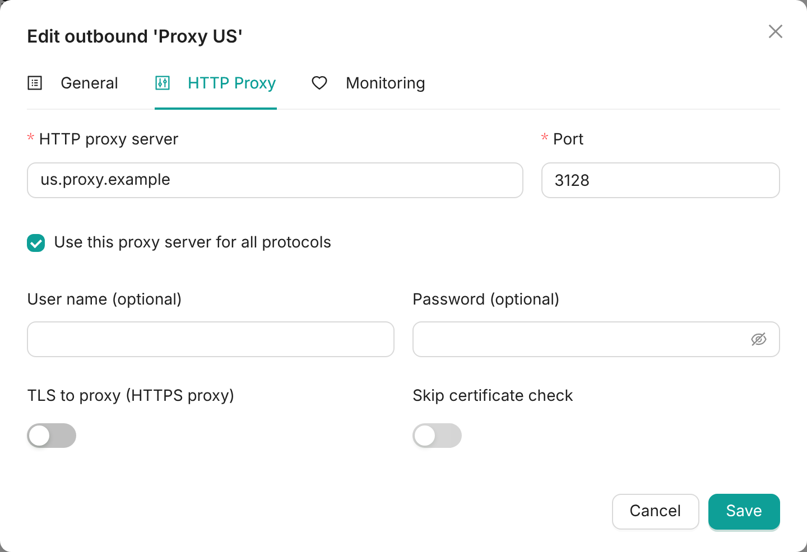

Server and port (3128). *Use this proxy server for all protocols* is on by default; turn it
off to set separate **HTTPS** and **FTP** proxy servers (empty → the HTTP proxy is used).
Proxy credentials and *TLS to proxy (HTTPS proxy)* are optional.

### OpenVPN

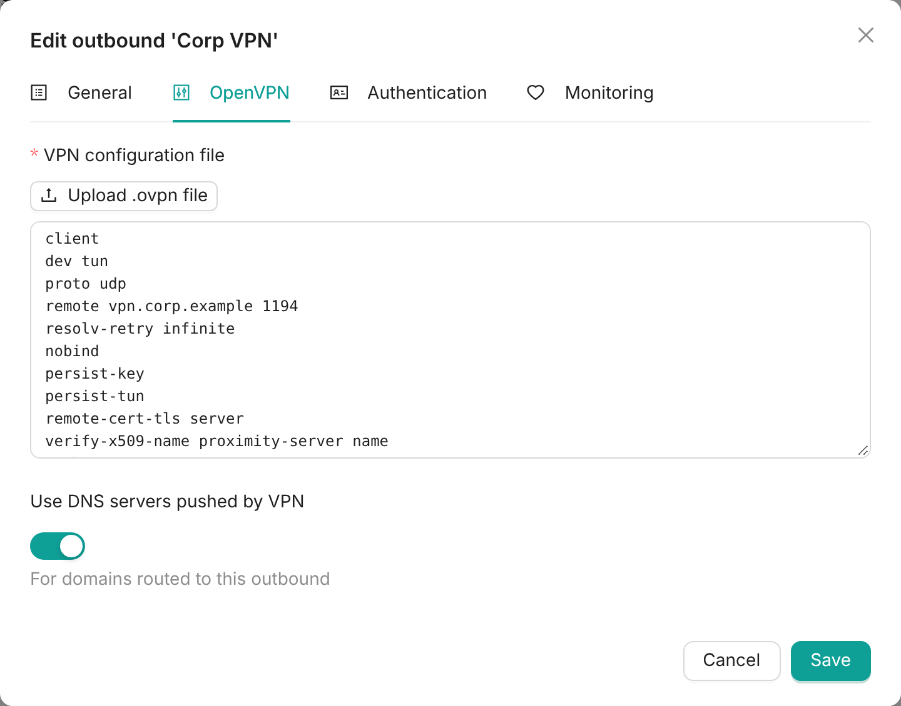

Tabs: **General**, **OpenVPN**, **Authentication**, **Monitoring**.

**OpenVPN** tab (above):

- **VPN configuration file** — *Upload .ovpn file* or paste/edit the text; inline
  `<ca>`, `<cert>`, `<key>`, `<tls-auth>` blocks are supported. The editor numbers the
  lines and highlights them: directives, protocols and other keywords, host names, IP
  addresses, netmasks and ports, comments, inline block tags, certificates; private keys,
  static keys and the password of `<auth-user-pass>` are shown in red.
- **Use DNS servers pushed by VPN** — resolve the domains of routes that target this
  outbound through the VPN's DNS.
- **Receive routes** — keep a route with the networks announced by the VPN; it is on only
  while the connection is up (see [Routes provided by a VPN](routes.md#routes-provided-by-a-vpn)).
  AmneziaWG has the same switch: its networks are the `AllowedIPs`.

**Authentication** tab:

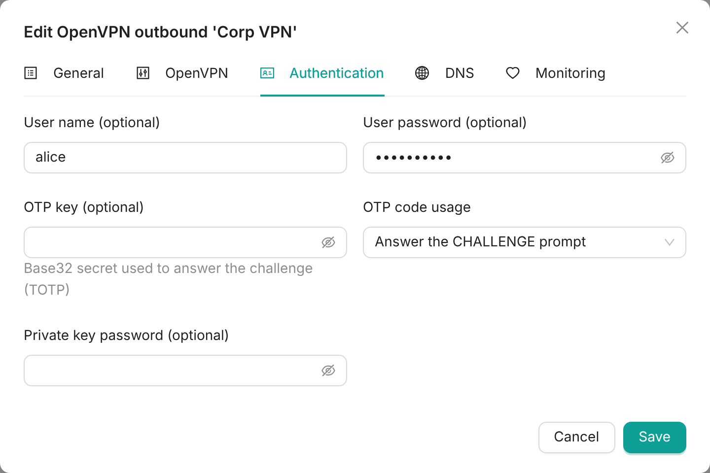

- **User name / User password** — answered automatically when the server asks.
- **OTP key** — base32 TOTP secret; *OTP code usage* is either *Answer the CHALLENGE
  prompt* or *Append code to the password*.
- **Private key password** — if the client key is encrypted.

Directives that would break Proximity's control (`dev`, `up`, `script-security`, `daemon`,
`management` …) are removed automatically. With **Receive routes** on, the routes pushed by
the server appear in Routes as **Routes of OpenVPN N**.

### AmneziaWG

- **Upload .conf file** or paste the configuration. The editor highlights sections, keys,
  addresses and masks, the endpoint, numbers of the obfuscation parameters (`Jc`, `Jmin`,
  `Jmax`, `S1`, `S2`, `H1`–`H4`) and shows `PrivateKey` and `PresharedKey` in red.
- **Scan QR code from image** — choose a screenshot/photo of the QR code from the Amnezia
  app; it is decoded in the browser.
- **Convert vpn:// key** — paste the `vpn://…` key exported by the Amnezia app and press
  the button: it is replaced with a normal configuration.
- **Use DNS servers from configuration** — use the `DNS =` servers for the domains routed
  to this outbound.

### Monitoring

Every outbound and inbound has a **Monitoring** tab. It starts with the recovery settings:

| Field | Meaning |
|---|---|
| Restore lost connections | On by default. When all *Connection attempts* fail, Proximity waits and starts a new series of attempts; the state is `reconnecting` with the message `recovery attempt N: …`. Off: the service becomes `failed` and waits for **Start** / **Restart** |
| Restore after, seconds | Default 60 (1…86400). Pause before a new series of attempts |
| Recovery attempts | Default 0 — unlimited. Otherwise the number of series in a row (1…1000) after which the service becomes `failed`. The counter is reset when the connection works again |

Recovery covers everything that can pass by itself: an unreachable server, a timeout, a
failed monitoring check, time that is not synchronized yet, a busy port of an inbound.
Errors of a tunnel or inbound that need your action are not retried and end as `failed`
at once: `… is required by server`, `invalid private key password`, `server certificate
is rejected`, an overlapping tunnel network, a broken configuration. `authentication
failed` is never restored either, so that rejected credentials are not repeated without
an end: with an OTP key the attempts of the current series are used (each with a fresh
code), without it — one attempt. A HOST or proxy outbound stays `failed` between the checks and
returns to `good` by itself; for it *Restore after* is the interval of these checks.

Tunnels (OpenVPN, AmneziaWG) also have the checks of a working connection below. A failed
check is one of the signals that the connection is lost: it starts reconnection without
waiting for the tunnel itself to notice.

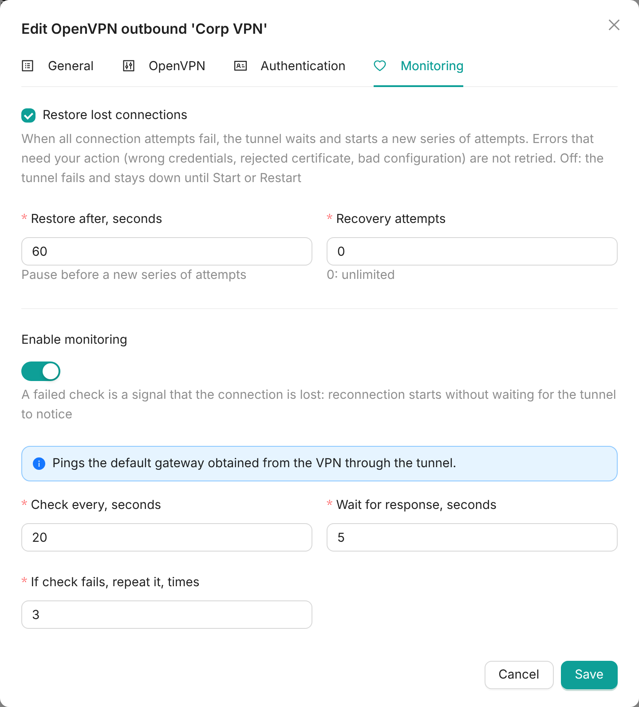

| Field | Meaning |
|---|---|
| Enable monitoring | Turn the checks on |
| Check every, seconds | Interval between checks |
| Wait for response, seconds | Timeout of one check |
| If check fails, repeat it, times | Retries before the tunnel is reconnected (attempts and pause — on the **General** tab) |
| Check target (host:port) | AmneziaWG: TCP target reached through the tunnel |

OpenVPN is checked by pinging the VPN gateway through the tunnel.

### Connection log

The live log of an outbound (last 300 lines, 3000 with *Verbose*; see
[Miscellaneous](#miscellaneous)): process output, answered prompts, applied
routes, check results, starts and stops. It is saved in `logs/` of the settings folder and
survives container restarts. It refreshes every 1.5 s; **Follow new lines** keeps it scrolled to
the bottom, **Copy** copies the whole log, **Download** saves it as
`outbound-<ID>-<date>-<time>.log` (`inbound-…` for inbounds, time in UTC).

Lines are highlighted (the same in the inbound log):

| Look | Lines |
|---|---|
| gray date, bold time | the time stamp of every line |
| red text, red bar on the left | errors: *failed*, *refused*, *timeout*, *panic*, *fatal*, *AUTH_FAILED* … |
| amber text, amber bar | warnings: *warning*, *retry*, *reconnect*, OpenVPN *Note:* lines |
| green | success: *Initialization Sequence Completed*, *Peer Connection Initiated*, *VERIFY OK* |
| teal | Proximity's own events: *starting*, *stopped* |
| dimmed | debug details: `net_route_…`, `TLS:`, `Timers:` |

Inside a line, IP addresses (with mask and port) are blue, quoted text is teal, and level
words such as `level=warning` or `[ERROR]` become colored labels. Web links (`http://`,
`https://`) are clickable and open in a new browser tab. The counters next to the line
count show how many errors and warnings the log has.

## Routes

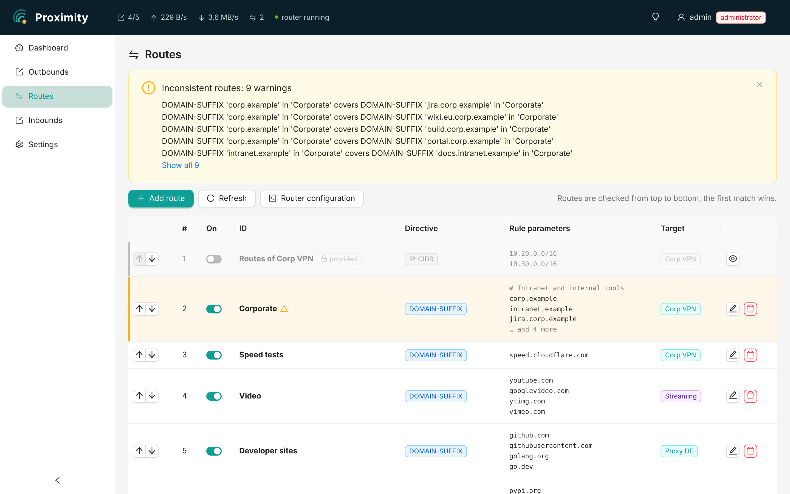

Routes are checked from top to bottom; the first match wins. The table shows the order,
the *On* switch, ID, directive, parameters (comments dimmed), and the target. Rows with a
⚠ are involved in a warning listed at the top. **Everything else (MATCH)** at the bottom
sets the default target.

A route row is tinted by the state of its target: red when the target outbound is down or
failed, the fallback has no alive outbound, or the target does not exist; blue while the
target is connecting or reconnecting; yellow when the route is involved in a warning; gray
when the route is off. The states refresh every 3 seconds.

- **Add route** / ✏️ — the editor with syntax highlighting, a toolbar (**Load from file**,
  **Save to file**, **Sort A–Z**) and a live preview of the generated router rules:

  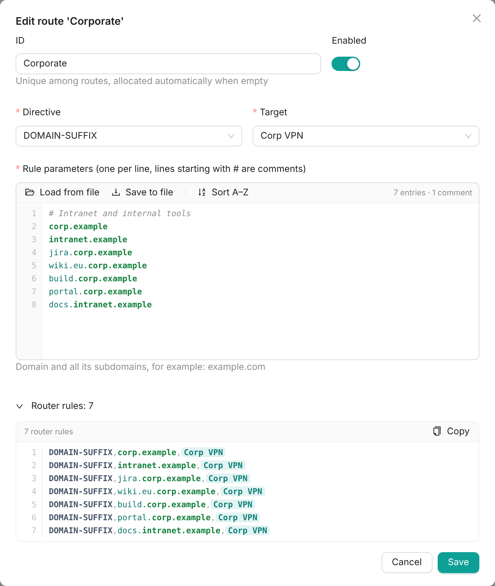

  Domains, subdomains, wildcards, IP addresses, masks, ports, options and comments get
  their own colors; impossible values (an octet above 255, a mask above 32) are underlined
  in red. The expandable **Router rules** list below the editor is highlighted the same
  way, numbered, and has a **Copy** button. The colors are listed in
  [Routes](routes.md#fields-of-a-route).

- 🔒 **provided** routes come from a VPN outbound with *Receive routes* on; they are
  read-only (👁 to view) and switch themselves on and off with the connection, but can be
  moved.
- **Router configuration** — the complete generated mihomo configuration, read-only, with
  numbered lines and highlighting: keys, strings, numbers and `true` / `false`, IP addresses
  and masks, domains, ports, outbound and fallback names; the `rules` list is highlighted
  like the router rules preview. **JSON / YAML** switches the format (remembered by the
  browser): JSON is exactly what mihomo receives, YAML is the same data in the usual mihomo
  form. **Hide passwords** (on by default, remembered by the
  browser) replaces passwords and private keys with `"<hidden>"`; the toolbar shows how many
  values are hidden. **Copy** puts the configuration on the clipboard, **Save** downloads it as
  `mihomo-config-<date>-<time>.json` or `.yaml` (time in UTC); both take the configuration
  as shown, in the selected format, so
  with hidden passwords it can be shared but not used as is:

  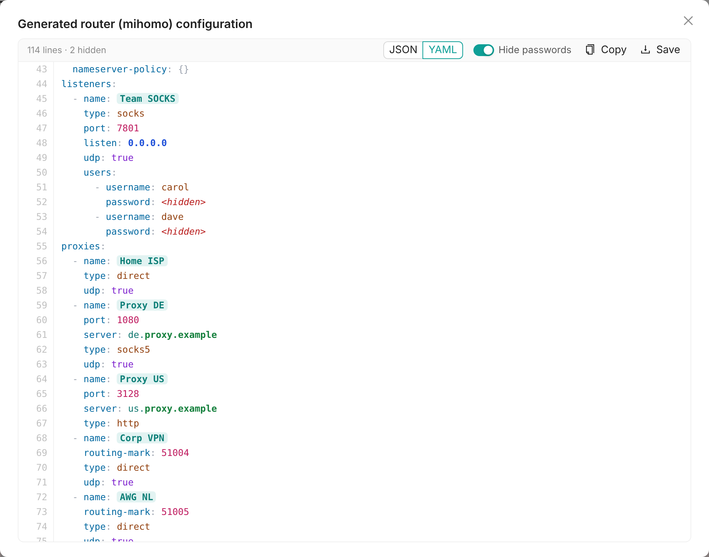

Routes, fallbacks and the default target can also be edited from the
[Connection map](#connection-map): click a route, a fallback or *Everything else*.

The full reference, with all directives, normalization rules and recipes, is in
[Routes](routes.md).

### Fallbacks

The **Fallbacks** section at the bottom of the Routes page lists proxy groups. A fallback
is a group of outbounds that routes can target as one. Order matters: the
first usable member is used. The *Enabled* switch stands before the ID. A fallback row is
red when none of its outbounds is in good state.

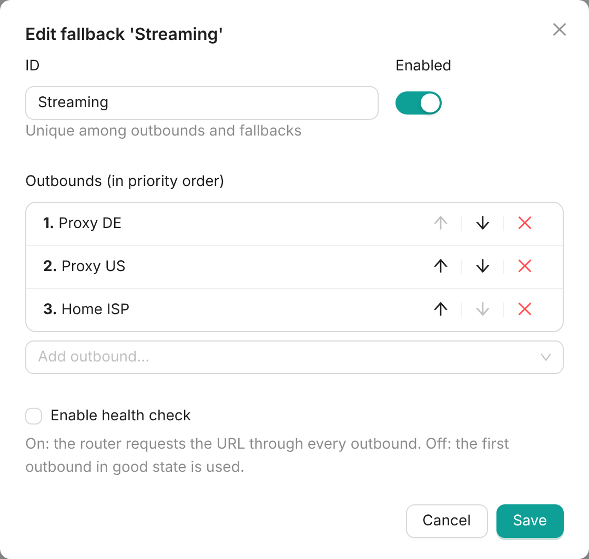

| Field | Meaning |
|---|---|
| ID | Unique among outbounds and fallbacks; empty → `Fallback <N>` |
| Enabled | Off: the fallback and its routes are skipped |
| Outbounds (in priority order) | Add with *Add outbound…*, reorder with ↑ ↓, remove with ✕ |
| Enable health check | **Off** (default): the first member that Proximity sees as good. **On**: mihomo requests *Health check URL* through every member each *Interval* seconds and uses the first that answers |

## Inbounds

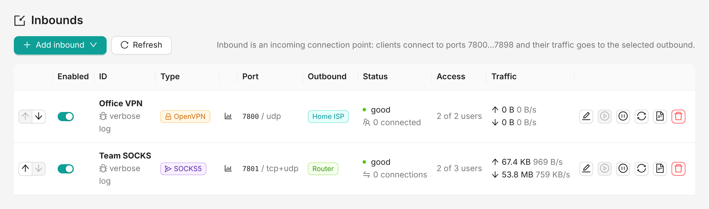

An inbound is an incoming connection point: clients connect to a port of Proximity and
their traffic leaves through the selected outbound. **Add inbound** offers two types:
**SOCKS5 Inbound** (a SOCKS5 proxy server) and **OpenVPN Inbound** (an OpenVPN server).
Changes are applied immediately: saving restarts only the affected inbound, and a change
of users does not interrupt other clients.

The table shows the *Enabled* switch before the ID, then the port, the outbound, the state, connected OpenVPN clients (hover the
counter for names and addresses), users and traffic. Actions: ▶ **Start**, ⏸ **Stop** (with
confirmation), 🔄 **Restart**, 📄 log (kept across restarts). A stopped or failed inbound
keeps its state after a container restart.

### General

| Field | Meaning |
|---|---|
| ID | Unique among inbounds; empty → `SOCKS5 <N>` / `OpenVPN <N>` |
| Enabled | Off: the port is closed |
| Start automatically when the router starts | On by default: the inbound starts with the router (unless it was stopped or failed) |
| Connection attempts | Default 3. Failed starts in a row before the inbound is considered lost; what happens next is set by *Restore lost connections* on the **Monitoring** tab (see [Monitoring](#monitoring)) |
| Reconnection timeout, seconds | Default 10. Pause between attempts |
| Statistics | Count upload and download traffic of the inbound |
| Verbose | Off by default. The inbound log gets `debug:` lines: settings, attempts, state changes, clients that connect and disconnect (OpenVPN), and every connection of its clients with its duration and traffic. The OpenVPN server runs with at least `verb 6`, and the log keeps more lines (3000 by default) |
| Port number | Unique, `7800…7898` (the range published by the Docker files); empty → the first free port |
| Outbound | **Router** — the routes decide, like for the proxy port; **Host** — the host network connection, routes are skipped; or one of the outbounds — everything goes there |

An inbound does not start (state *failed* with the reason) when its outbound is disabled
or deleted, or when anonymous connections are off and there is no enabled user.

### SOCKS5

| Field | Meaning |
|---|---|
| Listen address | `*` or an IPv4 address of the host |
| UDP relay | SOCKS5 `UDP ASSOCIATE` |
| TLS | SOCKS5 over TLS. The certificate and the key are generated (self-signed) when TLS is switched on; replace them or press **Regenerate** |

### OpenVPN

The OpenVPN inbound dialog has the tabs **General**, **Server**, **Clients**, **Security**,
**Keys and certificates** and **Users**. When a field is invalid, saving opens its tab.

| Tab | Fields |
|---|---|
| Server | *Public address* and *Public port* (what clients connect to; written to exported configurations), *Protocol* UDP/TCP, *Listen address*, *VPN network* (when empty: `10.<X>.<N>.0/24`, where `<X>` is 64–191 and fixed for this installation, so two installations rarely collide), *Maximum clients*, *Tunnel MTU* (1420 for a new inbound: packets of the tunnel fit a 1500-byte link without fragments), *Log verbosity* |
| Clients | *Route all client traffic through the VPN*, *Clients can reach each other*, *Additional routes* (one IPv4 network per line, up to 64; addresses and masks are highlighted, an invalid line is underlined in red and blocks saving), *DNS servers* (empty: the Proximity resolver, so domain routes work for VPN clients) |
| Security | *Data ciphers*, *HMAC digest*, *Minimum TLS version*, *Renegotiation*, *Keepalive*, *Require one-time code (TOTP)* with the *TOTP key* |
| Keys and certificates | CA certificate and key, server certificate and key, client certificate and key, TLS-crypt key. The fields highlight the `BEGIN` / `END` lines; the body of private and static keys is red |

Keys, certificates, the TLS-crypt key and the TOTP key are generated automatically when
the dialog opens. Every field can be edited (paste your own PEM text) or regenerated with
its **Regenerate** button; *Regenerate CA and all certificates* replaces the whole chain.
After regeneration clients need new configuration files.

The server accepts only the current client certificate. **Regenerate** of the client
certificate is therefore the way to take access away from everybody who has an old
configuration file: after **Save** the old certificate (and any other certificate of the
same CA) is rejected, the inbound log says `client certificate is rejected: it is not the
current client certificate of this inbound`. Export the configuration again for those
who stay.

All users of an inbound share the client certificate and the TOTP key; they differ by user
name and password. With TOTP on, clients are asked for the code together with the password
(`static-challenge`); a client that cannot show a prompt may append the code to the
password.

A one-time code works once. The same code is accepted again only from the same user at
the same address — that is a quick reconnect of the same client. Another user or
another address gets `AUTH_FAILED` (inbound log: `one-time code of user '…' is already
used`) and connects with the next code, at most 30 seconds later. A Proximity outbound
with an OTP key waits for the next code by itself.

After a login the client holds a token and is not asked for a code again: not when the
keys are renewed, and not after a restart of the inbound or of Proximity. The token is
tied to the server key and the TOTP key (regenerate one of them and every client enters
a new code), and a client with a token is still refused when its user is disabled or
deleted.

`ping` of clients: the router carries only TCP and UDP, so a ping to another host could
not follow the routes and would leave through the host connection. It is rejected at
once (*Packet filtered*); `ping` of the server's tunnel address works. An inbound whose
*Outbound* is **Host** sends everything straight to the host connection, and its clients
may ping.

### Users

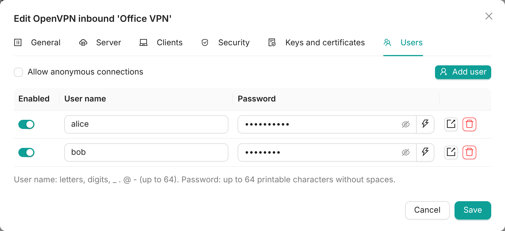

| Element | Meaning |
|---|---|
| Allow anonymous connections | SOCKS5: no authentication at all, the list is not checked. OpenVPN: a client with the certificate connects without user name and password |
| User list | *Enabled*, *User name*, *Password* (⚡ generates a random one), delete |
| Export configuration (OpenVPN) | Saves the inbound and opens a read-only, highlighted preview of the client configuration with **Copy to clipboard** and **Export**. The file is named `<ID>-<username>.conf`. *Embed user name and password* writes the credentials into the file (OpenVPN 2.6 or newer) |

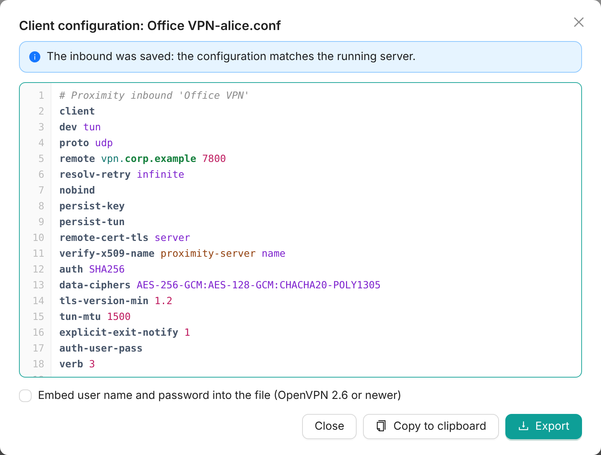

Disabling or deleting an OpenVPN user, or changing the password, disconnects the sessions
of that user at once: the client is told to stop and does not wait for its keepalive
timeout.

## Settings

The page has five sections.

### Router service

The state of the router (mihomo) and the **Start**, **Stop** and **Restart** buttons
(Operator and Administrator). **Stop** asks for confirmation: the proxy port, the
inbounds and the tunnels (OpenVPN, AmneziaWG outbounds) stop, host traffic is no longer
captured (it goes directly); all outbounds stop. **Start** starts the outbounds and
inbounds that have *Start automatically* on and were running before. **Restart** starts a new mihomo process; it also starts a stopped
router.

*Start the router when the container starts* (Administrator, applied at once):

| Option | Router state before the container restart | After the restart |
|---|---|---|
| on | running | running |
| on | stopped | stopped |
| off | any | stopped |

The router state is saved to `router.json` in the settings folder.

### Router

| Setting | Meaning |
|---|---|
| Proxy port (HTTP + SOCKS5) | mihomo mixed port, default 7899. In bridge mode it must match the port published by Docker |
| Bind address | `*` = all addresses. In host mode `PROXIMITY_PROXY_BIND` overrides it |
| Router log level | mihomo log level: `silent`, `error`, `warning`, `info`, `debug` |
| Route all outgoing connections of the host through Proximity | Transparent capture. Available only in host network mode (Linux, `docker-compose.yml`) |
| Keep ping of the host on its routes | On by default. Ping cannot pass a proxy: with this option a ping goes out directly only to addresses whose route (or the default target) is **DIRECT** or a **HOST** outbound, goes through the tunnel when the route is an OpenVPN or AmneziaWG outbound, and other addresses (proxies, fallbacks, REJECT) do not answer. Off: every ping of the host leaves directly, past the routes |
| IPv6 | Enable when the host has IPv6; otherwise IPv6 traffic bypasses the routes |
| Enable connectivity checks | Periodically check HOST outbounds and proxy servers |
| Probe target (host:port) | Target for HOST checks, default `1.1.1.1:443` |
| Check interval, seconds | How often |
| Unreachable routes: Maximum count | Size of the *Unreachable routes* list on the Dashboard, default 100. The oldest entries are removed first |
| Unreachable routes: Maximum lifetime | Entries that did not repeat for this time are removed, default 1 day |

Only an administrator can change these settings; other roles see them read-only.

### Miscellaneous

**Time synchronization.** OpenVPN needs exact time: certificates have a validity period and
one-time codes (TOTP) change every 30 seconds. Proximity never changes the host clock.
Instead it compares the host clock with NTP servers:

| Result | State | What happens |
|---|---|---|
| The host clock differs by no more than the allowed deviation | 🟢 *Host clock is used* | Everything uses the host clock |
| The host clock is wrong | 🟡 *Proximity's own time is used* | OpenVPN clients and servers run with the measured offset (through `libfaketime`), one-time codes are generated and checked with the corrected time |
| NTP servers do not answer, but the host reports a synchronized clock (NTP daemon on the host) | 🟢 *Host clock is used* | As above |
| NTP servers do not answer and the host clock is not synchronized | 🔴 *Time is not synchronized* | OpenVPN does not start; the check is repeated every 10 s |

The state, the last result and **Check now** are shown at the top of the section.

| Field | Meaning |
|---|---|
| Synchronize automatically | On by default: NTP servers `time.cloudflare.com`, `time.google.com`, `pool.ntp.org`, allowed deviation 1 s, check every hour. Off: the fields below |
| NTP servers | 1…10 host names or IP addresses, optionally with `:port` (default port 123) |
| Allowed deviation, seconds | 1…600. A larger deviation of the host clock switches to Proximity's own time |
| Check interval, seconds | 60…86400 |
| Wait for synchronization, seconds | Default 60, 5…600, also in automatic mode. Every OpenVPN client and server waits for synchronized time before it starts; when the time is still not synchronized after this wait, the connection fails (*failed*) and is started again with **Start** / **Restart** |

UDP port 123 to the NTP servers must be open. When Proximity captures the host traffic, its
own NTP requests bypass the capture.

**Event log** — how many lines the log of every outbound and inbound keeps:

| Field | Meaning |
|---|---|
| Lines to keep in normal mode | Default 300, 10…100000. For connections with *Verbose* off |
| Lines to keep in Verbose mode | Default 3000, 10…100000. For connections with *Verbose* on |

The limits apply at once to all logs, also of stopped connections: older lines are removed,
connections are not restarted. The log files in `logs/` are rewritten on the next line.

### Users

Administrators manage accounts here: **Add user**, change role or password (leave the
password empty to keep it), delete. *Anonymous users can view the dashboard* is applied at
once. Roles:

| Role | Can |
|---|---|
| Administrator | everything, including users and settings |
| Operator | edit outbounds, inbounds, fallbacks and routes; export and import the configuration |
| User | view everything except secrets |

Every user can change their own password from the user menu in the header. A password
change signs the user out of all other sessions.

### Backup and Restore

Administrator and Operator. *Export configuration* downloads one JSON file with outbounds
and inbounds (including passwords, VPN keys and certificates), fallbacks, routes and
settings; *Import configuration* replaces them after confirmation. A file written by a
version without inbounds keeps the current inbounds. User accounts are not included; an
Operator's import keeps the current settings.

## Themes

The 💡 button in the header switches between light and dark themes; the choice is stored
in the browser.

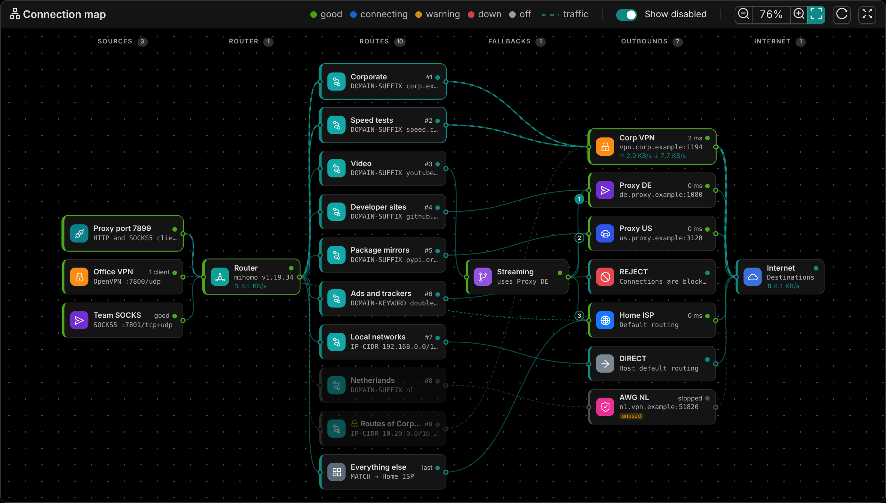

